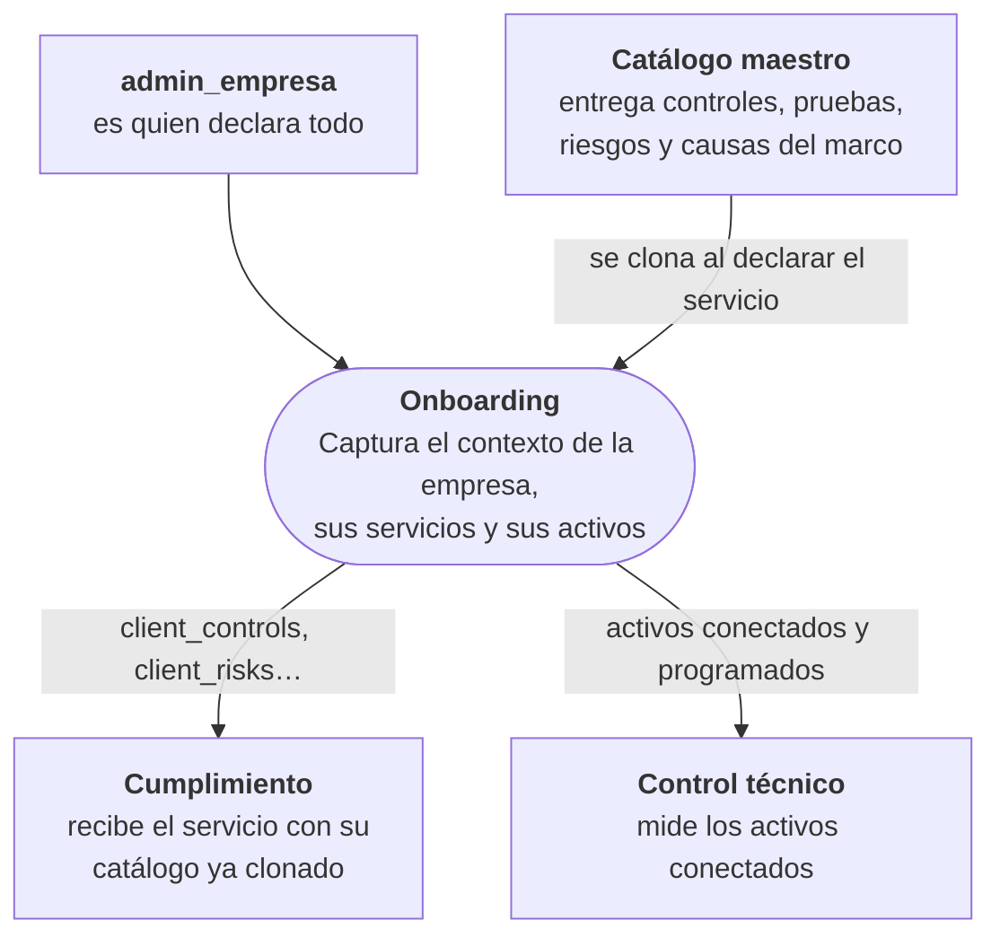
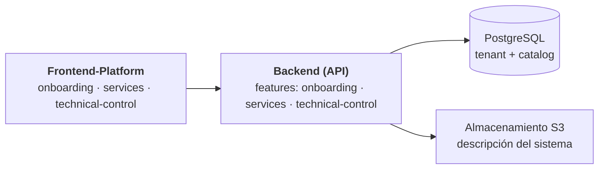
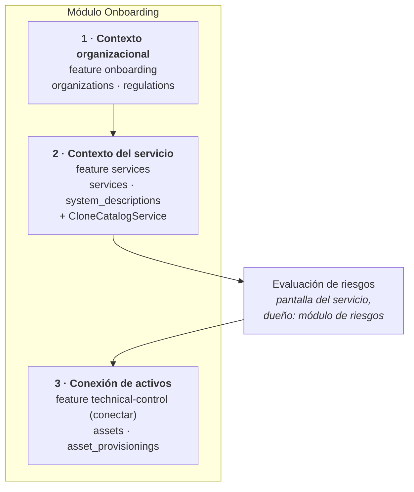

# Onboarding · C4

Responde: **¿qué piezas capturan el contexto del cliente?** El mapa general está en
[`../01-contexto.md`](../01-contexto.md) y [`../02-contenedores.md`](../02-contenedores.md).

## Nivel 1 · Contexto

## Nivel 2 · Contenedores

## Nivel 3 · Los tres componentes

El paso de riesgos ocurre dentro de la pantalla del servicio pero **no es de este módulo**: aquí solo importa que
es obligatorio antes de conectar activos (D89).

## Cómo verificarlo

`ls Backend/src/features/{onboarding,services,technical-control}` y
`ls Frontend-Platform/src/app/features/{onboarding,services,technical-control}`.
