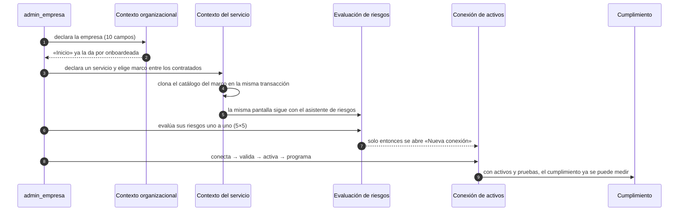

# Onboarding · Flujos

Responde: **¿en qué orden ocurre todo y qué bloquea qué?** El paso a paso de cada componente está en su
`03-flujos.md`.

## La cadena completa

## Las puertas (qué bloquea qué)

| Para… | Hace falta | Si no |
|---|---|---|
| Declarar un servicio | El contexto organizacional | Cumplimiento invita a crear un servicio, no falla |
| Que exista algo que medir | Elegir marco al crear el servicio | Sin marco no hay controles clonados |
| Conectar activos de un servicio | Evaluar sus riesgos vigentes | «Nueva conexión» cerrada, con el motivo y el avance («faltan 4 de 10») |
| Medir un marco | Definir su período auditado | El marco queda «Sin medir», no en 0 % |

**Nada de esto es un asistente obligatorio de una sentada** (D89): el cliente vuelve cuando quiera. Lo único
secuencial es el orden de arriba.

## Cómo se calcula el avance

`GET /v1/auth/me` no guarda «en qué paso va»: deriva el avance de lo ya guardado y lista
`organizational_context`, `service_context` y `technical_control`. Platform solo mira si el primero está completo.

## Lo que el onboarding deja listo

| Al terminar | Existe en la base |
|---|---|
| Componente 1 | `organizations` con sus regulaciones y cargos responsables |
| Componente 2 | `services` + el catálogo clonado: `client_controls`, `client_control_tests`, `evidence_requirements`, `client_risks`, `client_causes` |
| Riesgos | Cada riesgo del servicio evaluado (probabilidad × impacto) |
| Componente 3 | `assets`, `service_assets`, `asset_provisionings` activos y programados |

## Cómo verificarlo

`producto/flujo-end-to-end.md` cuenta el mismo recorrido desde el producto; D89 fija el orden y las puertas.
