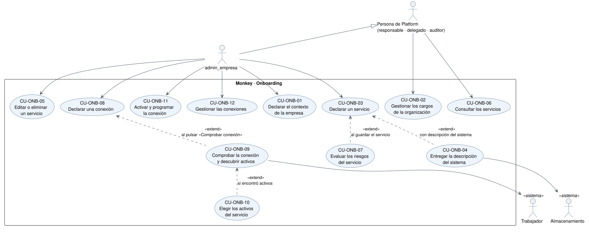

# Onboarding · casos de uso

Responde: **¿qué pasos sigue cada actor con el sistema, qué puede salir distinto y en qué estado queda todo al
terminar?** Cada caso realiza una o varias [historias](04-historias.md); la secuencia técnica (tablas, transacciones)
está en [`03-flujos.md`](03-flujos.md) y en el `03-flujos.md` de cada componente, y los cuerpos y errores en los
contratos de [`contracts/onboarding/`](../../../../../../contracts/onboarding/contexto-organizacional.md).

## Diagrama de casos de uso

Fuente del diagrama: [`05-casos-de-uso.puml`](05-casos-de-uso.puml) (PlantUML; se regenera con
`skills/process/monkey-docs/scripts/render-uml.sh`). «Persona de Platform» agrupa a `responsable`, `delegado` y
`auditor`, que solo leen; `admin_empresa` es además «Persona de Platform» y es quien declara todo.

CU-ONB-07 es del módulo de riesgos de Cumplimiento: aparece aquí porque la misma pantalla lo encadena al alta del
servicio y porque condiciona CU-ONB-08 (D89). Las conexiones a servidores con la sonda, bases de datos, equipos y las
demás nubes están parciales o por construir (HU-ONB-19, HU-ONB-20): CU-ONB-08 y CU-ONB-09 describen el flujo de la nube.

## Resumen

| ID | Caso | Actor principal | Historias |
|---|---|---|---|
| CU-ONB-01 | Declarar el contexto de la empresa | `admin_empresa` | HU-ONB-01, HU-ONB-02, HU-ONB-03, HU-ONB-04 |
| CU-ONB-02 | Gestionar los cargos de la organización | `admin_empresa` · Persona de Platform (lee) | HU-ONB-05 |
| CU-ONB-03 | Declarar un servicio | `admin_empresa` | HU-ONB-06, HU-ONB-07 |
| CU-ONB-04 | Entregar la descripción del sistema | `admin_empresa` | HU-ONB-08, HU-ONB-09 |
| CU-ONB-05 | Editar o eliminar un servicio | `admin_empresa` | HU-ONB-10, HU-ONB-11 |
| CU-ONB-06 | Consultar los servicios | Persona de Platform | HU-ONB-12 |
| CU-ONB-07 | Evaluar los riesgos del servicio | `admin_empresa` | HU-ONB-13, HU-ONB-14 |
| CU-ONB-08 | Declarar una conexión | `admin_empresa` | HU-ONB-14, HU-ONB-15, HU-ONB-16, HU-ONB-17, HU-ONB-18, HU-ONB-19, HU-ONB-20, HU-ONB-29 |
| CU-ONB-09 | Comprobar la conexión y descubrir sus activos | `admin_empresa`; secundario: el trabajador | HU-ONB-21, HU-ONB-22, HU-ONB-29 |
| CU-ONB-10 | Elegir los activos del servicio | `admin_empresa` | HU-ONB-23 |
| CU-ONB-11 | Activar y programar la conexión | `admin_empresa` | HU-ONB-24 |
| CU-ONB-12 | Gestionar las conexiones | `admin_empresa` | HU-ONB-25, HU-ONB-26, HU-ONB-27, HU-ONB-28 |

---

### CU-ONB-01 · Declarar el contexto de la empresa

| | |
|---|---|
| **Actor** | `admin_empresa` |
| **Precondición** | Sesión abierta en Monkey Platform; la empresa la registró Monkey Admin con su razón social y sus marcos |
| **Postcondición** | `organizations` con sus regulaciones; rastro `organizational_context.save`; «Inicio» da la empresa por onboardeada |

**Flujo principal**
1. Al entrar sin el contexto declarado, Platform lleva al `admin_empresa` al asistente.
2. El sistema devuelve el formulario con la razón social precargada y bloqueada y las opciones de cada lista en su
   idioma.
3. El `admin_empresa` recorre las 5 pantallas; el avance se guarda en su navegador.
4. En la revisión, envía los campos completos.
5. El sistema valida contra el catálogo, crea la organización (o la actualiza) con sus regulaciones y deja el rastro en
   la misma transacción.
6. El avance del navegador se borra; `GET /v1/auth/me` ya lista `organizational_context` como completo.

**Flujos alternos**
- 1a. El contexto ya existe → entra directo a la revisión con lo guardado y puede editar (vuelve al paso 4).
- 2a. El rol no es `admin_empresa` → `403 FORBIDDEN`.
- 3a. Cierra el navegador a mitad → al volver retoma lo que llevaba (mismo usuario y navegador).
- 4a. Envía la razón social → `422 VALIDATION_FAILED` (`field.not_editable`).
- 4b. Valor fuera de catálogo, lista obligatoria vacía o con repetidos, descripción de más de 2000 caracteres o `eu`
  como país de constitución → `422 VALIDATION_FAILED`, todos los errores a la vez.
- 4c. Combina «Ninguna» con otras regulaciones → `422 VALIDATION_FAILED` (`regulation.none_exclusive`).

### CU-ONB-02 · Gestionar los cargos de la organización

| | |
|---|---|
| **Actor** | `admin_empresa`; Persona de Platform solo consulta |
| **Precondición** | Contexto organizacional declarado |
| **Postcondición** | Cargo creado, con su persona cambiada o quitado; rastro `responsible.create`, `responsible.update` o `responsible.delete` |

**Flujo principal**
1. El actor abre «Cargos de la organización»; el sistema lista los cargos con la persona que los ocupa y si están en
   uso.
2. El `admin_empresa` crea un cargo con su tipo y el nombre de la persona.
3. Más adelante cambia la persona: todo lo que apuntaba al cargo sigue apuntándole.
4. Quita un cargo que ya no está en uso.

**Flujos alternos**
- 2a. La organización no está declarada → `409 ORGANIZATION_NOT_DECLARED`.
- 2b. Ya existe ese tipo con esa persona (al crear o al cambiar la persona) → `409 RESPONSIBLE_ALREADY_EXISTS`.
- 2c. Tipo fuera del enum o nombre demasiado largo → `422 VALIDATION_FAILED`.
- 2d. `responsable`, `delegado` o `auditor` intenta crear, cambiar o quitar → `403 FORBIDDEN`.
- 4a. Algo apunta al cargo (un activo, una evidencia requerida, un tratamiento de riesgo) → `409 RESPONSIBLE_IN_USE`:
  primero se reasigna.

### CU-ONB-03 · Declarar un servicio

| | |
|---|---|
| **Actor** | `admin_empresa` |
| **Precondición** | Contexto organizacional declarado; al menos un marco contratado por Monkey Admin |
| **Postcondición** | Servicio con sus marcos, criterios y proveedores; catálogo clonado (`catalog.status = ready`); rastro `service.create`; la pantalla sigue con **CU-ONB-07** |

**Flujo principal**
1. El `admin_empresa` abre «Nuevo servicio» desde «Mis servicios», Cumplimiento o «Inicio».
2. Recorre las 6 pantallas (servicio, clientes, datos y alcance, marco, proveedores, cumplimiento); la de marco muestra
   todos y solo deja elegir los contratados.
3. En la revisión envía el servicio, con el enlace de la descripción del sistema si lo tiene.
4. El sistema valida contra el catálogo y los marcos contratados, añade `security` si faltaba y, en una transacción,
   crea el servicio y clona controles, dimensiones, pruebas vinculadas, evidencias requeridas, riesgos y causas, con
   su rastro.
5. La pantalla muestra los requisitos y controles preparados, con sus códigos explicados, y sigue con el asistente de
   riesgos (**CU-ONB-07**).

**Flujos alternos**
- 1a. Falta el contexto organizacional → `409 ORGANIZATION_NOT_DECLARED`.
- 2a. Elige un marco no contratado → `409 FRAMEWORK_NOT_CONTRACTED` y la pantalla invita a hablar con mercadeo.
- 2b. Elige un marco «próximamente» → `409 FRAMEWORK_NOT_AVAILABLE`.
- 3a. Nombre ya usado en la empresa → `409 SERVICE_NAME_TAKEN`.
- 3b. Valores fuera de catálogo, listas vacías o repetidas, enlace inválido o proveedor sin tipo →
  `422 VALIDATION_FAILED`, todos a la vez.
- 3c. Quiere entregar un archivo → crea el servicio sin descripción y sigue en **CU-ONB-04**.
- 4a. El clonado falla → no queda nada: ni servicio ni catálogo a medias.

### CU-ONB-04 · Entregar la descripción del sistema

| | |
|---|---|
| **Actor** | `admin_empresa`; actor secundario: el almacenamiento |
| **Precondición** | El servicio existe |
| **Postcondición** | `system_descriptions` con enlace, archivo o los dos; el servicio completo; rastro `service.system_description` |

**Flujo principal**
1. El `admin_empresa` entrega el enlace (`http` o `https`) o sube un PDF o `.docx` de hasta 25 MB.
2. El sistema valida el enlace, o la extensión y la firma del archivo, y lo guarda en el almacenamiento con una llave
   por empresa y servicio; un archivo nuevo reemplaza y borra el anterior, y el enlace conserva el archivo.
3. Quien puede ver el servicio pide descargarlo y recibe un enlace firmado de 5 minutos.
4. ⚪ El sistema lee las 10 secciones y llena CSOC y CUEC (DT-12: no existe).

**Flujos alternos**
- 1a. Enlace inválido → `422 url.invalid`.
- 1b. Sin archivo o vacío → `422 FILE_REQUIRED`; más de 25 MB → `413 FILE_TOO_LARGE`; ni PDF ni `.docx` por
  extensión y firma → `415 UNSUPPORTED_MEDIA_TYPE`.
- 2a. La instalación no tiene almacenamiento → `503 STORAGE_UNAVAILABLE`; la pantalla ofrece el enlace.
- 3a. Solo hay enlace → `404 SYSTEM_DESCRIPTION_NOT_A_FILE`.

### CU-ONB-05 · Editar o eliminar un servicio

| | |
|---|---|
| **Actor** | `admin_empresa` |
| **Precondición** | El servicio existe en su empresa |
| **Postcondición** | Servicio actualizado (con lo nuevo clonado) o eliminado; rastro `service.update` o `service.delete` |

**Flujo principal**
1. El `admin_empresa` abre el servicio y elige editar.
2. Cambia los campos que quiera; si amplía criterios o marcos, el sistema recalcula los requisitos aplicables y clona
   solo lo que falta.
3. Si quita un marco, el sistema lo deja inactivo sin borrar controles y lo dice en la respuesta.
4. Para eliminar, confirma en «Mis servicios»; el sistema borra todo lo del servicio y su archivo.

**Flujos alternos**
- 1a. El servicio es de otra empresa → `404`.
- 2a. Marco no contratado → `409 FRAMEWORK_NOT_CONTRACTED`; datos inválidos → `422 VALIDATION_FAILED`.
- 4a. El servicio tiene evaluaciones, evidencias entregadas, observaciones o planes de acción →
  `409 SERVICE_HAS_EVALUATIONS`.

### CU-ONB-06 · Consultar los servicios

| | |
|---|---|
| **Actor** | Persona de Platform |
| **Precondición** | Sesión abierta en Monkey Platform |
| **Postcondición** | Nada cambia |

**Flujo principal**
1. La persona abre «Mis servicios».
2. El sistema devuelve la página de servicios que le corresponden: todos para `admin_empresa` y `auditor`; para
   `responsable` y `delegado`, solo los que tienen un control suyo como dueño o ejecutor.
3. Abre uno y ve su información, sus marcos y sus conexiones; el `auditor`, en solo lectura.

**Flujos alternos**
- 3a. `responsable` o `delegado` abre un servicio sin controles suyos → `403`.
- 3b. El servicio es de otra empresa → `404`.

### CU-ONB-07 · Evaluar los riesgos del servicio

| | |
|---|---|
| **Actor** | `admin_empresa` |
| **Precondición** | Servicio recién creado (**CU-ONB-03**) o con riesgos vigentes sin evaluar |
| **Postcondición** | Cada riesgo vigente con probabilidad, impacto, valor y nivel; los retirados, con su motivo en la auditoría; «Nueva conexión» abierta |

**Flujo principal**
1. Al guardar el servicio, la misma pantalla abre el asistente: a la izquierda la lista de riesgos, a la derecha el
   primero sin evaluar.
2. Por cada riesgo, el `admin_empresa` responde probabilidad e impacto de 1 a 5.
3. El sistema calcula valor y nivel, lo guarda y pasa al siguiente.
4. Con todos los vigentes evaluados, el servicio puede declarar activos (**CU-ONB-08**).

**Flujos alternos**
- 1a. Interrumpe el asistente → lo retoma desde el detalle del servicio, en el primer riesgo sin evaluar.
- 2a. Marca «Este riesgo no aplica a mi servicio» → escribe un motivo de al menos tres letras y el sistema lo retira;
  deja de contar como pendiente.
- 2b. Vuelve a incluir un riesgo retirado → recupera su evaluación anterior.
- 2c. Agrega un riesgo propio → llena el formulario, elige o crea sus causas y el riesgo entra a la cola.
- 2d. El riesgo está dado de baja → `409 RISK_INACTIVE`.
- 4a. El servicio no tiene riesgos vigentes → no se bloquea nada.

### CU-ONB-08 · Declarar una conexión

| | |
|---|---|
| **Actor** | `admin_empresa` |
| **Precondición** | Servicio con sus riesgos vigentes evaluados (D89; hoy solo lo impone la pantalla, DT-77) |
| **Postcondición** | Conexión `pending`, `not_monitored`, enlazada a sus servicios, con lo que el cliente debe hacer (`connection_setup`); rastro `asset.create` |

**Flujo principal**
1. El `admin_empresa` abre «Nueva conexión»; el sistema muestra el catálogo agrupado por tipo, con las plataformas
   disponibles y las bloqueadas.
2. Elige una plataforma disponible y entra a su paso a paso.
3. Elige el canal entre los de esa plataforma (en AWS, el rol de solo lectura es el recomendado).
4. Declara el nombre, la cuenta o el proyecto, las regiones (si la plataforma las tiene) y los servicios que soporta.
5. El sistema crea la conexión con código `AST-####` y tipo deducido, y le entrega el `external_id`, la plantilla o el
   comando y los pasos ya traducidos, sin nombrar al motor.
6. El `admin_empresa` crea el rol en su cuenta (o corre el comando en Cloud Shell) y devuelve el ARN del rol (o el
   número de proyecto).
7. Sigue con **CU-ONB-09**.

**Flujos alternos**
- 1a. Faltan riesgos por evaluar → «Nueva conexión» cerrada con el motivo, el avance y un botón a **CU-ONB-07**; las
  rutas de conexión llevan al detalle del servicio.
- 2a. Elige una plataforma bloqueada → la tarjeta no navega; por API → `422 connection.provider_not_supported`.
- 3a. Canal que no es de la plataforma → `409 CONNECTION_METHOD_NOT_APPLICABLE`.
- 3b. Canal de llaves → entrega las llaves (se cifran y no vuelven) y la pantalla advierte que son menos seguras; no
  hay paso 6.
- 3c. Servidor Linux o Windows → declara la versión del sistema; la conexión nace con su agente `pending` y la
  instalación sigue en Control técnico (D113).
- 4a. Regiones vacías o fuera del catálogo, cuenta mal formada, sin servicios, versión de sistema fuera de su catálogo
  → `422 VALIDATION_FAILED`; regiones o credenciales en GCP → `422 field.not_allowed`.
- 5a. GCP sin la identidad de Monkey configurada → el comando viene vacío y la plantilla responde
  `503 CONNECTION_UNAVAILABLE`.
- 6a. ARN con otra cuenta que la declarada, o sin forma de ARN, o número de proyecto que no son dígitos →
  `422 VALIDATION_FAILED`.

### CU-ONB-09 · Comprobar la conexión y descubrir sus activos

| | |
|---|---|
| **Actor** | `admin_empresa`; actor secundario: el trabajador, único que habla con la nube del cliente |
| **Precondición** | Conexión de nube declarada con su rol, llaves o número de proyecto |
| **Postcondición** | Conexión `validated` con fecha y comprobaciones disponibles; activos descubiertos como activos propios; rastro `asset.validate` |

**Flujo principal**
1. El `admin_empresa` pulsa «Comprobar conexión».
2. El sistema deja en cola una validación y espera unos segundos.
3. El trabajador la reclama, asume el acceso de solo lectura y comprueba que la cuenta o el proyecto es el declarado.
4. El trabajador lee el inventario en las regiones declaradas (servidores, bases, almacenamiento, funciones) y lo
   entrega con el cierre.
5. El sistema guarda el resultado y cada recurso como activo propio, y responde «Conexión comprobada» con la cobertura
   como `"n/18"`.
6. El `admin_empresa` ve los activos encontrados en el detalle de la conexión y sigue con **CU-ONB-10**.

**Flujos alternos**
- 1a. La conexión ya está activa o programada → se vuelve a comprobar y se refrescan los activos y la fecha, sin
  cambiar su estado.
- 3a. Falla por algo del cliente (rol inexistente, cuenta o proyecto distinto, llaves inválidas, sin regiones,
  federación rechazada) → `422 CONNECTION_FAILED` señalando el campo; queda el rastro con `result = error`.
- 3b. El trabajador no responde o no hay sonda → `503 CONNECTION_UNAVAILABLE`; la conexión queda como estaba.
- 3c. La conexión es un servidor con agente → `503 CONNECTION_UNAVAILABLE` (un servidor no se «valida»: lo lee la sonda, D113).
- 3d. Modo simulado → `200` con `mode: demo`, sin fingir que el activo opera.
- 4a. Un servicio de la nube no se pudo leer → la validación sigue y se informa el inventario incompleto.

### CU-ONB-10 · Elegir los activos del servicio

| | |
|---|---|
| **Actor** | `admin_empresa` |
| **Precondición** | Conexión comprobada que sirve a ese servicio |
| **Postcondición** | El servicio tiene enlazados exactamente los activos elegidos; rastro `service.assets_set` |

**Flujo principal**
1. En el detalle de la conexión, el sistema lista los activos encontrados y marca cuáles son del servicio (ninguno al
   principio).
2. El `admin_empresa` marca los que pertenecen al servicio y guarda.
3. El sistema enlaza los marcados y desenlaza los demás, y responde cuántos quedan, entraron y salieron.

**Flujos alternos**
- 2a. Un id no es un activo activo de esa conexión → `422 VALIDATION_FAILED` (`asset_ids`).
- 2b. El servicio o la conexión no son de su empresa, o la conexión no sirve a ese servicio → `404`.
- 2c. Faltan riesgos por evaluar → la pantalla lo impide (D89); la API todavía no (DT-77).

### CU-ONB-11 · Activar y programar la conexión

| | |
|---|---|
| **Actor** | `admin_empresa` |
| **Precondición** | Conexión `validated` |
| **Postcondición** | Conexión activa (`operational`, o `warning` con la sonda simulada) y `scheduled` con su frecuencia; rastros `asset.activate` y `asset.schedule` |

**Flujo principal**
1. El `admin_empresa` activa la conexión comprobada.
2. Elige la frecuencia entre las que admite la conexión.
3. El sistema la guarda y la conexión queda programada.
4. ⚪ Las mediciones corren solas con esa frecuencia (en la nube hoy no hay quien las dispare).

**Flujos alternos**
- 1a. No está comprobada → `409 ASSET_NOT_VALIDATED`; ya está activa → `409 ASSET_ALREADY_ACTIVE`.
- 2a. Programa sin activar → `409 ASSET_NOT_ACTIVE`.
- 2b. Frecuencia que la conexión no admite → `422 FREQUENCY_NOT_SUPPORTED`.

### CU-ONB-12 · Gestionar las conexiones

| | |
|---|---|
| **Actor** | `admin_empresa` |
| **Precondición** | La conexión existe en su empresa |
| **Postcondición** | Conexión editada (de vuelta a `pending` si cambió el acceso) o dada de baja con sus activos descubiertos; rastro `asset.update` o `asset.retire` |

**Flujo principal**
1. El `admin_empresa` abre el servicio y ve sus conexiones con su estado, o la lista de conexiones filtrada por
   servicio, tipo o estado.
2. Edita el nombre, la criticidad o las etiquetas: la conexión sigue igual.
3. O cambia la cuenta, las regiones, el rol o las llaves: la conexión vuelve a `pending`, pierde activación y
   programación, y debe repetir **CU-ONB-09** y **CU-ONB-11**.
4. O da de baja la conexión: deja de evaluarse, sus llaves se borran y sus activos descubiertos se dan de baja y se
   desenlazan; el historial se conserva.

**Flujos alternos**
- 2a. Hay una comprobación o evaluación en curso → `409 EXECUTION_IN_PROGRESS` (también al dar de baja).
- 2b. ⚪ Ajustar la criticidad o el responsable de un activo descubierto → hoy `404` (DT-63).
- 3a. Cambia de cuenta o de proyecto → se renueva el `external_id`; en GCP se borra el número de proyecto y hay que
  correr el comando nuevo.
- 3b. Rol de otra cuenta → `422 connection.account_mismatch`; campo de otro canal → `422 field.not_allowed`.
- 4a. Una conexión dada de baja → `404` para todo; no se puede ver ni restaurar (DT-11).
