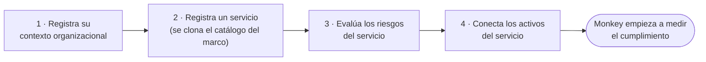

# Onboarding

Responde: **¿cómo prepara una empresa su contexto para que Monkey pueda empezar a evaluar su cumplimiento?** Es la
preparación de contexto: lo que la empresa le cuenta a Monkey (quién es, qué servicios ofrece, qué riesgos tiene) y los
activos que conecta para que se midan. Sin esto no hay nada que evaluar.

## El flujo (conceptual)

Así es como Monkey lo hace hoy y no cambia nada de lo decidido. **Ojo con el vocabulario:** en el texto de **D89**,
«onboarding» designa solo el tramo obligatorio (el contexto de la empresa), y los servicios y activos «dejan de ser
pasos del onboarding» porque el cliente los hace cuando quiera. Aquí «Onboarding» se usa en sentido amplio, como la
**preparación de contexto** completa; el flujo, el orden y las reglas de D89 (activos solo tras evaluar los riesgos) se
mantienen tal cual. Esta carpeta agrupa los pasos en un módulo porque comparten propósito, actor y orden.

## Módulo y componente

- **Módulo:** una parte del producto con su propia carpeta en `arquitectura/` (este es uno).
- **Componente:** una parte de un módulo, con su pantalla, sus tablas y su flujo. Vive en un subdirectorio del módulo.

| # | Componente | Paso | Qué captura | Sus archivos |
|---|---|---|---|---|
| **1** | [Contexto organizacional](contexto-organizacional/README.md) | 1 | La empresa: identidad, perfil y jurisdicción | [modelo](contexto-organizacional/02-modelo.md) · [flujos](contexto-organizacional/03-flujos.md) |
| **2** | [Contexto del servicio](contexto-servicio/README.md) | 2 y 3 | El servicio, su descripción del sistema y la evaluación de sus riesgos | [modelo](contexto-servicio/02-modelo.md) · [flujos](contexto-servicio/03-flujos.md) |
| **3** | [Conexión de activos](conexion-activos/README.md) | 4 | Los activos que se miden y cómo se conectan | [modelo](conexion-activos/02-modelo.md) · [flujos](conexion-activos/03-flujos.md) · [nube](conexion-activos/flujo-conexion-nube.md) |

Del módulo entero: [`01-c4.md`](01-c4.md) (las piezas y los tres componentes) y [`03-flujos.md`](03-flujos.md)
(la cadena completa y qué bloquea qué). El índice general está en [`../README.md`](../README.md).

La evaluación de riesgos (paso 3) ocurre dentro de la pantalla del servicio, pero **su dueño es el módulo de riesgos**
de Cumplimiento (por documentar): aquí solo se registra que es un paso del flujo y que bloquea el paso 4.
Lo que viene después de conectar —ejecutar, medir, programar— es el módulo [`control-tecnico/`](../control-tecnico/README.md).

## Contenido

[`01-c4.md`](01-c4.md) · [`03-flujos.md`](03-flujos.md) · [`04-historias.md`](04-historias.md) ·
[`05-casos-de-uso.md`](05-casos-de-uso.md). Los modelos y flujos de cada componente están en su subdirectorio.

## Dónde está cada dato

| Dato | Dueño |
|---|---|
| Recorrido de un cliente de punta a punta | `producto/flujo-end-to-end.md` |
| Entidades y campos de los 3 componentes | `datos/modelo/06-onboarding.md` §6.1 a §6.3 |
| Rutas y formularios | `contracts/onboarding/contexto-organizacional.md`, `contracts/onboarding/contexto-servicio.md`, `contracts/onboarding/conexion-activos/README.md` |
| Decisiones (`D-n`) | [`datos/decisiones/onboarding/README.md`](../../datos/decisiones/onboarding/README.md): `D23` · `D30` · `D44` · `D45` · `D46` · `D51` · `D59` · `D60` · `D61` · `D67` · `D69` · `D73` · `D89` · `D92` · `D93` |
| Pendientes del comité (`P-n`) | ninguno propio |
| Código | `Backend/src/features/onboarding`, `services`, `technical-control`; `Frontend-Platform` en las mismas features |
| Deuda vigente (15 `DT-n`) | [`deuda-tecnica/onboarding.md`](../../deuda-tecnica/onboarding.md) |
| Requisitos de seguridad | [`seguridad/onboarding.md`](../../seguridad/onboarding.md): `SEG-52` · `SEG-53`. Los de **subida de archivos** son de [`plataforma.md`](../../seguridad/plataforma.md) |
