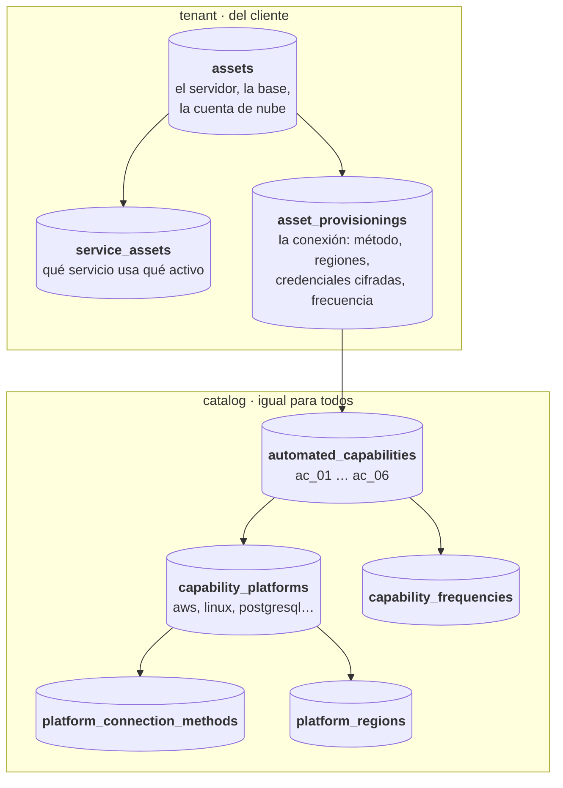

# Conexión de activos · Modelo

Responde: **¿qué guarda un activo y qué guarda su conexión?** El diagrama campo por campo está en
[`datos/modelo/06-onboarding.md`](../../../datos/modelo/06-onboarding.md) §6.3; aquí el mapa y las fronteras.

## Lo del cliente y lo del catálogo

**La regla que explica el diagrama:** qué conexiones, plataformas, métodos, regiones y frecuencias se ofrecen sale
de la **base** (`catalog.*`, D67), no del código. Añadir una plataforma es una fila, no un despliegue.

## Dónde vive cada cosa

| Dato | Tabla | Nota |
|---|---|---|
| El activo y su estado operativo | `assets` | `operational_status`, `technical_coverage` |
| Un activo descubierto | `assets` con `parent_asset_id` | La conexión de nube que lo encontró (D61) |
| El vínculo con un servicio | `service_assets` | Un activo puede servir a varios servicios |
| El método de conexión | `asset_provisionings.connection_method` | `readonly_role`, `access_keys` o `agent` |
| Las regiones que se evalúan | `asset_provisionings.regions` | **Solo** las que el cliente declaró |
| Las credenciales | `asset_provisionings.encrypted_credentials` | AES-256-GCM; nunca se devuelven |
| La frecuencia | `asset_provisionings.schedule_frequency` | Nula hasta programar |

## Dos cosas que no son secretos

`external_id` (lo genera Monkey) y `role_arn` (lo entrega el cliente) son **columnas normales**, no secretos: el
acceso depende de la política de confianza del rol, no de que esos valores sean privados.

## Frontera con Control técnico

Este componente guarda **la conexión**; las corridas y sus resultados (`executions`, `check_results`,
`asset_resources`, `execution_logs`) son de [Control técnico](../../control-tecnico/02-modelo.md).

## Cómo verificarlo

`Backend/prisma/schema/tenant/onboarding.prisma` (activos) y `catalog/technical-catalog.prisma` (el catálogo).
