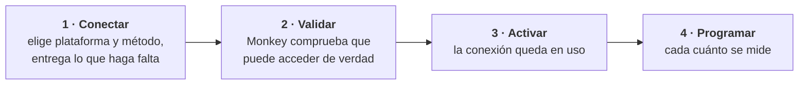
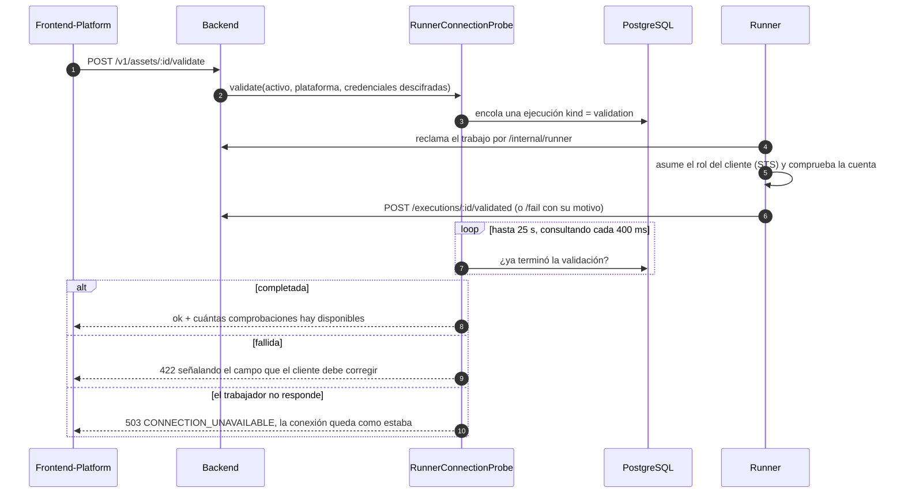

# Conexión de activos · Flujos

Responde: **¿cómo pasa un sistema del cliente de «declarado» a «se está midiendo»?** Cuatro pasos en orden, y
ninguno se puede saltar. El detalle visual de la nube está en [`flujo-conexion-nube.md`](flujo-conexion-nube.md).

## Los cuatro pasos

**La regla de oro: «Automatizado ≠ Operativo».** Una conexión no se da por buena porque el formulario esté completo.
Solo una sonda que comprobó el acceso real puede afirmar que el activo está operando; mientras no exista conector
real, la comprobación responde `unavailable` o `simulated` y **nunca se finge** (D46, D48).

## 2 · Validar, paso a paso (nube)

**Qué mirar**

- **El Backend nunca toca la cuenta del cliente.** Solo el Runner tiene identidad en la nube; el Backend encola y
  espera (D58).
- **Es síncrono para el usuario** porque tarda segundos: la pantalla se queda esperando. Una evaluación completa,
  en cambio, tarda minutos y va por el historial.
- **Cada motivo de fallo se traduce al campo a corregir** (`role_arn`, `credentials`, `platform`, `regions`). Lo que
  es culpa de Monkey (trabajador caído, llaves base vencidas) **no se le achaca al cliente**: es un 503.
- **Solo la nube se valida así.** Un servidor con agente no pasa por `validate` (responde `503`): su instalación y su lectura son del Control técnico (D113).

## 4 · Programar

`PUT /v1/assets/:id/schedule` guarda la frecuencia entre las que ofrece el catálogo para esa conexión
(`continuous`, `every_6h`, `every_24h`). Desde aquí el activo pasa a ser asunto de
[Control técnico](../../control-tecnico/03-flujos.md).

> Hoy no se encontró en `Backend/src/` quién convierte una regla programada en ejecuciones
> ([`../../control-tecnico/06-mejoras.md`](../../control-tecnico/06-mejoras.md), M1).

## Descubrir activos (solo nube)

Una conexión de nube **descubre** los recursos de la cuenta y crea activos hijos (`parent_asset_id`, D59, D61). El
descubrimiento solo **lee**, solo en las regiones declaradas, y no filtra el error del proveedor al cliente (SEG-51).

## Qué ve el cliente

Nunca el nombre del motor: «sonda», «capacidad automática» o «evaluación automática». La cobertura técnica se
muestra como un número aparte del cumplimiento.

## Cómo verificarlo

`contracts/onboarding/conexion-activos/README.md` y
`Backend/src/features/technical-control/infrastructure/probes/`.
