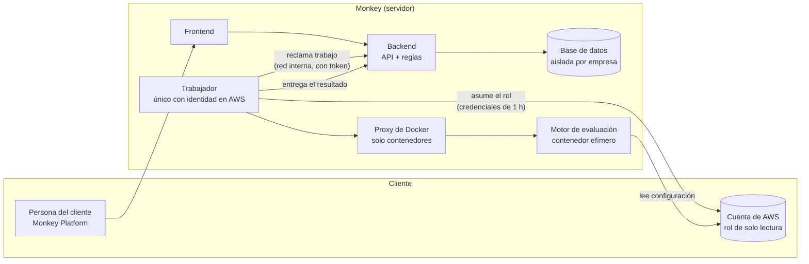
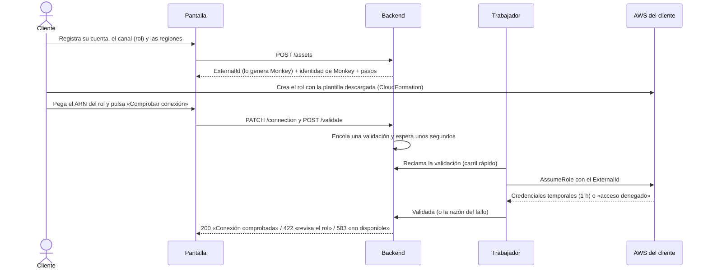
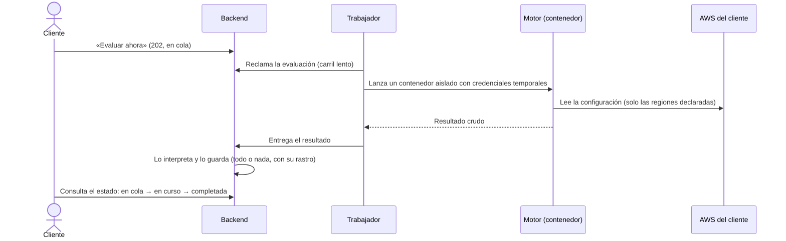

# El flujo de conexión de una cuenta de nube (AWS)

Lo que se muestra al comité: cómo un cliente conecta su nube con Monkey y quién hace qué. Las decisiones están en `D53`, `D54`, `D57` y `D58`; el contrato de la conexión (Componente 3 del onboarding),
en `contracts/onboarding/conexion-activos/README.md` (la evaluación posterior, en `contracts/control-tecnico.md`). **Interno: nombra al motor y nada de esto sale al cliente.**

## La idea en una frase
**Un solo componente habla con la nube del cliente** (el trabajador). El backend, la pantalla y la base de datos nunca tocan la cuenta del cliente ni guardan
llaves de AWS, y el motor que evalúa corre aislado, sin acceso a nada de Monkey.

## Quién es quién

## Conectar y comprobar (lo que ve el cliente)

## Evaluar (minutos, sin que el cliente espere en la pantalla)

## Qué garantiza cada pieza

| Pieza | Garantía | Cómo se comprueba |
|---|---|---|
| Rol del cliente | Solo lectura; solo lo asume Monkey y solo con su ExternalId | Plantilla probada; AWS real rechaza un ExternalId equivocado |
| Backend | No toca AWS ni guarda llaves de la nube de Monkey; no descifra credenciales al validar | Pruebas de la sonda `runner` |
| Trabajador | Único con identidad en AWS; sin acceso a la base de datos ni a los secretos del backend | Entorno propio (`runner.env`); pruebas contra Docker y backend reales |
| Motor | Contenedor efímero, sin capacidades, sin montajes, fuera de la red del backend, siempre eliminado | `docker-engine.e2e-spec.ts` (SEG-48) |
| Llaves del cliente (canal de llaves) | Cifradas; nunca salen en una respuesta, el rastro ni la pantalla | `conexion.e2e-spec.ts` y prueba con navegador (SEG-50) |
| Resultado | Se guarda entero o no se guarda, con su rastro; una empresa nunca ve el de otra | RLS y pruebas de aislamiento (SEG-01, SEG-36) |

## Qué falta (honesto)
Azure y GCP (por probar más adelante con una cuenta real), el canal de agente para servidores y bases de datos (`DT-57`, D71), el enlace de «un clic» (`DT-55`), la redacción de
los hallazgos para el cliente (`P14` E2) y el cálculo de cumplimiento, que es otro módulo.
