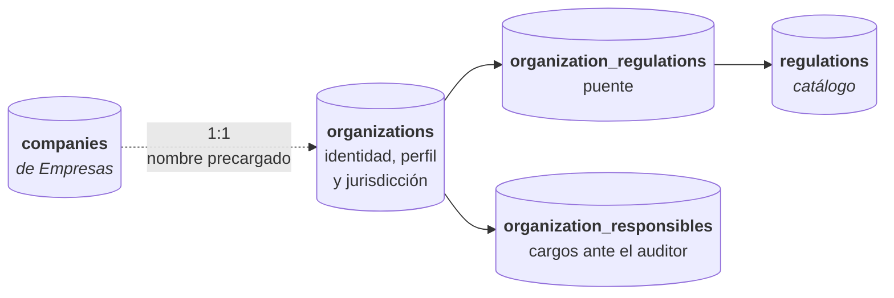

# Contexto organizacional · Modelo

Responde: **¿qué tablas guardan lo que la empresa declara de sí misma?** El diagrama campo por campo está en
[`datos/modelo/06-onboarding.md`](../../../datos/modelo/06-onboarding.md) §6.1 y **no se redibuja aquí**: esto es
solo el mapa de qué guarda cada tabla y dónde están las fronteras.

## Las cuatro tablas

| Tabla | Qué guarda | Quién la posee |
|---|---|---|
| `organizations` | Una fila por empresa: descripción, tamaño, industria, países, número de clientes | Este componente |
| `organization_regulations` | Qué regulaciones le aplican (N:M) | Este componente |
| `regulations` | El catálogo de regulaciones posibles | [Catálogo maestro](../../README.md) |
| `organization_responsibles` | El **cargo** que responde ante el auditor (COO, CISO…) y quién lo ocupa | Este componente |

## Tres cosas que se leen mal si no se dicen

- **El nombre llega precargado y bloqueado.** Se fijó al registrar la empresa (`companies.name`) y aquí no se edita.
- **Un cargo responsable no es una cuenta** (D30). `organization_responsibles` guarda el cargo y el nombre de la
  persona que lo ocupa hoy; las cuentas con las que se entra son de [Gestión de usuarios](../../gestion-usuarios/README.md).
  La persona puede cambiar sin tocar quién apunta al cargo.
- **El marco no se elige aquí.** Monkey Admin lo contrata al registrar la empresa (D47) y el cliente elige, entre
  los contratados, al declarar cada servicio.

## Cómo verificarlo

`Backend/prisma/schema/tenant/onboarding.prisma` (modelos `Organization`, `Regulation`, `OrganizationRegulation`,
`OrganizationResponsible`).
