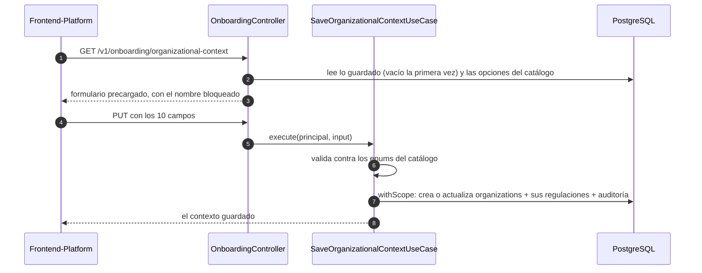

# Contexto organizacional · Flujos

Responde: **¿qué pasa al guardar el contexto de la empresa?** Es el flujo más simple del producto: un formulario
que se llena una vez.

## Guardar el contexto

**Qué mirar**

- **Es `PUT`, no `POST`:** se guarda entero cada vez. No hay «paso 1 de 3» que recordar.
- **Las opciones no están en el frontend.** Tamaño, industria, países y regulaciones salen de
  `GET /v1/catalogs/:name` con la etiqueta en el idioma de la petición; el frontend nunca hardcodea listas.
- **El avance se deriva.** Nadie escribe «onboarding completo»: `GET /v1/auth/me` lo calcula mirando si la
  organización tiene lo obligatorio ([`../03-flujos.md`](../03-flujos.md)).

## Qué se desbloquea al terminar

«Inicio» da la empresa por onboardeada y se puede declarar el primer servicio
([`../contexto-servicio/03-flujos.md`](../contexto-servicio/03-flujos.md)).

## Cómo verificarlo

`Backend/src/features/onboarding/application/use-cases/` y `contracts/onboarding/contexto-organizacional.md`.
