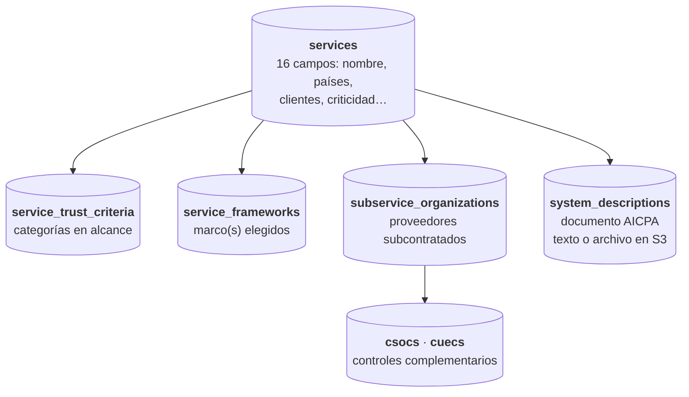

# Contexto del servicio · Modelo

Responde: **¿qué guarda un servicio y qué aparece en la base al crearlo?** El diagrama campo por campo está en
[`datos/modelo/06-onboarding.md`](../../../datos/modelo/06-onboarding.md) §6.2; aquí el mapa de tablas y la frontera
con Cumplimiento.

## Las tablas del servicio

## Lo que aparece solo porque se eligió un marco

Al fijarse `service_frameworks` se **clona** el catálogo en la misma transacción. Esas tablas ya no son de este
componente: son de [Cumplimiento](../../cumplimiento/02-modelo.md).

| Se clona (copia del cliente) | Se referencia (no se copia) |
|---|---|
| `client_controls` + `client_control_dimensions` + `client_control_tests` | `catalog.tests` (D36) |
| `evidence_requirements` (desde `evidence_templates`) | `catalog.requirements`, `catalog.points_of_focus` |
| `client_risks`, `client_causes` | |

**Por qué se clona.** El cliente reescribe la interpretación de un control, crea controles propios y da de baja los
que no le aplican, sin tocar el catálogo; y el catálogo cambia sin mover a los clientes ya creados.

**Por qué los requisitos no se clonan.** Son el texto de un estándar y viven en la misma base: se referencian con
llave foránea real (§3.5, D25).

## Dos cosas que importan

- **Un servicio es la unidad de cumplimiento**, junto con el marco: nunca «la empresa entera».
- **Los riesgos y las causas son de cada servicio**, no de la empresa: la misma causa puede tener probabilidad e
  impacto distintos en dos servicios.

## Cómo verificarlo

`Backend/prisma/schema/tenant/onboarding.prisma` y `npm run clone:verify` (comprueba que el clonado deja lo esperado).
