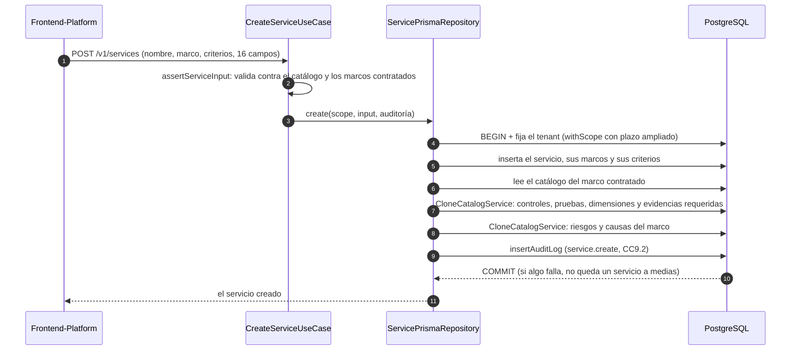
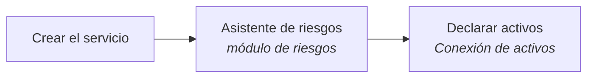

# Contexto del servicio · Flujos

Responde: **¿qué pasa al declarar un servicio?** Es la operación más pesada del onboarding: una sola transacción
que crea el servicio y copia cientos de filas del catálogo.

## 1 · Crear el servicio (y clonar el catálogo)

**Qué mirar**

- **El clonado no es un paso aparte.** Elegir marco lo dispara; no hay un botón «clonar».
- **Plazo ampliado a propósito.** Copiar cientos de filas no cabe en el plazo normal de una transacción de Prisma,
  por eso `withScope` acepta `timeoutMs`.
- **Todo o nada.** Un servicio sin su catálogo clonado sería un servicio imposible de medir; por eso va en la misma
  transacción, con su rastro de auditoría.
- **Ampliar un servicio vuelve a clonar.** Agregar un marco repite el proceso para el catálogo nuevo.

**Cómo verificarlo**: `CreateServiceUseCase`, `CloneCatalogService` y `npm run clone:verify`.

## 2 · La descripción del sistema

El documento AICPA de 10 secciones se guarda de dos formas: como **texto** (`POST /services/:id/system-description`)
o como **archivo** (`POST …/system-description/file`, que va a S3). La descarga entrega un enlace firmado, nunca una
URL pública.

## 3 · La cadena que sigue en la misma pantalla

El asistente evalúa los riesgos del servicio uno a uno **sin llevar al usuario a Cumplimiento** (D89). Hasta
terminarlo, «Nueva conexión» queda cerrada, con el motivo y el avance. Un servicio sin riesgos vigentes no se bloquea.

## Quién puede qué

Crear, editar y dar de baja un servicio es del `admin_empresa`. El `auditor` lee todos; el `funcional`, solo
aquellos en los que es responsable de alguna dimensión.

## Cómo verificarlo

`contracts/onboarding/contexto-servicio.md` y `Backend/src/features/services/application/use-cases/`.
