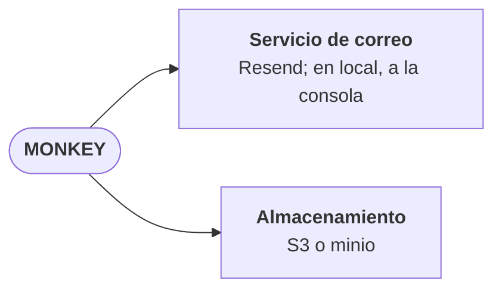
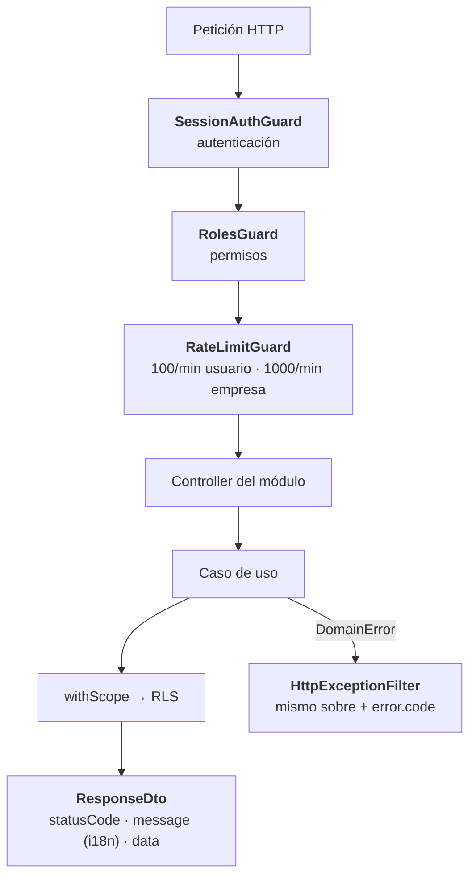
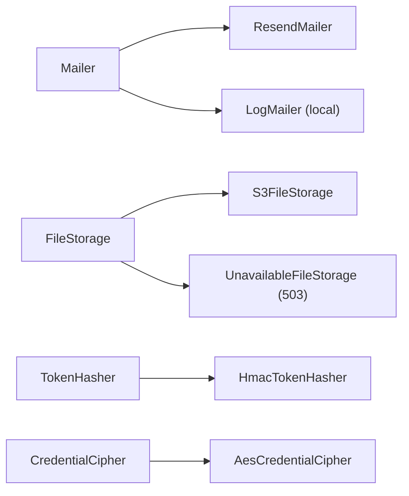

# Plataforma · C4

Responde: **¿por dónde pasa toda petición y qué servicios externos usa Monkey?**

## Nivel 1 · Los servicios externos

Los dos son **puertos con adaptadores**: `Mailer` y `FileStorage`. Si no están configurados, la aplicación
arranca igual y la operación que los necesita responde `503`. Nunca se finge que funcionaron.

## Nivel 3 · La cadena transversal de una petición

**Toda ruta exige sesión por defecto.** `@Public()` la abre y `@Roles(...)` la restringe: lo que se declara es la
excepción, no la regla. Es la razón de que no exista un endpoint desprotegido por olvido.

## Los puertos y sus adaptadores

El mismo patrón que la sonda en [Control técnico](../control-tecnico/01-c4.md): el caso de uso pide el puerto y el
módulo de Nest decide el adaptador según el entorno.

## Cómo verificarlo

`ls Backend/src/common` y `ls Backend/src/infrastructure`.
