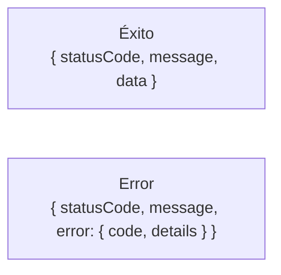
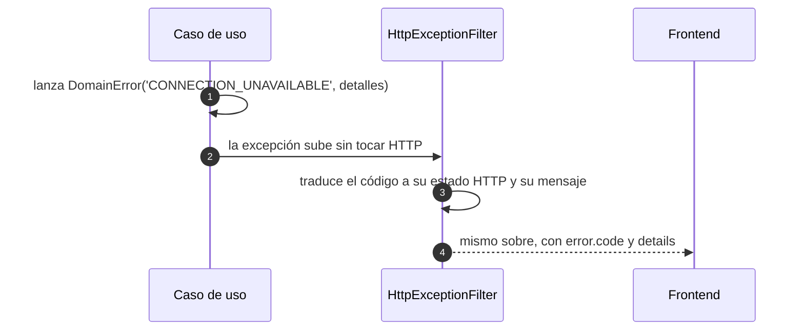
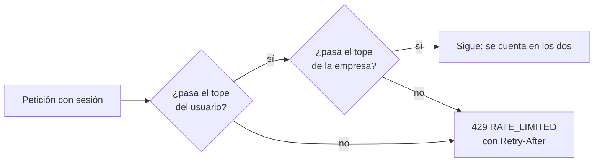

# Plataforma · Flujos

Responde: **¿qué forma tiene todo lo que entra y sale?**

## 1 · El sobre de respuesta

Toda respuesta, correcta o con error, tiene la misma forma. Es lo que permite que el frontend tenga **un solo**
manejador.



- **`message` se traduce** según `Accept-Language`; es para la persona.
- **`error.code` no se traduce nunca**; es para el frontend, que decide qué pantalla mostrar.
- Un error de validación señala **el campo**, para poder resaltarlo en el formulario.

La lista de códigos y su significado vive en `contracts/conventions.md` y en el contrato de cada módulo.

## 2 · Un error, de donde nace a donde se ve



**El caso de uso no sabe de HTTP.** Lanza un error de dominio; traducirlo a un `409` o un `503` es trabajo del
filtro. Por eso se puede probar un caso de uso sin levantar el servidor.

## 3 · El límite de peticiones



**Una petición rechazada no gasta cupo** de nadie: solo se cuenta si pasó los dos topes. Las rutas públicas
(login, recuperación) **no pasan por aquí**, porque limitar por dirección exige conocer la IP real detrás del
proxy (`DT-37`).

## 4 · Un archivo, de ida y de vuelta

```mermaid
sequenceDiagram
    autonumber
    participant FE as Frontend
    participant API as Backend
    participant S3 as Almacenamiento
    FE->>API: sube el archivo (tipo y tamaño validados)
    API->>API: calcula su huella SHA-256
    API->>S3: guarda con la llave prefijada por empresa
    API->>API: registra la fila; si falla, borra el archivo
    FE->>API: pide descargarlo
    API->>S3: genera un enlace firmado de 5 minutos
    API-->>FE: el enlace, nunca el archivo por una URL pública
```

El bucket **no es público** (SEG-44) y el contenido se valida de verdad, no por la extensión (SEG-43, SEG-60).

## 5 · El correo

Hoy solo salen dos: la **clave de acceso** de una empresa nueva (D99) y los de **contraseña** (enlace de
recuperación y aviso de cambio, D101). Comparten la plantilla de marca, y el logo viaja **incrustado** en el
mensaje, no como URL: así se ve aunque la dirección de la app no sea pública y aunque el cliente bloquee imágenes
remotas. Todo lo demás que debería notificarse está en [Notificaciones](../notificaciones/README.md).

## Cómo verificarlo

`contracts/conventions.md`, `Backend/src/common/filters/http-exception.filter.ts` y `Backend/src/i18n/`.
