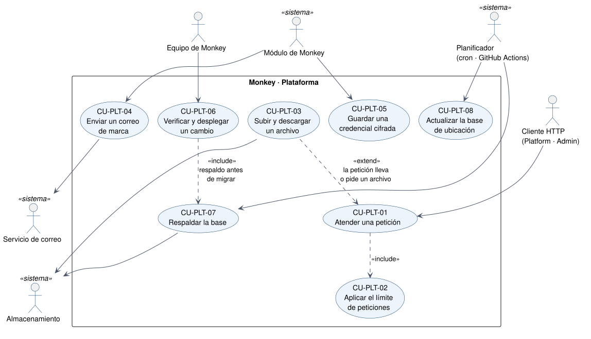

# Plataforma · casos de uso

Responde: **¿qué pasos siguen una petición, un archivo, un correo, un despliegue y un respaldo, qué puede salir distinto y
en qué estado queda todo al terminar?** Cada caso realiza una o varias [historias](04-historias.md); la secuencia técnica
está en [`03-flujos.md`](03-flujos.md), el servidor en [`infraestructura/`](infraestructura/README.md) y la forma de las
respuestas en [`contracts/conventions.md`](../../../../../../contracts/conventions.md).

## Diagrama de casos de uso

Fuente del diagrama: [`05-casos-de-uso.puml`](05-casos-de-uso.puml) (PlantUML; se regenera con
`skills/process/monkey-docs/scripts/render-uml.sh`). «Cliente HTTP» es cualquier frontend que llama a la API en nombre de
una persona; «Equipo de Monkey» desarrolla y opera; «Planificador» es el cron o GitHub Actions.

## Resumen

| ID | Caso | Actor principal | Historias |
|---|---|---|---|
| CU-PLT-01 | Atender una petición | Cliente HTTP | HU-PLT-01, HU-PLT-02, HU-PLT-03, HU-PLT-04, HU-PLT-07 |
| CU-PLT-02 | Aplicar el límite de peticiones | Sistema | HU-PLT-05, HU-PLT-06 |
| CU-PLT-03 | Subir y descargar un archivo | Cliente HTTP | HU-PLT-09, HU-PLT-10 |
| CU-PLT-04 | Enviar un correo de marca | Sistema | HU-PLT-08 |
| CU-PLT-05 | Guardar una credencial cifrada | Sistema | HU-PLT-11, HU-PLT-12 |
| CU-PLT-06 | Verificar y desplegar un cambio | Equipo de Monkey | HU-PLT-13, HU-PLT-14, HU-PLT-15 |
| CU-PLT-07 | Respaldar la base | Planificador | HU-PLT-16 |
| CU-PLT-08 | Actualizar la base de ubicación | Planificador | HU-PLT-17 |

---

### CU-PLT-01 · Atender una petición

| | |
|---|---|
| **Actor** | Cliente HTTP (Monkey Platform o Monkey Admin) |
| **Precondición** | La ruta existe; salvo `@Public()`, la petición trae la cookie de sesión |
| **Postcondición** | Respuesta con el sobre de `conventions.md`, `message` en el idioma pedido |

**Flujo principal**
1. El cliente envía la petición con `Accept-Language`.
2. El sistema valida la sesión (`SessionAuthGuard`) y el rol (`RolesGuard`).
3. Aplica el límite de peticiones (**CU-PLT-02**).
4. El caso de uso pide una conexión con `withScope` y ejecuta dentro del aislamiento de la empresa.
5. El sistema responde `{ statusCode, message, data }`; una colección trae `items`, `page`, `page_size`, `total` y
   `total_pages`.

**Flujos alternos**
- 2a. Sin cookie válida → `401 UNAUTHENTICATED`. Rol que no alcanza → `403 FORBIDDEN`.
- 4a. El recurso es de otra empresa o no existe → `404 NOT_FOUND`.
- 4b. Valores que no pasan → `422 VALIDATION_FAILED` con todos los campos en `error.fields`.
- 4c. Choca con el estado actual → `409 CONFLICT` u otro código del contrato del módulo.
- 4d. No hay conexión libre en 10 s → `500 INTERNAL_ERROR`, sin detalle interno (D49).
- 5a. `page_size` mayor que 100 → `422 VALIDATION_FAILED`; sin `page_size`, 25.

### CU-PLT-02 · Aplicar el límite de peticiones

| | |
|---|---|
| **Actor** | Sistema |
| **Precondición** | Petición con sesión (hoy); ruta pública de autenticación (por construir, D124) |
| **Postcondición** | La petición sigue y cuenta en el cupo del usuario y de la empresa, o se rechaza sin gastar cupo |

**Flujo principal**
1. El sistema comprueba el tope del usuario (100/min).
2. Comprueba el tope de la empresa (1000/min).
3. Si pasa los dos, la cuenta en ambos y la petición sigue.

**Flujos alternos**
- 1a. / 2a. Tope superado → `429 RATE_LIMITED` con `Retry-After`; no se cuenta (SEG-19).
- 1b. Ruta pública (ingreso, recuperación) → *por construir:* tope por dirección con la IP real detrás del proxy, contador
  en Redis (D124, MD-218). Hoy no se limita aquí (DT-37).
- 3a. Varias instancias → *hoy* cada una cuenta por su lado (DT-37); con Redis el cupo es común (D124).

### CU-PLT-03 · Subir y descargar un archivo

| | |
|---|---|
| **Actor** | Cliente HTTP (en onboarding o en evidencias) |
| **Precondición** | Sesión con un rol que puede subir en ese módulo; almacenamiento configurado |
| **Postcondición** | Archivo en el bucket privado con su huella SHA-256 y su fila registrada; o un enlace firmado de 5 min |

**Flujo principal**
1. El cliente sube el archivo.
2. El sistema comprueba tamaño, nombre y tipo por la firma del contenido (SEG-43, SEG-60).
3. Calcula la huella SHA-256 y guarda el archivo con la llave prefijada por empresa (SEG-44).
4. Registra la fila; una versión nueva no pisa la anterior.
5. Al pedir la descarga, el sistema devuelve un enlace firmado de 5 minutos (SEG-59).

**Flujos alternos**
- 2a. Tipo no permitido o contenido que no coincide → `415 UNSUPPORTED_MEDIA_TYPE`; sin archivo →
  `422 FILE_REQUIRED`; más de 25 MB → `413 FILE_TOO_LARGE`.
- 3a. Almacenamiento no configurado → `503 STORAGE_UNAVAILABLE`.
- 4a. Falla el registro → el archivo subido se borra.
- 5a. El enlace venció o se alteró → el almacenamiento lo rechaza; se pide otro.
- 5b. Una evidencia pedida para verse en pantalla (`disposition=inline`) que no es PDF, PNG ni JPG → `422`
  ([`contracts/cumplimiento/evidencia.md`](../../../../../../contracts/cumplimiento/evidencia.md)).

### CU-PLT-04 · Enviar un correo de marca

| | |
|---|---|
| **Actor** | Sistema, a pedido de un módulo (clave de acceso, invitación, contraseña) |
| **Precondición** | La operación que lo pide ya quedó guardada |
| **Postcondición** | Correo entregado al servicio en el idioma de quien lo recibe, o el fallo informado sin deshacer nada |

**Flujo principal**
1. El módulo arma el mensaje con la plantilla de marca y el logo incrustado.
2. Elige el idioma: el guardado de quien lo recibe o, si aún no tiene cuenta, el de quien lo envía (D111).
3. El sistema lo entrega al servicio de correo configurado.

**Flujos alternos**
- 3a. Fuera de producción con `MAIL_PROVIDER=log` → el correo se escribe en la consola, no sale.
- 3b. El servicio falla → se informa el fallo; la operación sigue en pie y el correo se puede reenviar.
- 0a. En producción sin servicio real o sin `MAIL_API_KEY`/`MAIL_FROM` → el servidor no arranca (SEG-71).

### CU-PLT-05 · Guardar una credencial cifrada

| | |
|---|---|
| **Actor** | Sistema, al dar de alta una conexión del cliente |
| **Precondición** | `CREDENTIALS_ENCRYPTION_KEY` configurada |
| **Postcondición** | Credencial cifrada (`v1.…`) en la base; ninguna respuesta la devuelve |

**Flujo principal**
1. El sistema recibe la credencial en el alta.
2. La cifra con AES-256-GCM y guarda solo el texto cifrado.
3. Responde sin la credencial (SEG-24).

**Flujos alternos**
- 2a. *Por construir:* rotar la llave re-cifra todo con `v2` desde un gestor de secretos (SEG-25, DT-5).

### CU-PLT-06 · Verificar y desplegar un cambio

| | |
|---|---|
| **Actor** | Equipo de Monkey |
| **Precondición** | PR abierto contra `develop` |
| **Postcondición** | El cambio corre en la VPS de desarrollo con la base migrada y respaldada; la documentación de la API, apagada |

**Flujo principal**
1. El equipo abre el PR; el CI corre lint, build, tipos, unitarias, migraciones desde cero, verificadores y aislamiento
   (SEG-40).
2. El equipo fusiona en `develop`.
3. GitHub Actions copia el repo a la VPS.
4. En el Backend, `check-env.sh` comprueba los archivos de entorno del servidor.
5. `migrate.sh` respalda la base, migra con el rol dueño y carga los catálogos (SEG-42).
6. Se reconstruye y levanta el contenedor (y el trabajador, si el compose lo define).

**Flujos alternos**
- 1a. El CI falla → *hoy* nada impide fusionar ni desplegar (SEG-41, DT-46); acuerdo de equipo: no fusionar en rojo.
- 4a. Falta una variable → el despliegue se detiene diciendo cuál; el backend anterior sigue corriendo.
- 5a. La migración falla → se aborta; el backend anterior sigue y queda el respaldo previo.
- 6a. En el dominio desplegado `/v1/docs` responde 404 (SEG-62).

### CU-PLT-07 · Respaldar la base

| | |
|---|---|
| **Actor** | Planificador (cron de la VPS) |
| **Precondición** | Credenciales del almacenamiento cargadas fuera del repo |
| **Postcondición** | Volcado legible en el bucket de respaldos, con expiración a 30 días y 7 copias locales |

**Flujo principal**
1. El cron lanza `backup-staging.sh`.
2. El sistema vuelca la base y comprueba que el volcado se lee.
3. Lo sube al almacenamiento y verifica que quedó con el mismo tamaño.
4. Fija la expiración y borra las copias locales que sobran.

**Flujos alternos**
- 2a. / 3a. Un paso falla → sale con error y queda en el log; *hoy* nadie recibe aviso (DT-84).
- 4a. *Por construir:* comprobación de que el respaldo más reciente tiene menos de un día y el más antiguo no pasa de
  35 (DT-84).

### CU-PLT-08 · Actualizar la base de ubicación

| | |
|---|---|
| **Actor** | Planificador (cron semanal) |
| **Precondición** | Credenciales del proveedor de la base en su archivo del servidor |
| **Postcondición** | Base nueva en la carpeta montada en el backend; la anterior como copia |

**Flujo principal**
1. El cron lanza `geoip-update.sh`.
2. El sistema descarga la base y deja la anterior como `.prev`.
3. El Backend detecta el cambio y la relee en una hora como mucho (D123).

**Flujos alternos**
- 2a. Faltan las credenciales → se detiene sin tocar la base vigente.
- 3a. Se pide `--restart` → se reinicia el backend para leerla ya.
