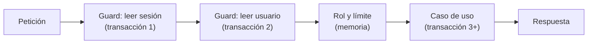

# La API con 500 usuarios

Responde: **¿aguantaría el Backend actual a 500 usuarios y dónde se atoraría primero?** Veredicto corto: **sí
aguanta en promedio, pero tiene tres puntos frágiles** (sesión, lecturas de cumplimiento y ráfagas de login) que
conviene resolver antes de medir. Las cifras son estimaciones con los supuestos de abajo; confírmalas con la prueba
de carga ([`06-mejoras.md`](06-mejoras.md), M2).

## Supuestos (cámbialos si no se cumplen)

- 500 usuarios **conectados**, no todos a la vez: cada uno hace una petición cada ~5 s → **~100 peticiones/s** en el pico.
- Repartidos en unas 25 a 50 empresas (10 a 20 personas cada una).
- Una sola instancia del Backend (un proceso de Node), una base PostgreSQL en el mismo servidor.
- Mezcla: 80 % lecturas ligeras, 20 % lecturas de cumplimiento (lista o resumen de controles).

## Qué cuesta una petición hoy

Tres transacciones o más por petición, cada una con `BEGIN`, `set_config`, consulta y `COMMIT`. Las dos primeras no
aportan nada al negocio: son el costo de verificar quién eres.

> **Al 2026-11-19 (MD-219, MD-230, D125):** el guard valida la sesión en **una** transacción, y cuatro rutas
> (`PATCH /v1/controls/:id`, `GET /v1/controls/:id/tests`, `GET /v1/evidence-requirements/:id/submissions`,
> `GET /v1/services/:id`) abren una sola para el caso de uso: **2 por petición**. El diagrama y las cuentas de abajo
> son el punto de partida de la auditoría; el resto de rutas sigue con 3 o más hasta que se apliquen MD-220 a MD-225.

## Dónde se atoraría, de mayor a menor riesgo

| # | Punto | Qué pasa | Estimación |
|---|---|---|---|
| 1 | **Lecturas de cumplimiento** | Cada una carga el servicio entero y lo calcula en Node, y mientras tanto retiene una conexión y bloquea el único hilo de ejecución | A 20 lecturas pesadas/s de 100–150 ms: ~2–3 conexiones y 2–3 s de CPU por segundo. **Satura un núcleo.** |
| 2 | **Ráfaga de logins** | `bcrypt` con costo 12 tarda ~200–300 ms de CPU y usa el pool de hilos de libuv (4 por defecto), compartido con DNS y archivos | 500 logins en 30 s ≈ 17/s: el pool se llena y **todo lo demás se retrasa** (a las 8:00 de la mañana pasa). |
| 3 | **Pool de conexiones** | El pool por defecto es de 10. Promedio: 100 req/s × 3 transacciones × ~5 ms ≈ 1,5 conexiones ocupadas. Con las lecturas pesadas, 4–5. | Alcanza en promedio; en un pico aparecen esperas (`maxWait` de 10 s) y, pasado el plazo, errores 500. |
| 4 | **Límite de peticiones** | 100/min por usuario y 1000/min por empresa, en memoria | Una empresa con 20 usuarios activos (~240 peticiones/min) no se acerca al tope. Una con 100 usuarios activos ronda 1200/min y **se topa sola**. Con 2 instancias el tope se duplica. |
| 5 | **Subida de evidencia** | El archivo vive en memoria durante la petición | 50 subidas de 20 MB a la vez = 1 GB. Poco probable, pero sin protección. |
| 6 | **Crecimiento de tablas** | `evaluations` y `audit_logs` solo suben | Meses, no días. Se vuelve problema con la sonda diaria sobre muchos activos. |

## Qué hacer, en orden

1. **Medir primero** ([`06-mejoras.md`](06-mejoras.md), M2): k6 con 100 req/s sostenidos y un pico de 500 logins en 30 s. Registrar p95, errores y
   conexiones en uso. Sin esto, todo lo siguiente es opinión.
2. **Quitar las dos transacciones de la sesión** *(hecho en MD-219; y una transacción por caso de uso, D125, en 4 rutas: pendiente el resto)* ([`autenticacion/06-mejoras.md`](../autenticacion/06-mejoras.md), M1): una consulta o caché de 10–30 s. Baja un tercio de la carga
   a la base en todo el producto con poco código.
3. **Fijar el pool** ([`06-mejoras.md`](06-mejoras.md), M1): `max` entre 20 y 30 (sin pasar de `max_connections` de Postgres menos las del Runner y
   migraciones). Más conexiones no arregla un cálculo lento: solo mueve la cola.
4. **Cachear la foto del servicio** ([`cumplimiento/06-mejoras.md`](../cumplimiento/06-mejoras.md), M2), invalidándola al escribir un hecho. Es la mejora de mayor efecto.
5. **Subir `UV_THREADPOOL_SIZE` a 8–16** y limitar los logins simultáneos, o bajar el costo de `bcrypt` solo si
   seguridad lo aprueba (SEG-18).
6. **Dos instancias detrás del proxy** con límite de peticiones compartido ([`autenticacion/06-mejoras.md`](../autenticacion/06-mejoras.md), M2). Todo el Backend es sin estado
   salvo ese contador, así que escala horizontal sin cambios grandes.
7. **PgBouncer** en modo transacción cuando haya más de una instancia: cuidado, `set_config(..., true)` dura una
   transacción, por lo que es compatible con ese modo.

## Plan de la prueba (resumen)

| Escenario | Carga | Se mide |
|---|---|---|
| Línea base | 20 req/s durante 10 min, lecturas ligeras | p95 < 300 ms |
| Pico de cumplimiento | 100 req/s, 20 % lista de controles | CPU del proceso, conexiones, p95 |
| Ráfaga de logins | 500 logins en 30 s | Tiempo de login y latencia del resto |
| Aislamiento bajo carga | Dos empresas, una saturada | La otra mantiene su p95 |

Aceptación sugerida: p95 menor a 500 ms en lecturas, cero errores 500, y ninguna empresa degrada a otra.

## Cómo verificarlo

- Pool y transacciones: `Backend/src/infrastructure/database/prisma.service.ts`.
- Costo de `bcrypt`: `Backend/src/features/auth/infrastructure/security/bcrypt-password.hasher.ts`.
- Límite: `Backend/src/common/rate-limit/rate-limit.guard.ts`.
- La foto del servicio: `compliance/infrastructure/shared/service-snapshot.loader.ts` ([`cumplimiento/`](../cumplimiento/README.md)).
