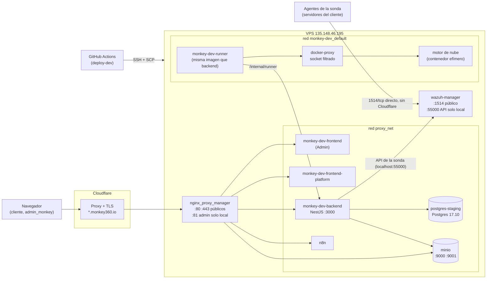
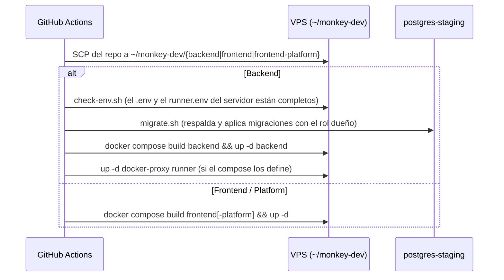

# Infraestructura · la VPS de desarrollo

Componente de [Plataforma](../README.md).


Responde: **¿qué corre en el servidor de desarrollo, cómo llega el tráfico, cómo se despliega, cuánto consume y qué
conviene arreglar?** Es un documento interno (nombra a la sonda y al motor de nube). Se levantó el **2026-11-18**
(MD-217) leyendo el servidor en **solo lectura** con el usuario `claude-ro`; lo que ese usuario no puede ver está en
[Lo que no se pudo ver](#lo-que-no-se-pudo-ver). Las cifras son de ese día: vuelve a medir antes de decidir con ellas
([Cómo actualizar este documento](#cómo-actualizar-este-documento)).

## Resumen

| | |
|---|---|
| **Máquina** | VPS KVM `vps-0431ba5c`, IP `135.148.46.195` · Ubuntu 26.04 LTS, kernel 7.0 · encendida 18 semanas sin reiniciar · zona UTC |
| **CPU** | 4 vCPU (Intel Haswell) · media de 7 días **≈ 1 %**, pico **22 %** |
| **RAM** | 7,6 GiB · usada ≈ 3 GiB (**≈ 28 %** de media en 7 días) · **sin swap** |
| **Disco** | 72 GB · **58 GB usados (80 %)**, quedan 15 GB |
| **Contenedores** | 10, en 6 proyectos de Docker Compose (sin `daemon.json`) |
| **Entrada** | Cloudflare (proxy y TLS público) → Nginx Proxy Manager (80/443) → contenedores por la red `proxy_net` |
| **Despliegue** | GitHub Actions al fusionar en `develop`: copia el repo por SCP y hace `docker compose build` + `up` **en la VPS** |

Hoy la máquina va holgada en CPU y RAM. Lo que aprieta es **el disco** y, sobre todo, **la exposición**: hay puertos
abiertos a internet que no deberían estarlo ([Mejoras](#mejoras-propuestas)).

## Cómo llega el tráfico



`backend`, `frontend` y `frontend-platform` están en **dos redes**: la del proyecto (`monkey-dev_default`, donde viven
el trabajador y el `docker-proxy`) y `proxy_net` (la del proxy). Postgres, MinIO, n8n y Nginx Proxy Manager **solo**
están en `proxy_net`, así que todos se ven entre sí.

### Dominios

Todos pasan por Cloudflare (IP de Cloudflare, certificado de su borde de Google Trust Services, vence el 2027-01-25).

| Dominio | Responde | Qué es (deducido) |
|---|---|---|
| `app-dev.monkey360.io` | 200 | Monkey Platform |
| `admin-dev.monkey360.io` | 200 | Monkey Admin |
| `api-dev.monkey360.io` | 404 en `/` · 401 en rutas con sesión | Backend (`/v1`) |
| `storage.monkey360.io` | 200 | **Consola web de MinIO** (por sus cabeceras CSP) |
| `n8n.monkey360.io` | **502** | n8n (el proxy no llega al contenedor) |
| `monkey360.io` · `www` | 200 | Sitio público (no se pudo ver a qué contenedor va) |

## Contenedores

Consumo medido con `docker stats` el 2026-11-18 a media tarde (con poca carga).

| Proyecto (carpeta) | Contenedor | Imagen | Puertos | Límite de RAM | RAM usada |
|---|---|---|---|---|---|
| `monkey-dev` | `monkey-dev-backend-1` | `monkey-dev-backend:latest` (build local) · monta `./geoip` en solo lectura | 3000 interno | **ninguno** | 76 MB |
| `monkey-dev` | `monkey-dev-runner-1` | la misma | — | 256 MB | 43 MB |
| `monkey-dev` | `monkey-dev-docker-proxy-1` | `tecnativa/docker-socket-proxy:0.3.0` | 2375 interno | ninguno | 4 MB |
| `monkey-dev` | `monkey-dev-frontend-1` | build local (nginx) | 80 interno | ninguno | 8 MB |
| `monkey-dev` | `monkey-dev-frontend-platform-1` | build local (nginx) | 80 interno | ninguno | 5 MB |
| `nginx_proxy_manager` | `nginx_proxy_manager` | `jc21/nginx-proxy-manager:2.15.1` | **80, 443 públicos** · 81 local | ninguno | 126 MB |
| `postgres-staging` | `postgres-staging` | `postgres:17.10` | 5432 interno | ninguno | 69 MB |
| `minio` | `minio` | `minio/minio:latest` | **9000 y 9001 públicos** | ninguno | 114 MB |
| `wazuh-manager` | `wazuh-manager` | `wazuh/wazuh-manager:4.14.6` | **1514 público** · 55000 local | 2 GB | 704 MB |
| `n8n` | `n8n` | `docker.n8n.io/n8nio/n8n:latest` | 5678 interno | ninguno | 316 MB |

Solo el trabajador y el gestor de la sonda tienen límite de memoria, y la máquina **no tiene swap**: si un contenedor
se dispara, el kernel mata procesos sin aviso. El trabajador además está endurecido (`read_only`, `cap_drop: ALL`,
`no-new-privileges`, `tmpfs` en `/tmp`) y solo ve su `runner.env` y `runner-secrets/` en solo lectura.

### Imágenes en disco

| Imagen | Tamaño en disco | En uso |
|---|---|---|
| `toniblyx/prowler@sha256:9dbc…` (motor de nube) | 4,6 GB | Sí, aunque no aparezca: el trabajador la arranca en cada escaneo |
| `wazuh/wazuh-manager:4.14.6` | 2,5 GB | Sí |
| `n8n:latest` | 2,5 GB | Sí |
| `jc21/nginx-proxy-manager:2.15.1` | 1,8 GB | Sí |
| `monkey-backend-tools:latest` | 1,7 GB | **No** (nada la usa) |
| `monkey-dev-backend:latest` | 960 MB | Sí |
| `postgres:17` | 646 MB | **No** (corre `postgres:17.10`) |
| `postgres:17.10` · `minio` · frontends · `docker-socket-proxy` | ≈ 1,2 GB juntas | Sí |

## Cómo se despliega

Los tres repos despliegan igual, al fusionar en `develop` (`.github/workflows/deploy-dev.yml` de cada uno):



- Los archivos de entorno (`~/monkey-dev/.env`, `runner.env`) **viven solo en el servidor**; el despliegue no los
  escribe. Se editan con `backend/scripts/deploy/set-env.sh` y `check-env.sh` detiene el despliegue si falta algo.
- El compose de `monkey-dev` está versionado en el repo del Backend (`deploy/docker-compose.dev.yml`); los otros cinco
  (`minio`, `n8n`, `nginx_proxy_manager`, `postgres-staging`, `wazuh-manager`) solo existen en `/home/ubuntu/<proyecto>/`.
- **El despliegue no actualiza el compose que corre.** Copia el repo a `~/monkey-dev/backend/`, pero
  `~/monkey-dev/docker-compose.yml` se queda como estaba. Si un ticket cambia `deploy/docker-compose.dev.yml`, alguien
  con el usuario `ubuntu` lo copia a mano (respaldando el anterior) y recrea el servicio (`docker compose up -d <servicio>`).
  Así se hizo con el volumen de GeoIP (MD-217, 2026-11-19).
- El build se hace **en la VPS**: cada despliegue compila con la CPU y la RAM del servidor y acumula capas en disco.
- La URL de la API de los frontends se hornea en el build (`API_URL: https://api-dev.monkey360.io/v1`).

## Datos y almacenamiento

| Qué | Dónde | Notas |
|---|---|---|
| Base de datos | `postgres-staging`, volumen `postgres_staging_data` | Las variables de n8n y de Nginx Proxy Manager apuntan a un Postgres: **probablemente el mismo** (no se puede leer el host) |
| Archivos (evidencias, copias de empresas archivadas) | `minio`, carpeta `~/minio/data` | API S3 en 9000 |
| Respaldos de la base | `scripts/deploy/backup-staging.sh`: `pg_dump` nocturno **a ese mismo MinIO**, expira a 30 días, 7 copias locales | Están **en la misma máquina** que la base. Que el cron corra no se puede ver con `claude-ro` (SEG-35, `DT-84`) |
| Configuración de la sonda | 8 volúmenes `wazuh_*` | Es lo que más disco mueve: 594 GB leídos y 485 GB escritos desde que arrancó (5 semanas) |
| Base de ubicación (MD-217) | `~/monkey-dev/geoip/GeoLite2-City.mmdb` (≈ 50 MB), montada en el backend como `/app/geoip` (solo lectura). En servicio desde el 2026-11-19 | La actualiza `backend/scripts/deploy/geoip-update.sh` con un cron semanal de `ubuntu` (ver abajo); el backend relee el archivo solo, como mucho una hora después, y solo deja log si falla. Las credenciales de MaxMind van en `~/monkey-dev/geoip.env` (600), no en el `.env` del backend. Hasta MD-218 (`trust proxy`) el backend ve la IP del proxy y la ubicación sale desconocida |

Cron de GeoIP (`crontab -e` del usuario `ubuntu`). `set -a` exporta las variables de `geoip.env`; sin él, el script no
las recibe:

```cron
0 4 * * 1 cd /home/ubuntu/monkey-dev && set -a && . ./geoip.env && set +a && bash backend/scripts/deploy/geoip-update.sh >> geoip/update.log 2>&1
```

## Seguridad del servidor

| Control | Estado |
|---|---|
| SSH | Solo con llave (`PasswordAuthentication no`). Puerto 22 abierto a todo internet |
| Cortafuegos (`ufw`) | **Desactivado** (`ENABLED=no`). Además, Docker publica puertos saltándose `ufw` |
| `fail2ban` | **Inactivo** (con SSH solo por llave el riesgo es menor) |
| Actualizaciones automáticas | Activas (`unattended-upgrades`) · **76 paquetes pendientes** · **reinicio pendiente** (kernel) |
| Logs de Docker | Sin rotación configurada (no existe `/etc/docker/daemon.json`): los `json-file` crecen sin tope |
| `journald` | 3,6 GB en disco |
| Métricas | Solo `sysstat` (historial local de CPU y RAM). Sin monitoreo externo ni alertas |
| Puertos que responden en la IP directa | 22, 80, 443, **1514**, **9000**, **9001** (cerrados: 81, 5432, 55000) |
| Cabeceras HTTP | Platform, Admin y la API **no** mandan HSTS, CSP, `X-Frame-Options` ni `nosniff`; la API anuncia `x-powered-by: Express` |

## Mejoras propuestas

Propuestas, no decisiones; cada una tiene su ticket en Jira (2026-11-18). Prioridad **A** = exposición o riesgo de caída hoy.

| # | Mejora | Prio | Esfuerzo | Ticket |
|---|---|---|---|---|
| I1 | **La consola de MinIO está en internet**: por la IP (`:9001`) y por `storage.monkey360.io`. El compose ya la pone en `127.0.0.1`, pero el contenedor que corre se creó con una versión anterior y no se recreó. Recrearlo (`docker compose up -d` en `~/minio`), quitar el host de la consola del proxy (o protegerlo con Cloudflare Access) y no publicar el 9000 en la IP: el backend llega a MinIO por `proxy_net` | A | S | MD-233 |
| I2 | **El origen se puede atacar saltándose Cloudflare**: 80 y 443 responden en la IP directa. Abrirlos solo a los rangos de Cloudflare (o un Cloudflare Tunnel, que además cierra 80/443) | A | M | MD-234 |
| I3 | **Cortafuegos apagado** y Docker publicando en `0.0.0.0`. Encender `ufw` con 22 (idealmente solo IPs conocidas), 80/443 (Cloudflare) y 1514 (agentes), y filtrar lo publicado por Docker en la cadena `DOCKER-USER` o publicando solo en `127.0.0.1` | A | M | MD-234 |
| I4 | **Disco al 80 %**: rotación de logs de Docker (`daemon.json` con `max-size`/`max-file`), tope a `journald` (p. ej. 500 MB), borrar las imágenes sin uso (`monkey-backend-tools`, `postgres:17`: ~2,3 GB) y la caché de build de cada despliegue. Vigilar el crecimiento de los volúmenes de la sonda | A | S | MD-235 |
| I5 | **Respaldos en la misma máquina**: si se pierde la VPS se pierden la base y sus copias. Copiar los respaldos fuera (otro proveedor u otra región) y comprobar en el propio script que el cron corrió (cierra parte de SEG-35 / `DT-84`) | A | M | MD-236 |
| I6 | **Reinicio y parches pendientes** (kernel y 76 paquetes). Programar una ventana de reinicio | A | S | MD-237 |
| I7 | **Sin límites de memoria y sin swap**: poner `mem_limit` a backend, Postgres, n8n, MinIO y el proxy, y añadir 2–4 GB de swap como colchón | B | S | MD-238 |
| I8 | **Cabeceras de seguridad**: HSTS, CSP, `X-Frame-Options: DENY`, `nosniff` en Platform y Admin (en el nginx de cada imagen o en el proxy) y `helmet` en la API (quita `x-powered-by`) | B | S | MD-239 |
| I9 | ✅ **IP real del cliente** (MD-485, backend): el backend resuelve `req.ip` con `trust proxy` (`TRUST_PROXY`, apagado por defecto) y normaliza `::ffff:`. **Falta en el despliegue: `TRUST_PROXY=2`** (Cloudflare + NPM; `X-Forwarded-For` limpio, no se lee `CF-Connecting-IP`). Confiar en más saltos permite falsificar la IP; la protección completa es I2 (origen solo para Cloudflare) | B | S | MD-485 |
| I10 | **Postgres comparte red con todo**: n8n, MinIO y el proxy pueden hablar con la base. Una red interna solo backend ↔ Postgres | B | S | MD-240 |
| I11 | **`n8n.monkey360.io` da 502**: revisar el host en el proxy o apagar n8n si no se usa (libera ~320 MB de RAM y 2,5 GB de disco) | B | S | MD-241 |
| I12 | **Imágenes `:latest`** (MinIO, n8n): fijar versiones para que un `pull` no cambie nada sin querer | B | S | MD-242 |
| I13 | **El build se hace en la VPS**: construir las imágenes en GitHub Actions y subirlas a un registro (GHCR); la VPS solo hace `pull` y `up`. Despliegues más rápidos y sin picos de CPU ni basura de build en el servidor | C | M | MD-243 |
| I14 | **Sin monitoreo**: un chequeo externo de disponibilidad (`app-dev`, `admin-dev`, `api-dev`) y una alerta de disco > 85 % | C | S | MD-244 |
| I15 | **Compose fuera de git**: versionar los de `minio`, `nginx_proxy_manager`, `postgres-staging` y `wazuh-manager` (sin secretos) como el de `monkey-dev`, y borrar los `.bak` del servidor | C | S | MD-245 |

## Lo que no se pudo ver

`claude-ro` no tiene permiso, a propósito, para:

- Los `.env`, `runner.env` y `runner-secrets/` (secretos).
- La configuración interna de Nginx Proxy Manager (`~/nginx_proxy_manager/data`): los dominios salen de probarlos desde
  fuera, no de su configuración.
- El `crontab` de `ubuntu`: no se puede confirmar qué corre de noche (respaldos).
- `docker network ls`, `docker volume ls`, `docker system df` y `docker inspect` (este último mostraría variables de
  entorno con secretos).

## Cómo actualizar este documento

Con el usuario de solo lectura (`ssh monkey-vps`), sin leer nunca un archivo de entorno:

```bash
free -h; df -hT -x tmpfs -x overlay; nproc; uptime -p                    # máquina
sudo docker ps -a; sudo docker stats --no-stream; sudo docker images      # contenedores
sudo docker compose ls                                                    # proyectos y sus compose
sar -u -f /var/log/sysstat/saDD; sar -r -f /var/log/sysstat/saDD          # historial de CPU y RAM
ss -tln                                                                   # puertos que escuchan
```

Los compose se leen ocultando los valores de `environment:`. Los puertos abiertos y los certificados se comprueban
desde fuera (`/dev/tcp/<ip>/<puerto>`, `openssl s_client`).
