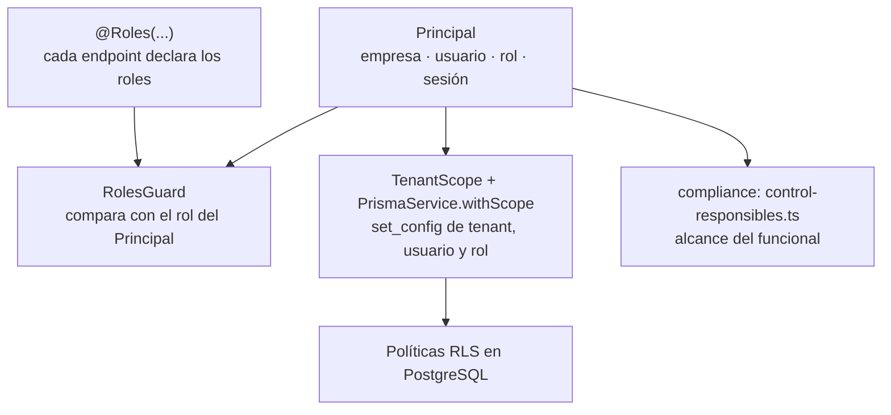

# Roles y permisos · C4

Responde: **¿qué piezas hacen cumplir los permisos y dónde actúa cada una?**

## Nivel 1 · Contexto

## Nivel 3 · Componentes

## Las tres capas

| Capa | Qué decide | Dónde |
|---|---|---|
| 1 · Endpoint | ¿Este rol puede llamar esta ruta? | `@Roles(...)` + `RolesGuard`, con el rol de la base |
| 2 · Empresa | ¿Este dato es de mi empresa? | RLS con `app.tenant_id`; el código no filtra |
| 3 · Alcance dentro de la empresa | ¿Esta prueba es de mi especialidad? (D98) | `compliance`, al leer, solo para el `funcional` |

## Cómo verificarlo

`cat Backend/src/common/guards/roles.guard.ts`, `grep -rn "@Roles(" Backend/src/features | wc -l` y
`grep -rln "app.user_role" Backend/prisma/migrations`.
