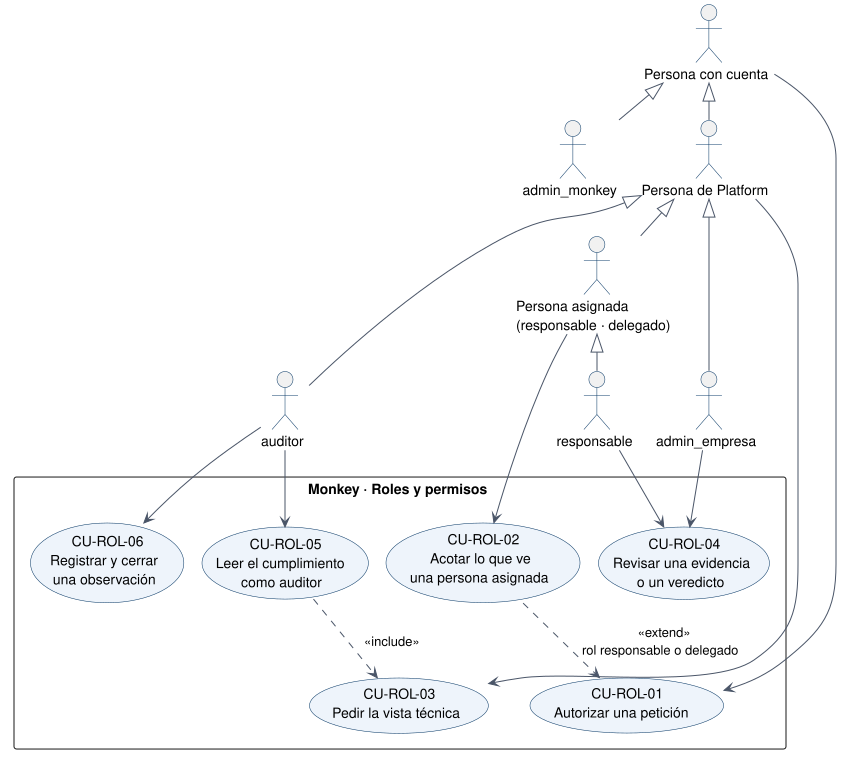

# Roles y permisos · casos de uso

Responde: **¿qué pasos sigue cada actor con el sistema, qué puede salir distinto y en qué estado queda todo al
terminar?** Cada caso realiza una o varias [historias](04-historias.md); la secuencia técnica está en
[`03-flujos.md`](03-flujos.md), las capas en [`01-c4.md`](01-c4.md) y las respuestas `403` y `404` en
[`contracts/conventions.md`](../../../../../../contracts/conventions.md).

Roles y permisos no tiene pantallas propias: sus casos son **lo que el sistema hace con el rol** en cada petición, y lo
que cada rol puede o no puede hacer sobre lo de Cumplimiento. Subir y revisar una evidencia o crear una cuenta se
describen en sus módulos; aquí solo quién puede. Las historias ⚪ (HU-ROL-11 y HU-ROL-12) no tienen caso: dependen de
`P35` y `P36`, abiertas.

## Diagrama de casos de uso

Fuente del diagrama: [`05-casos-de-uso.puml`](05-casos-de-uso.puml) (PlantUML; se regenera con
`skills/process/monkey-docs/scripts/render-uml.sh`). «Persona con cuenta» generaliza a `admin_monkey` y a la «Persona de
Platform»; esta, al `admin_empresa`, al `auditor` y a la «Persona asignada» (`responsable` y `delegado`). Cualquier
persona de Platform puede pedir la vista técnica (CU-ROL-03), pero solo la obtienen el `admin_empresa` y el `auditor`.

## Resumen

| ID | Caso | Actor principal | Historias |
|---|---|---|---|
| CU-ROL-01 | Autorizar una petición | Persona con cuenta | HU-ROL-01, HU-ROL-02, HU-ROL-03, HU-ROL-10 |
| CU-ROL-02 | Acotar lo que ve una persona asignada | `responsable` · `delegado` | HU-ROL-05, HU-ROL-06 |
| CU-ROL-03 | Pedir la vista técnica | Persona de Platform (la obtienen `admin_empresa` y `auditor`) | HU-ROL-04, HU-ROL-05, HU-ROL-06, HU-ROL-07 |
| CU-ROL-04 | Revisar una evidencia o un veredicto según el rol | `admin_empresa` · `responsable` | HU-ROL-04, HU-ROL-05, HU-ROL-06, HU-ROL-07 |
| CU-ROL-05 | Leer el cumplimiento como auditor | `auditor` | HU-ROL-07, HU-ROL-09 |
| CU-ROL-06 | Registrar y cerrar una observación | `auditor` | HU-ROL-08 |

---

### CU-ROL-01 · Autorizar una petición

| | |
|---|---|
| **Actor** | Persona con cuenta (cualquier rol) |
| **Precondición** | Sesión iniciada (Autenticación) |
| **Postcondición** | La petición se ejecuta dentro de la empresa de la cuenta, o se rechaza sin haber cambiado nada |

**Flujo principal**
1. La persona pide una ruta.
2. El sistema valida la sesión y lee de la base el usuario, su estado y su rol (HU-ROL-03).
3. El sistema comprueba que el rol esté entre los que declara la ruta (`@Roles`, capa 1, SEG-20).
4. El sistema fija la empresa, el usuario y el rol en la transacción (`withScope`) y la base devuelve solo lo de esa
   empresa (RLS, capa 2).
5. Si el rol es `responsable` o `delegado`, sigue con **CU-ROL-02**; si no, se ejecuta la acción.

**Flujos alternos**
- 2a. El usuario fue desactivado → se cierra su sesión (`403 ACCOUNT_INACTIVE`).
- 3a. El rol no está en la ruta (p. ej. `admin_monkey` en Cumplimiento, o una empresa en una ruta de `admin_monkey`) →
  `403 FORBIDDEN` (SEG-20).
- 4a. El recurso es de otra empresa → `404 NOT_FOUND`, sin decir que existe (`conventions.md`).

### CU-ROL-02 · Acotar lo que ve una persona asignada

| | |
|---|---|
| **Actor** | `responsable` (dueño) o `delegado` (ejecutor) |
| **Precondición** | CU-ROL-01 superó las capas 1 y 2 |
| **Postcondición** | La persona recibe solo lo de sus controles y el avance de lo suyo |

**Flujo principal**
1. El sistema resuelve los controles de la persona en `client_control_assignments`: el `responsable`, los suyos y los
   que ejecutan sus delegados; el `delegado`, los que ejecuta (capa 3, D102, SEG-66).
2. En una lista, devuelve solo esos controles y lo que cuelga de ellos (pruebas, evidencia, riesgos, observaciones).
3. En un resumen, calcula el avance solo sobre esos controles (D118).

**Flujos alternos**
- 1a. Sin controles asignados → listas vacías, sin error (SEG-66).
- 2a. Pide o escribe algo de su empresa que no es de sus controles → `403 FORBIDDEN` (SEG-66).
- 2b. Pide una observación de un servicio completo → `403` (SEG-70).

### CU-ROL-03 · Pedir la vista técnica

| | |
|---|---|
| **Actor** | Persona de Platform; solo `admin_empresa` y `auditor` la obtienen |
| **Precondición** | CU-ROL-01 superado; una lectura de Cumplimiento |
| **Postcondición** | La respuesta trae la vista de negocio más el objeto `technical`, o `403` sin datos |

**Flujo principal**
1. El actor pide la lectura con `?view=technical`.
2. El sistema comprueba que el rol sea `admin_empresa` o `auditor` (D81, SEG-54).
3. El sistema agrega `technical` (puntos de enfoque, estados de evaluación, pruebas y resultados por check); nunca
   quita nada de la vista de negocio.

**Flujos alternos**
- 2a. El rol es `responsable` o `delegado` → `403 FORBIDDEN` (SEG-54).

### CU-ROL-04 · Revisar una evidencia o un veredicto según el rol

| | |
|---|---|
| **Actor** | `admin_empresa` (cualquiera) o `responsable` dueño del control |
| **Precondición** | CU-ROL-01 superado; una entrega o un veredicto pendiente de revisión |
| **Postcondición** | Queda una revisión por rol, con quién subió y quién revisó en el rastro; el estado sale de combinarlas |

**Flujo principal**
1. El actor aprueba o rechaza.
2. El sistema comprueba el rol: `admin_empresa`, o `responsable` dueño del control (SEG-67).
3. Si es el `responsable`, comprueba que no haya subido ni registrado él lo que revisa (SEG-67).
4. El sistema guarda la revisión con el rol leído de la base (`reviewer_role`) y la escribe en `audit_logs`.

**Flujos alternos**
- 2a. El actor es `delegado`, `auditor` o `admin_monkey` → `403 FORBIDDEN` (SEG-67).
- 2b. Es un `responsable` y el control no es suyo → `403 FORBIDDEN` (SEG-67).
- 3a. El `responsable` subió o registró él lo que intenta revisar → `403` (SEG-67,
  `contracts/cumplimiento/veredictos.md`).
- 3b. El `admin_empresa` revisa lo que él mismo subió siendo dueño → se admite hoy (SEG-67); y con la VF18 es la regla: su aprobación es la final (D132),
  abierta.

### CU-ROL-05 · Leer el cumplimiento como auditor

| | |
|---|---|
| **Actor** | `auditor` |
| **Precondición** | CU-ROL-01 superado; cuenta del auditor activa en la empresa |
| **Postcondición** | El auditor obtiene lo que pidió; nada de la empresa cambió |

**Flujo principal**
1. El auditor pide servicios, controles, pruebas, riesgos, evidencias o exclusiones de su empresa.
2. El sistema le devuelve todo, sin restricción de asignación, con la cadena de dueño y ejecutor (D63, D102).
3. Puede pedir la vista técnica (**CU-ROL-03**) y descargar el archivo de una evidencia con un enlace temporal.

**Flujos alternos**
- 1a. Intenta escribir (revisar, registrar un veredicto, decidir una exclusión, editar un control o crear un usuario) →
  `403 FORBIDDEN` (SEG-67, `contracts/cumplimiento/README.md`, `contracts/gestion-usuarios.md`).
- 1b. Pide algo de otra empresa → `404` (D63).
- 3a. Exportar reportes o consultar el rastro de auditoría: sin contrato todavía (HU-ROL-09).

### CU-ROL-06 · Registrar y cerrar una observación

| | |
|---|---|
| **Actor** | `auditor` (autor); responden el `admin_empresa`, el dueño o el ejecutor del control |
| **Precondición** | CU-ROL-01 superado; un control vigente de la empresa |
| **Postcondición** | Observación `open`, `answered` o `closed`; el porcentaje no cambia (D63) |

**Flujo principal**
1. El auditor escribe la observación sobre un control: queda `open`.
2. El `admin_empresa`, el dueño o el ejecutor la responden: queda `answered` (SEG-70).
3. El autor la cierra (`closed`) o, si no queda conforme, la devuelve a `open`.

**Flujos alternos**
- 1a. Quien escribe no es `auditor` → `403 FORBIDDEN` (SEG-70).
- 1b. El control está dado de baja → `409 CONTROL_RETIRED`.
- 2a. Responde un `responsable` o `delegado` sobre un control que no es suyo → `403` (SEG-70).
- 2b. Ya está `answered` → `409 OBSERVATION_NOT_OPEN`.
- 3a. Otro auditor intenta editarla, cerrarla o devolverla → `403`, antes que cualquier regla de estado (SEG-70).
- 3b. Cerrar una que no está `answered` → `409 INVALID_TRANSITION`; tocar una cerrada → `409 OBSERVATION_CLOSED`.
