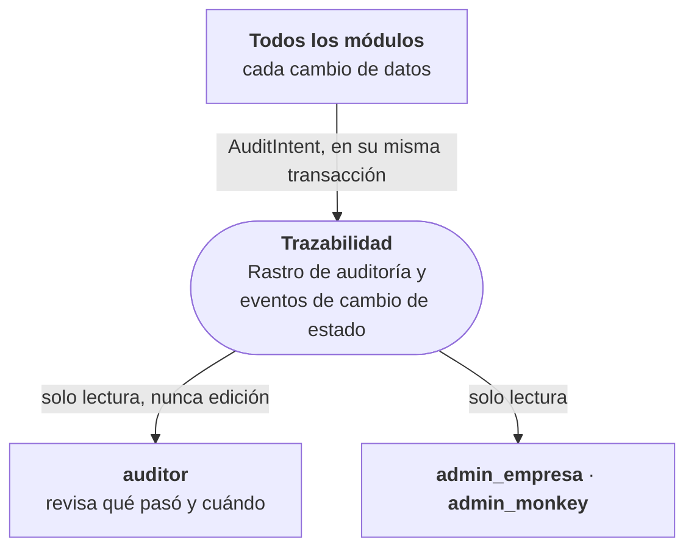
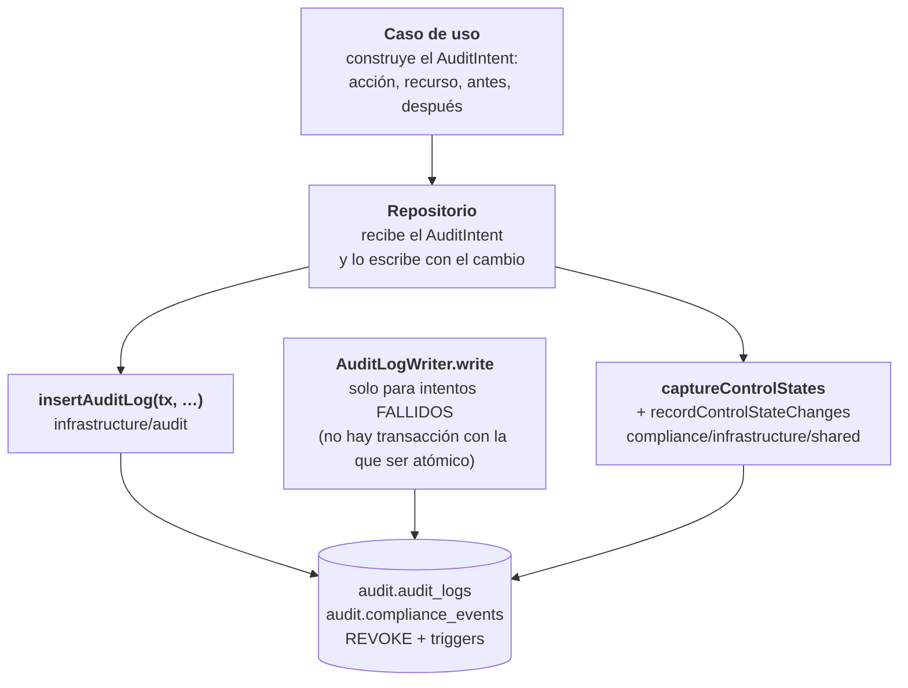

# Trazabilidad · C4

Responde: **¿quién escribe en los registros y quién los lee?**

## Nivel 1 · Contexto

## Nivel 3 · Piezas internas

**Por qué el `AuditIntent` lo construye el caso de uso y lo escribe el repositorio:** solo el caso de uso sabe qué
significó la acción, y solo el repositorio tiene la transacción abierta. Es lo que hace imposible olvidarse del
rastro: el método del repositorio **exige** el intent como parámetro.

## La excepción: lo que falla

Un intento fallido (un login con un correo que no existe) no tiene cambio con el que ser atómico, así que se
escribe aparte, de mejor esfuerzo, con `AuditLogWriter`. Son las únicas filas que pueden faltar si el proceso muere.

## Cómo verificarlo

- `grep -rn "insertAuditLog" Backend/src | wc -l` y `grep -rn "AuditLogWriter" Backend/src`.
- Inmutabilidad: `Backend/scripts/verify-audit-append-only.ts` (`npm run audit:verify`).
