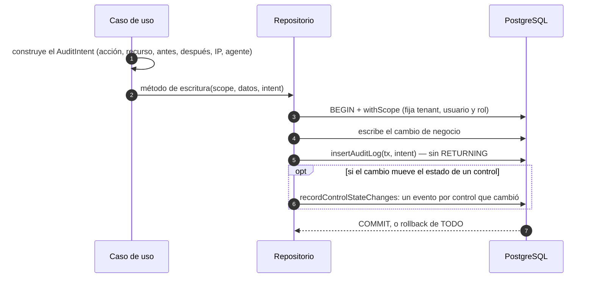
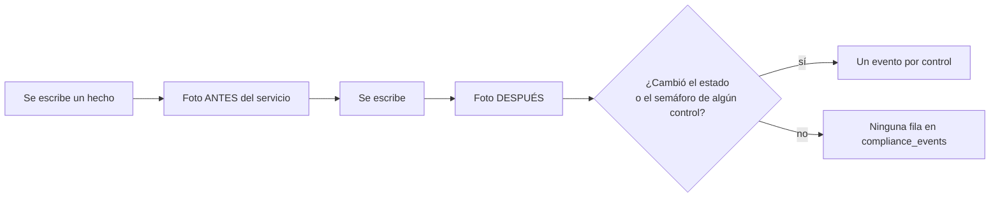

# Trazabilidad · Flujos

Responde: **¿cómo se escribe el rastro y cómo se consulta?**

## 1 · El patrón de toda escritura auditada

**Lo que esto garantiza:** no existe un cambio sin rastro, ni un rastro de algo que no ocurrió. Si el `INSERT` del
rastro falla, la acción se revierte (D52, SEG-36).

## 2 · Los dos niveles, con un ejemplo

El `admin_empresa` rechaza una evidencia y, con eso, un control pasa de efectivo a no efectivo:

| Registro | Fila que queda |
|---|---|
| `audit_logs` | `action = evidence.review`, `before_state` = la revisión anterior, `after_state` = la nueva, con el usuario y su IP |
| `compliance_events` | `changed_field = control.state`, `previous_value = effective`, `new_value = ineffective`, mismo usuario |

Uno cuenta **la acción**; el otro, **la consecuencia**. Hacen falta los dos: la acción sola no dice qué se movió, y
la consecuencia sola no dice quién la causó.

## 3 · Cuándo hay evento y cuándo no

Las cuatro puertas que pueden generar eventos: subir evidencia, revisarla, dar un veredicto y la entrega de
resultados de la sonda ([`cumplimiento/03-flujos.md`](../cumplimiento/03-flujos.md)).

## 4 · Convención de nombres

`action` es `recurso.verbo` en minúsculas: `auth.login`, `auth.login_failed`, `service.create`, `user.update`,
`evidence.review`, `execution.queue`, `company.deactivate`. La lista vive junto a cada contrato
(`contracts/conventions.md`); el nombre no se inventa al escribir código nuevo sin añadirlo ahí.

## 5 · Quién lo lee

| Rol | Qué ve |
|---|---|
| `auditor` | El rastro de su empresa, completo, en solo lectura |
| `admin_empresa` | El de su empresa |
| `responsable`, `delegado` | «Limitado» (matriz §5.5 de `datos/modelo/05-usuarios.md`); qué incluye ese límite no está definido todavía |
| `admin_monkey` | El de plataforma |

Nadie lo edita, y la matriz de §5.5 no tiene una fila para «borrar auditoría»: no existe.

## Cómo verificarlo

`npm run audit:verify` comprueba el append-only contra la base; `test/` cubre el aislamiento del rastro entre
empresas (SEG-34).
