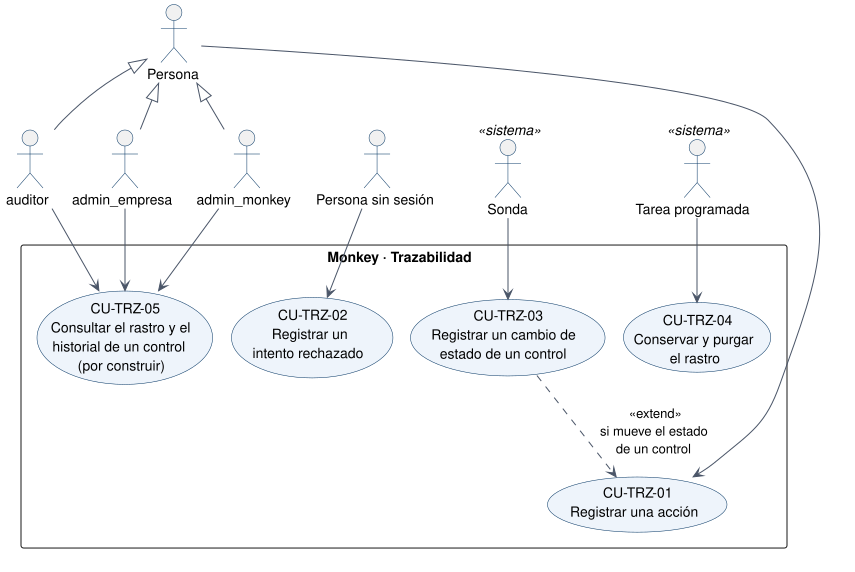

# Trazabilidad · casos de uso

Responde: **¿qué pasos siguen el sistema y cada actor para que quede constancia de una acción o de un cambio de estado,
qué puede salir distinto y en qué estado queda todo al terminar?** Cada caso realiza una o varias
[historias](04-historias.md); la secuencia técnica (transacciones, fotos antes y después) está en
[`03-flujos.md`](03-flujos.md) y la forma del rastro en
[`contracts/conventions.md`](../../../../../../contracts/conventions.md) («Auditoría»).

## Diagrama de casos de uso

Fuente del diagrama: [`05-casos-de-uso.puml`](05-casos-de-uso.puml) (PlantUML; se regenera con
`skills/process/monkey-docs/scripts/render-uml.sh`). «Persona» generaliza a los roles de Platform y a `admin_monkey`:
cualquiera de ellos dispara CU-TRZ-01 desde el módulo donde actúa. La sonda es un actor del sistema.

## Resumen

| ID | Caso | Actor principal | Historias |
|---|---|---|---|
| CU-TRZ-01 | Registrar una acción | Persona | HU-TRZ-01, HU-TRZ-02, HU-TRZ-06 |
| CU-TRZ-02 | Registrar un intento rechazado | Persona sin sesión | HU-TRZ-03 |
| CU-TRZ-03 | Registrar un cambio de estado de un control | Persona · sonda | HU-TRZ-04, HU-TRZ-05 |
| CU-TRZ-04 | Conservar y purgar el rastro | Sistema | HU-TRZ-07 |
| CU-TRZ-05 | Consultar el rastro y el historial de un control *(⚪ por construir)* | `auditor` · `admin_empresa` · `admin_monkey` | HU-TRZ-08, HU-TRZ-09 |

---

### CU-TRZ-01 · Registrar una acción

| | |
|---|---|
| **Actor** | Persona que hace una acción que cambia datos en cualquier módulo (crear un servicio, revisar una evidencia, iniciar sesión…) |
| **Precondición** | Sesión válida con su empresa (o una acción de plataforma de `admin_monkey`); el método del repositorio recibe un `AuditIntent` (D52) |
| **Postcondición** | El cambio de negocio y su fila de `audit_logs` confirmados juntos, o ninguno de los dos |

**Flujo principal**
1. La persona pide la acción.
2. El caso de uso arma el `AuditIntent`: `action` (`<recurso>.<verbo>`), recurso, estado anterior, IP y agente.
3. El repositorio abre la transacción con la empresa, el usuario y el rol de la sesión (`withScope`).
4. El repositorio escribe el cambio de negocio.
5. Si el cambio mueve el estado de un control, sigue **CU-TRZ-03** dentro de la misma transacción.
6. El repositorio escribe la fila del rastro con el estado anterior y el nuevo, sin `RETURNING`.
7. El sistema confirma la transacción y responde.

**Flujos alternos**
- 1a. El sistema cierra la sesión por inactividad, expiración o usuario inactivo → hoy no se escribe fila (DT-47).
- 3a. Acción de plataforma sin empresa (registrar una empresa) → la fila se escribe con `tenant_id` nulo.
- 4a. El cambio de negocio falla → se revierte todo; no queda fila de una acción que no ocurrió.
- 6a. La fila del rastro no se puede escribir → se revierte también el cambio y la respuesta es `500` `INTERNAL_ERROR`
  (D52, SEG-36).
- 6b. El intent contiene una credencial → no se guarda: el rastro lleva el `id` del recurso, nunca su secreto
  (`conventions.md`).
- 7a. Alguien intenta después editar o borrar la fila (incluido el dueño de la tabla) → la base lo rechaza (D41, SEG-33).
- 7b. Una sesión de otra empresa intenta leer o escribir la fila → RLS no se la muestra ni se la deja escribir (SEG-34).

### CU-TRZ-02 · Registrar un intento rechazado

| | |
|---|---|
| **Actor** | Persona sin sesión que intenta entrar o canjear una clave de acceso |
| **Precondición** | El intento falla en la validación (credenciales, clave) y no produce ningún cambio |
| **Postcondición** | Una fila con `result = error`, escrita de mejor esfuerzo; la respuesta al intento no depende de ella |

**Flujo principal**
1. La persona intenta iniciar sesión o canjear la clave.
2. El sistema rechaza el intento con el error del contrato correspondiente.
3. El sistema escribe aparte (`AuditLogWriter`) `auth.login_failed` o `access_key.redeem` con `result = error`, el
   `user_id` si la cuenta existe o el `attempted_email` si no, y `tenant_id` nulo (DT-29).

**Flujos alternos**
- 3a. Falla la escritura de la fila → la respuesta al intento sale igual; esa fila puede faltar (D52, punto 4).
- 2a. Una persona con sesión pide algo que su rol no puede (`403`) → hoy no se escribe fila (SEG-37 🟠).

### CU-TRZ-03 · Registrar un cambio de estado de un control

| | |
|---|---|
| **Actor** | Persona (veredicto, evidencia, exclusión, edición de un control) o la sonda (resultados de la evaluación automática) |
| **Precondición** | Una escritura que puede mover el estado de controles del servicio, dentro de su transacción (CU-TRZ-01 paso 5, o la entrega de resultados de la sonda) |
| **Postcondición** | Un evento en `compliance_events` por cada control cuyo estado o semáforo cambió, confirmado con la escritura |

**Flujo principal**
1. El sistema toma la foto de los estados de los controles del servicio antes de escribir.
2. Se escribe el hecho (veredicto, entrega o revisión de evidencia, exclusión aprobada, dimensiones del control, resultado
   de la sonda).
3. El sistema toma la foto de después y compara.
4. Por cada control cuyo estado o semáforo cambió, escribe un evento con el valor anterior, el nuevo, su causa y el actor
   (D91, SEG-63).

**Flujos alternos**
- 3a. Solo cambió el porcentaje, no el estado ni el semáforo → no se escribe evento (D91, punto 1).
- 4a. El actor es la sonda → `user_id`, `ip_address` y `user_agent` nulos: lo cambió el sistema (D91, punto 4).
- 4b. Falla la escritura del evento → se revierte la escritura que lo provocó (SEG-63, SEG-36).
- 2a. La escritura es conectar, dar de baja o reactivar un activo, desactivar una prueba, dar de baja un control o el
  vencimiento de una exclusión → hoy no se compara ni se escribe evento (DT-79); el estado mostrado sigue siendo
  correcto porque se deriva.

### CU-TRZ-04 · Conservar y purgar el rastro

| | |
|---|---|
| **Actor** | Sistema (la purga programada de una empresa archivada, D97) |
| **Precondición** | Rastro escrito por CU-TRZ-01 a CU-TRZ-03 |
| **Postcondición** | El rastro de una empresa activa sigue entero; el de una empresa archivada con plazo vencido ya no existe, salvo su rastro mínimo |

**Flujo principal**
1. Mientras la empresa está activa, su rastro permanece en la base viva, inmutable (D41, punto 3).
2. Si la empresa se archiva y vence su plazo, la tarea programada borra todo lo de la empresa, rastro incluido (D97).
3. Queda el rastro mínimo (nombre, fecha y hora, quién), sin datos del cliente (D97).

**Flujos alternos**
- 1a. Se restaura un respaldo → toda restauración termina volviendo a purgar lo listado en el rastro mínimo (D97).
- 1b. Se pide recuperar rastro de más de 35 días desde un respaldo → no es posible: los respaldos rotan a 35 días y no
  sostienen los 7 años (SEG-35 🟠, DT-84).

### CU-TRZ-05 · Consultar el rastro y el historial de un control *(⚪ por construir)*

| | |
|---|---|
| **Actor** | `auditor` o `admin_empresa` (su empresa); `admin_monkey` (el rastro de plataforma) |
| **Precondición** | Sesión válida; la matriz de §5.5 le da «Ver audit trail» |
| **Postcondición** | Solo lectura: nada cambia |

No hay contrato ni pantalla: los pasos, filtros y errores se escriben cuando exista su contrato en
`contracts/` (regla 6 de `CLAUDE.md`). Lo que ya fijan las fuentes: es de solo lectura, cada empresa ve solo lo suyo
(SEG-34) y el alcance «limitado» de `responsable` y `delegado` (§5.5) no está definido.
