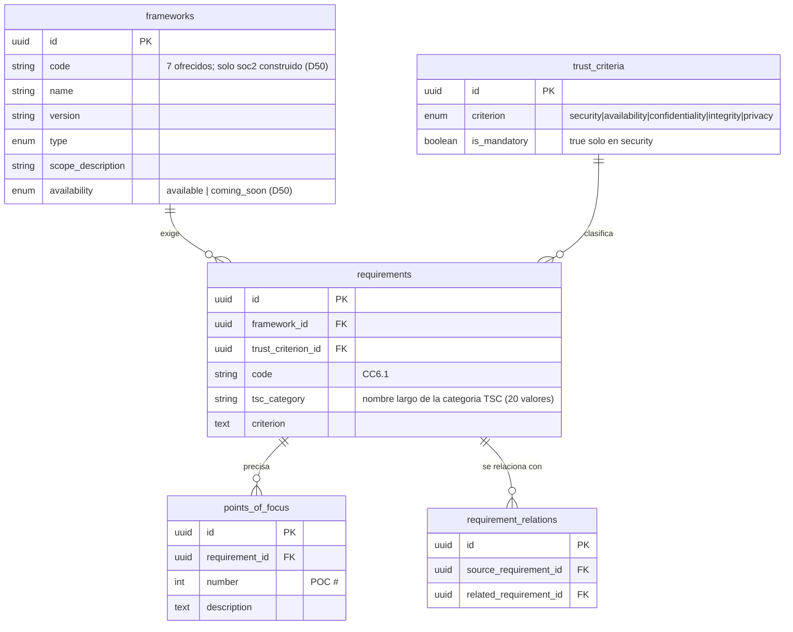
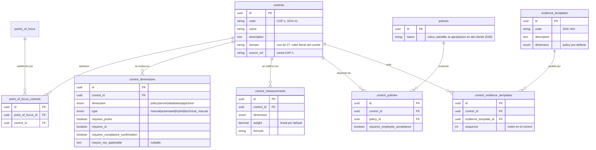
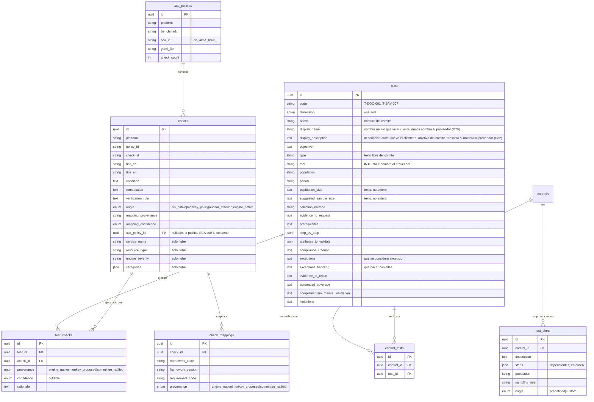
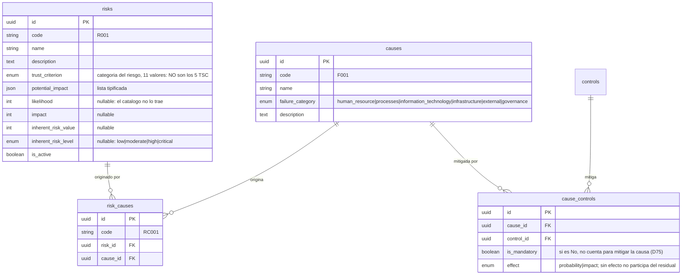
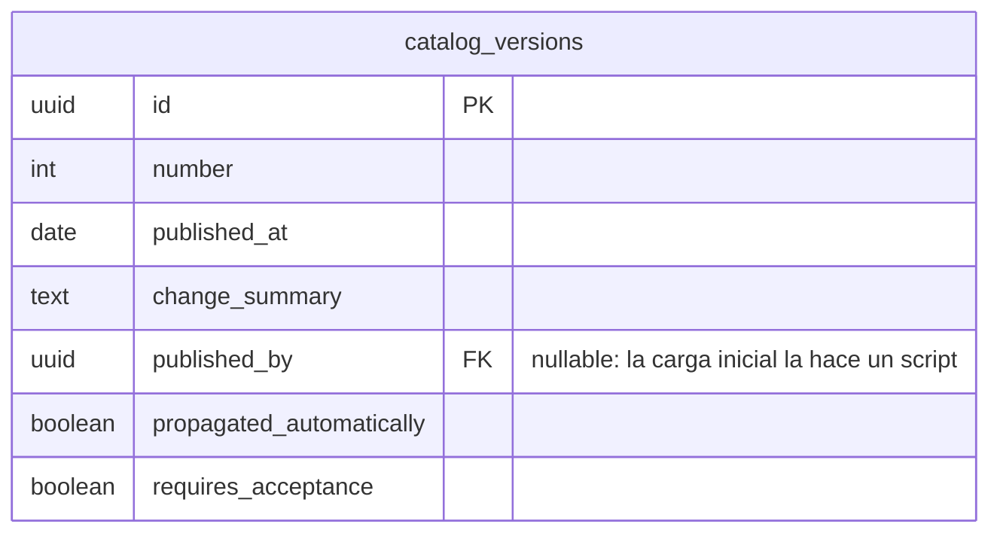

# Modelo de datos — §3 Catálogo maestro

> Parte de [`modelo-datos.md`](../modelo-datos.md) (índice). **Qué responde:** Marcos, requisitos, controles, tests, riesgos y causas; versionado y clonado. **Léelo:** Antes de tocar el catálogo, el control atómico o el clonado.
> Los números de sección (§) se conservan: cualquier cita a «§3» apunta aquí.

## 3. Catálogo maestro

**Qué es:** todo lo que Monkey administra y que existe **antes de que haya un solo cliente**
— los marcos con sus requisitos, los controles, los tests, los checks de la sonda, y el
catálogo base de riesgos y causas. Lo cura el equipo de Monkey desde Monkey Admin.

**Por qué importa:** cuando un cliente contrata un marco, no se le inventa nada: hereda este
catálogo y lo particulariza. Y como el catálogo cambia con el tiempo, se versiona.

### 3.1 El marco y sus requisitos

**El punto de enfoque es el punto de anclaje.** No se cuelga nada del marco ni del requisito
directamente: el control se vincula al **punto de enfoque**, que es el nivel de detalle
donde el estándar dice qué se espera.

### 3.2 El control y su desacople del marco

**El desacople es la regla estructural del modelo:** el control **no pertenece a ningún
marco**. Se vincula a puntos de enfoque (`N:M` vía `point_of_focus_controls`), y son los
requisitos los que pertenecen al marco. Datos reales que lo exigen: `MON-4` satisface `A1.1`,
`CC7.2` y `PI1.3` a la vez; la suma de controles por categoría TSC da 131 sobre 118 reales
*"porque varios controles sirven a varias categorías"*; y un solo check trae mapeo a **20
referencias** simultáneas.

**El dominio es del control, no del requisito, y son 27** (`controls.domain`, valor literal del
comité: "Gestión de Activos", "Monitoreo Continuo"…). En el Excel el dominio **cambia dentro de un mismo
requisito en 41 de los 61**, por eso no puede colgar del requisito; y no se deriva del prefijo del código
porque `AST` tiene dos dominios (D35). Prefijos de código: `AST`, `BCD`, `CAP`, `CFG`, `CHG`,
`CPL`, `DCH`, `GOV`, `HRS`, `IAC`/`IAO`, `IRO`, `MON`, `NET`, `SAT`, `TDA`…). Los más
cargados: Privacidad 17, Gobierno 13, Identificación y Autenticación 13.

**Un control depende de políticas y documentos**, no solo de tests: *"el control depende de
la aprobación de la política"*. Los documentos son `evidence_templates` (el comité vincula 89 a 67 de
los 119 controles, 50 documentos distintos; uno sirve a varios controles) y son de donde se
clonan las evidencias requeridas del cliente (§3.5, §7.3, D36).

> **Procedencia:** el catálogo de controles fue **extraído de Vanta** (119 registros,
> 25 ago 2026) y ampliado con los TEST y el mapeo propios. `CPL-1` es el único sin asignar
> porque **es la Descripción del Sistema**, no un control medible.

### 3.3 Tests, checks y plan de testeo

**`tests` es `N:M` con `controls`, y es deliberado.** `T-DOC-001` sirve a 103 controles: los 118
controles asignados y los 61 TEST producen **284 asignaciones** control↔TEST (de 1 a 7 pruebas por control,
2,4 de media). Modelarlo `N:1` duplicaría 61 tests en cientos de filas.

**La fuente de esas 284 es la hoja *Pruebas*** (columna *Controles relacionados*), que cubre las 61 pruebas
y los 118 controles. La matriz *Análisis TEST x Control* trae 248, de las que 27 citan `T-APP-001…006`, que
no existen en *Pruebas* — la propia hoja marca *"FALTAN 6"* — y contiene las otras 221 (D38). Por eso hoy
**la dimensión Aplicación no tiene ninguna prueba definida** (P9).

**Las pruebas son texto interno.** Nombran al proveedor del motor de monitoreo en 15 de sus 23 columnas
(`tool`, `automated_coverage`, `limitations`, `prerequisites`, `step_by_step`…) e incluso en 4 nombres:
ninguno de esos textos sale tal cual a la UI, a un reporte ni a un texto generado por IA (D70). Los campos
`population_size` y `suggested_sample_size` son **texto** porque en el Excel son frases ("Por determinar con
base en el inventario de proveedores"; "N<5 → 100%; si no, 10% de la población (mín. 5, máx. 25)"), no
enteros: el muestreo se guarda como dato y su cálculo se construye después (D8).

**Checks del motor de nube (D56).** El catálogo del motor de AWS (662 checks) se carga con `origin = engine_native`,
`platform = aws` y `policy_id = cloud_configuration` (el motor no agrupa en «políticas»; una constante conserva la clave de tres
partes). **El mapeo a SOC 2 no es check → requisito**: es check → **prueba** → control → punto de enfoque → requisito. El motor aporta
su propio check → requisito (`check_mappings`, `engine_native`, con el id normalizado: `cc_6_6` → `CC6.6`), que **no decide**. El
eslabón check → prueba (`test_checks`) lo asigna el comité; hasta que lo ratifique, Monkey lo **propone** (`monkey_proposed`) desde las
categorías del motor y los atributos de cada prueba T-CLD, y la confianza sube a `high` solo si el requisito SOC 2 que cita el motor
es alcanzable desde la prueba propuesta (dos fuentes independientes coinciden). **Un check sin prueba no se inventa: queda como
cobertura no alcanzada.** Gana siempre `committee_ratified`.

**La clave natural del check es de tres partes** (`platform` + `policy_id` + `check_id`) y el
catálogo es grande: **77 políticas, 11.352 checks, 18 plataformas** (Windows 8 políticas de
10 a Server 2025, macOS 12, Ubuntu 6, Debian 7, RHEL 6, más motores: PostgreSQL, MySQL, SQL
Server, Oracle, MongoDB, Apache, NGINX, IIS). El mapeo es **por política** (decisión D6): si
un activo corre una política sin mapeo, ese control queda **sin medir** para ese activo — no
se inventan equivalencias.

**El muestreo es dato, no texto** (decisión D8): *"N<5 → 100%; si no, 10% de la población
(mín. 5, máx. 25)"*. El cálculo de la muestra concreta se construye después; los campos se
guardan ahora.

**Cinco estados del check de la sonda** (distintos de los 4 del resultado de evaluación): `passed`, `failed`, `invalid`, `not_applicable` (llega como
`result` vacío) y `not_run`.

> **Cuidado con la palabra "prueba", que son tres cosas distintas:** los **61 TEST** de
> Monkey (`tests`), las **107 pruebas vinculadas** de Vanta y los **11.352 checks** de la
> sonda (`checks`). Más 89 vínculos a documentos (50 documentos distintos) y 16 vínculos a 10 políticas del catálogo de origen.
>
> **`ChecklistOs` se elimina** del schema y se reemplaza por `sca_policies` + `checks`.

### 3.4 Riesgos y causas (catálogo base)

**Los tres niveles se reutilizan**, y por eso las tres relaciones son `N:M`: 10 riesgos y 56
causas en el catálogo, unidos por 92 relaciones riesgo↔causa, y una causa como `F001`
apunta a cuatro controles distintos (209 aristas causa→control en total, sobre los 118 controles). **Diez de
las 56 causas no pertenecen a ningún riesgo** en la hoja del comité (F003, F004, F016, F020, F026, F034,
F042, F045, F053, F054): se cargan tal cual, sin asociar (P9).

**El riesgo cuelga del servicio, no del marco** (ver §7.2). Un riesgo no es "de SOC 2": es
del negocio del cliente, y los controles que lo mitigan sirven a los marcos que sea.

**El catálogo trae los riesgos sin evaluar.** La hoja *Riesgos* del comité define 10 riesgos con
su categoría e impactos potenciales, pero deja **probabilidad, impacto y nivel vacíos**: los
evalúa cada cliente sobre la matriz 5×5 (probabilidad × impacto: Bajo 1-4, Moderado 5-9, Alto
10-16, Crítico 17-25). Por eso esos cuatro campos son opcionales, y la categoría del riesgo
(`trust_criterion`) tiene **11 valores** — Confidencialidad, Integridad, Disponibilidad,
Privacidad, Cumplimiento, Seguridad, Continuidad, Terceros, Fraude, Reputación y Operación—,
que **no son los 5 TSC** de §3.1 pese al nombre de la columna (D33). Las causas se agrupan en 6
categorías de falla: recurso humano, procesos, tecnología de información, infraestructura,
externos y gobierno.

**Este catálogo es solo la plantilla.** Ningún cliente trabaja sobre `risks` ni `causes`: al
elegir marco se **copian** a `client_risks` y `client_causes` (§7.2) y ahí el cliente los
edita, agrega o elimina. Lo que un cliente cambie **solo lo ve él**; el catálogo y los demás
clientes no se enteran (decisión D28).

> "Riesgo residual" es un término del dominio y **se muestra** en la superficie (D80), explicado: es el riesgo que
> queda después del tratamiento, medido aparte del cumplimiento (D75).

### 3.5 Versionado del catálogo y qué se clona

**El catálogo se versiona y cada fila de `evaluations` guarda contra qué versión se midió**
(decisión A4). Sin eso, un histórico no es comparable y un número entregado a un auditor
puede cambiar solo — ya pasó una vez con la reclasificación de 223 checks.

**Qué se clona al escenario del cliente y qué no:**

| Elemento | ¿Se clona? |
|---|---|
| `controls` → `client_controls` | **Sí**, tabla propia: el cliente reescribe su interpretación (D3), **crea controles propios** (`control_id` nulo) y los **da de baja** (`is_active`). Ver D36 |
| `control_dimensions` → `client_control_dimensions` | **Sí** (D36): un control propio declara las suyas y cualquiera puede justificar `reason_not_applicable` |
| `risks` y `causes` → `client_risks` y `client_causes` | **Sí, en dos momentos distintos**, y con tablas propias del cliente (D28). El set base se clona **automáticamente** al elegir marco en el Componente 2 (§6.2), junto con sus relaciones (`client_risk_causes`, `client_cause_controls`); la **personalización** pasa después, en el módulo de Cumplimiento (§7.2), sin bloquear nada. Editar una copia jamás toca el catálogo ni a otro cliente |
| **`requirements` y `points_of_focus`** | **No se clonan — se referencian con FK real.** Viven en la misma base; `client_controls` y `service_frameworks` apuntan directo a ellos. Es texto de un estándar, no hace falta copiarlo |
| `evidence_templates` → `evidence_requirements` | **Sí** (D36): cada plantilla ligada al control se clona por control del cliente, con `source_ref` = código de la plantilla y responsable vacío. La evidencia de un control propio la define el cliente |
| `tests` | **No: se referencian con FK real** (`evaluations.test_id`, `exclusions.test_id`). El cliente no reescribe un test |
| `control_tests` → `client_control_tests` | **Sí** (D36): se copia el **vínculo** control ↔ test, no el test. Lo necesita un control propio y es lo que "cambiar los tests de un control requiere aceptación" (abajo) da por hecho |
| `control_measurements` | **No** (D2: peso lineal, sin configuración). Ausencia de fila = peso 1. Si D2 se revisa, se clonan entonces |

**Qué se propaga solo y qué requiere aceptación del consultor:**

| Tipo de cambio en el catálogo | Se propaga solo | Requiere aceptación |
|---|---|---|
| Corrección de redacción de un control | ✅ | |
| Control nuevo agregado al catálogo | ✅ | |
| Cambio en cómo se mide un control (peso, dimensiones, tests) | | ✅ |
| Control que se elimina del catálogo | | ✅ |
| Cambio en la procedencia o confianza del mapeo de un check | | ✅ |

**Y un control nuevo no baja el % del cliente a mitad de camino.** Entra a contar desde el
**siguiente periodo de evaluación** — el número del periodo en curso no se toca, aunque el
catálogo ya haya cambiado. Por eso `catalog_versions` guarda si cada cambio se propagó solo o
quedó pendiente de aceptación, y `service_frameworks` sabe desde qué periodo aplica cada
versión.

---
