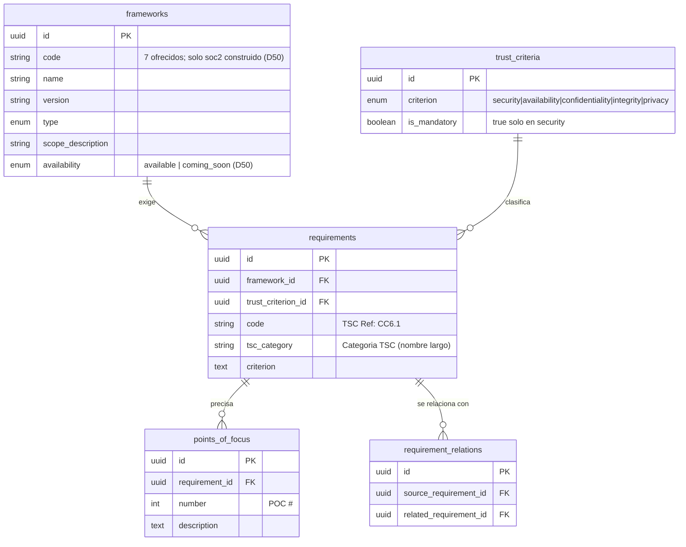
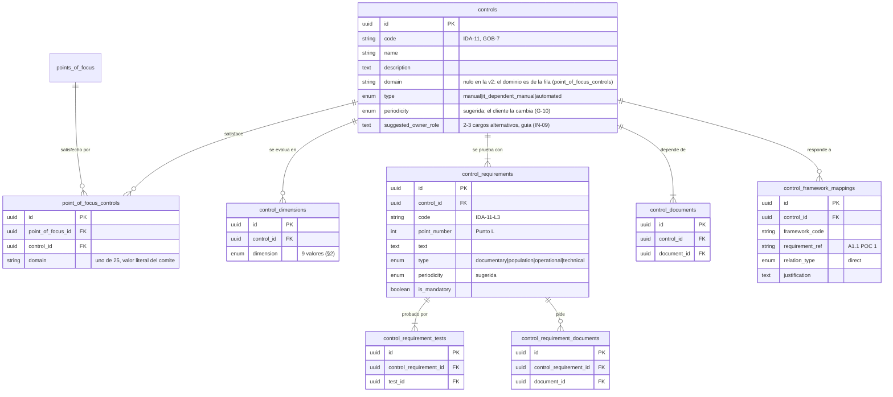
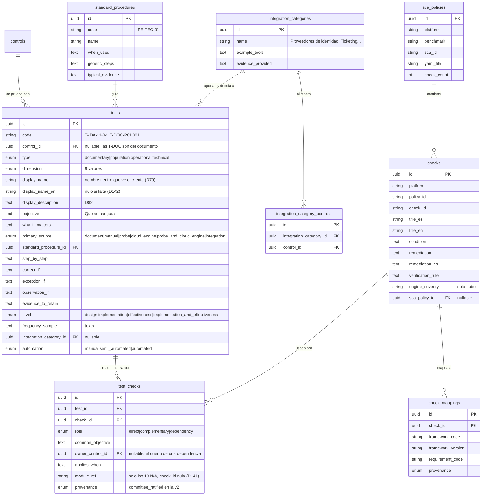
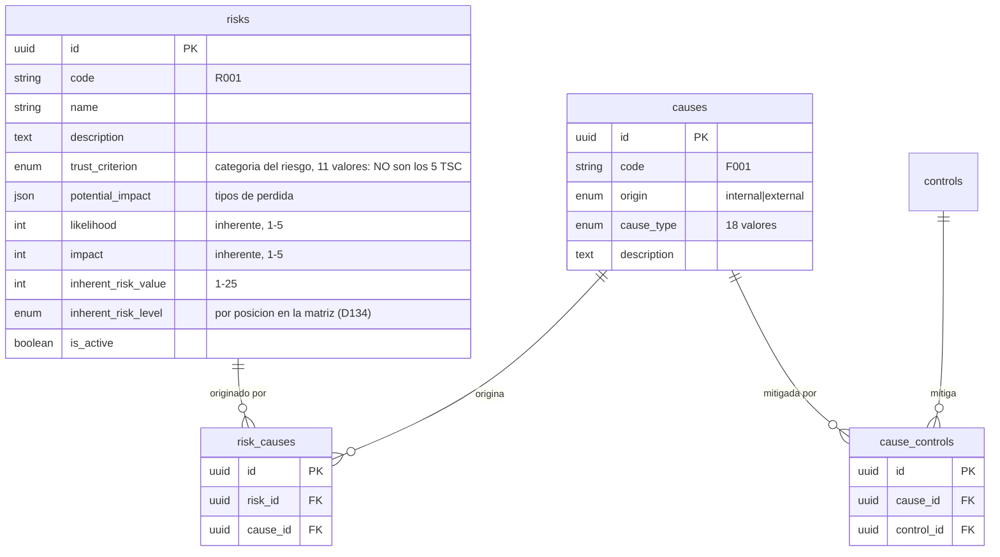
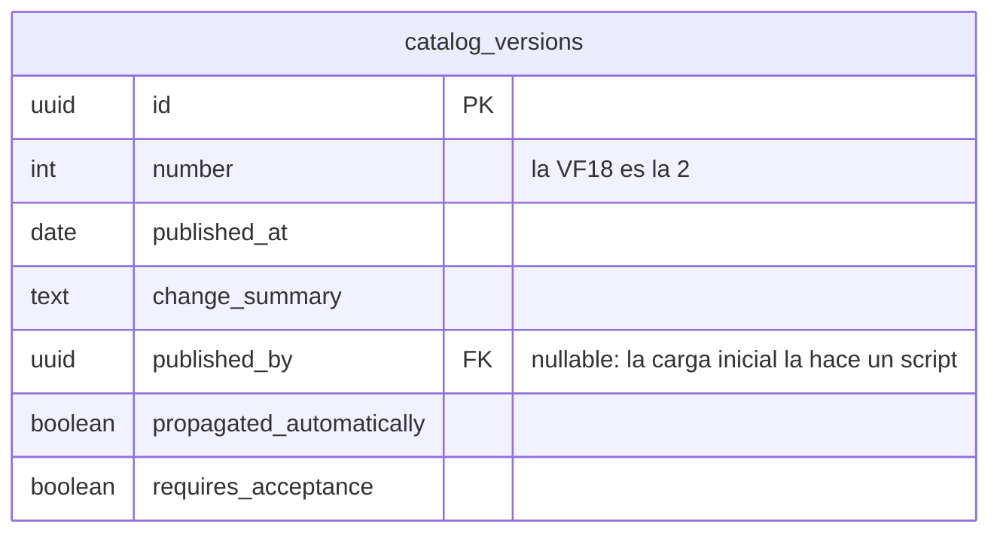

# Modelo de datos — §3 Catálogo maestro

> Parte de [`modelo-datos.md`](../modelo-datos.md) (índice). **Qué responde:** Marcos, requisitos, controles, requisitos del control, pruebas, checks, documentos, riesgos y causas; versionado y clonado. **Léelo:** Antes de tocar el catálogo, el control atómico o el clonado.
> Los números de sección (§) se conservan: cualquier cita a «§3» apunta aquí.

## 3. Catálogo maestro

**Qué es:** todo lo que Monkey administra y que existe **antes de que haya un solo cliente**: los marcos con sus
requisitos, los controles con sus requisitos del control, las pruebas y los checks que las automatizan, los
documentos sugeridos y el catálogo base de riesgos y causas. Lo cura el equipo de Monkey desde Monkey Admin.

**Por qué importa:** cuando un cliente contrata un marco no se le inventa nada: hereda este catálogo y lo
particulariza. Y como el catálogo cambia con el tiempo, se versiona.

**La fuente es la VF18 del comité, catálogo v2** (D128, D129). La tabla 7 de su hoja `01_DESARROLLO` mapea cada
columna del libro a una tabla de aquí; los nombres de las tablas nuevas están fijados en
el contrato de la carga ([`catalogo-maestro.md`](../../../../../../contracts/catalogo-maestro.md#carga-del-catálogo-v2-rc-01), RC-01, MD-491). Totales y reglas de integridad que la carga valida: §0.

### 3.1 El marco y sus requisitos

**Sin cambios en la v2:** 61 criterios TSC y 302 puntos de enfoque (`8_MATRIZ_MAESTRA`). **El punto de enfoque es
el punto de anclaje**: el control se vincula al punto de enfoque, no al marco ni al requisito. Cada punto de enfoque
tiene al menos un control (`IN-01`).

### 3.2 El control, sus requisitos y su desacople del marco

**El desacople es la regla estructural del modelo:** el control **no pertenece a ningún marco**. Se vincula a
puntos de enfoque (`N:M`): en la hoja `Controles Monkey` cada fila es la combinación control + criterio + punto
de enfoque, y el control se repite con los mismos datos (114 controles en 472 filas; `IN-08` exige que coincidan).
`control_framework_mappings` (`MAPEO_MARCOS`) registra a qué requisito de cada marco responde cada control: hoy
solo SOC 2 (472 filas, todas directas) y, después, ISO 27001 y los demás. Así una evidencia sirve en todos los
marcos donde el control aplica (P2 del libro).

**El requisito del control es la unidad de cálculo** (D129, §9). Son los puntos de la columna L («Documentos /
evidencias documentales requeridas»), uno por fila en la hoja `REQUISITOS`: 576, todos obligatorios, de cuatro
tipos (232 documentales, 244 operativos, 97 técnicos y 3 de población). Cada uno tiene al menos un test (`IN-04`).
**No confundirlo con `requirements`**, que es el criterio del marco.

**Del control:** el **tipo** (64 manuales,
12 manuales dependientes de TI, 38 automáticos: dice cómo opera y **no cambia el cálculo**), la **periodicidad
sugerida** (40 permanentes, 36 cuando sea requerido, 28 anuales, 4 semestrales, 3 mensuales, 3 trimestrales) y el
**rol responsable sugerido**, que es solo una guía: cada empresa asigna a sus usuarios (G-01). El **dominio** (25 valores literales) **es de la fila** control + punto de enfoque, no del control: 61 controles tienen 2 a 4 dominios distintos y `IN-08` no exige que coincidan (MD-491). Las **dimensiones**
vienen explícitas en las columnas «TEST …» de la hoja: el control aplica las que dicen «Definido» (las 114
aplican la documental). Desde MD-499 la carga suma además una fila por cada dimensión en que el control tenga pruebas y la hoja no marque (en la práctica `process`): 267 filas de «Definido» + 107 de `process` = **374** `control_dimensions`. La columna «EVALUACIÓN DE CONTROL» es un resultado por cliente y no se carga.

**Prefijos de código de la v2:** `ACT`, `AEV`, `CAP`, `CFG`, `CHG`, `CIF`, `CLI`, `CNT`, `CON`, `CPL`, `DCL`, `EQU`,
`FIS`, `GOB`, `IDA`, `INC`, `MNT`, `MOV`, `OPS`, `PRV`, `RED`, `RIE`, `RRH`, `TER`, `TRD`, `VUL`. No tienen equivalencia
oficial con los de la v1 (DEV-02).

**Un control depende de sus documentos.** Los 42 documentos del catálogo y sus 228 vínculos con controles están en
§11 (`catalog.documents`, D133): reemplazan a `policies` y a `evidence_templates` de la v1. Cada documento tiene su
prueba documental (`IN-05`).

### 3.3 Pruebas, procedimientos, integraciones y checks

**La prueba pertenece a un control** (D129): 430 pruebas `T-<control>-nn`, una o varias por requisito, y 42
documentales `T-DOC-…`, **una por documento**, que no llevan control y se vinculan por el documento. En total 472:
43 documentales (las 42 `T-DOC` más `T-OPS-1-01`), 38 de población, 237 operativas y 154 técnicas. Por dimensión:
proceso 275, documental 43, nube 36, BD 29, servidores 28, aplicación 23, red 22, endpoint 12, físico y ambiental 4.
`control_tests` (N:M de la v1) se retira: la relación es `tests.control_id` y, para lo que prueba cada una,
`control_requirement_tests` (161 pruebas cubren varios puntos de L, así que no cabe en una columna). Mientras el
código v1 siga vivo, la carga alimenta `control_tests` como puente (`contracts/catalogo-maestro.md`, MD-491).

**Procedimientos estándar** (`PROCEDIMIENTOS`, 8): `PE-DOC-01` documental, `PE-POB-01` población, `PE-TEC-01`
check automático, `PE-TEC-02` técnico manual, `PE-MUE-01` muestra operativa, `PE-ACC-01` listado de accesos,
`PE-EXC-01` evaluación de fallos e `PE-INT-01` evidencia por integración. **Categorías de integración**
(`INTEGRACIONES`, 14): proveedores de identidad, RR. HH., verificación de antecedentes, capacitación, control de
versiones, ticketing, MDM, escáneres de vulnerabilidades, logs y SIEM, gestores de contraseñas, nube, DLP,
finanzas y CRM, y consentimiento y cookies; cada una con los controles que alimenta y la evidencia que aporta.

**Las pruebas son texto interno.** 126 de las 472 nombran a los proveedores de la sonda o del motor de nube en
algún campo: nada de eso sale tal cual a la UI, a un reporte ni a un texto generado por IA. El cliente ve el nombre y
la descripción neutros que escribe Monkey (D70, D82) y la tabla 9 de `01_DESARROLLO` (D128). La columna `Estado`
de la hoja `TEST` no se carga.

**El rol del check** (D129, `TEST_CHECKS`, 4.684 vínculos para 117 pruebas): **Directo** (1.728: decide el
cumplimiento), **Complementario** (2.001: solo observación) o **Dependencia** (955: toma la conclusión del control
dueño, `owner_control_id`, sacado del objetivo común «dueño CIF-3»; `IN-06` exige que el check sea Directo en el
dueño). `applies_when` dice cuándo aplica («Cliente conecta AWS», «Agente con la política …»). **Un mismo check es
Directo en un solo control** (`IN-07`). Todos entran como `committee_ratified` (DEV-12): ya no hay propuestas de
desarrollo ni confianza calculada (D56). Diecinueve vínculos tienen check ID `N/A`: son módulos de la sonda o
puntajes globales, no checks. Se cargan con `check_id` nulo y `module_ref` (MD-491). Un módulo pasa si no hay hallazgos críticos ni altos abiertos; un puntaje, con 80 % o más (D141, D146).

**La clave del check** es plataforma + check ID en el motor de nube y política + check ID en la sonda (DEV-11); en
el modelo, `platform` + `policy_id` + `check_id`. `TEST_CHECKS` trae el **nombre** de la política y el cruce con
`sca_policies` se hace por ese nombre. Los catálogos: la **sonda 4.14.7** (11.352 checks, 77 políticas, 18
plataformas, con título en español para todos y remediación en español para 218) y el **motor de nube 5.45.0**
(1.621 checks en 20 plataformas: AWS, Azure, Microsoft 365, GCP, Kubernetes, Alibaba Cloud, Google Workspace,
Oracle Cloud, OpenStack, Cloudflare, Okta, E2E Networks, GitHub, Huawei Cloud, Vercel, Linode, MongoDB Atlas,
STACKIT, NHN Cloud y Scaleway, con su severidad). Ambos traen columnas de mapeo a otros marcos, que van a
`check_mappings`. **Solo cuenta para el cumplimiento un check vinculado en `TEST_CHECKS`**: lo demás es catálogo.

**Cinco estados del check de la sonda** tal como llegan: `passed`, `failed`, `invalid`, `not_applicable` y `not_run`.
Cómo se convierten en los estados del libro (PASS, FAIL, FAIL con excepción, No aplica, Sin datos): §9.

### 3.4 Riesgos y causas (catálogo base)

**Los tres niveles se reutilizan** y las relaciones son `N:M`: 10 riesgos y **100 causas** unidos por **551
relaciones** riesgo↔causa, y **771** causa→control. Todas las causas tienen riesgo y control, y todos los controles
tienen causa (`IN-02`, `IN-03`). La fuente de verdad de los dos vínculos es la hoja `Causas`; las relaciones ya no
tienen código. La causa tiene **origen** (84 internas, 16 externas) y **tipo** (18 valores: humano, procesos y
métodos, tecnológico…), y no tiene nombre corto: se muestra la descripción. `cause_controls` ya no lleva efecto ni
obligatoriedad: el residual se calcula por cobertura (D134).

**El riesgo trae su valoración inherente** (D134): probabilidad e impacto (en el libro son texto, «4 - Probable»: se
carga el número), su valor y su **nivel según la posición en la matriz**, no por rangos. Llega prellenada al
asistente de riesgos del servicio, donde el cliente la confirma o la ajusta. La categoría del riesgo
(`trust_criterion`) tiene **11 valores** — Confidencialidad, Integridad, Disponibilidad, Privacidad, Cumplimiento,
Seguridad, Continuidad, Terceros, Fraude, Reputación y Operación —, que **no son los 5 TSC** (D33); los 10 riesgos
usan siete. `potential_impact` son solo **tipos de pérdida** (comentario de la hoja `Riesgos`).

**El riesgo cuelga del servicio, no del marco** (§7.2), y **este catálogo es solo la plantilla**: al elegir marco se
copia a `client_risks` y `client_causes`, y lo que un cliente cambie solo lo ve él (D28).

### 3.5 Versionado del catálogo y qué se clona

**El catálogo se versiona y cada evaluación guarda contra qué versión se midió** (A4). **La v2 no convive con la
v1** (D128): el entorno de desarrollo se recrea y la v2 se carga sola, porque los datos que había son de prueba.
Las filas del catálogo todavía no llevan versión propia; hará falta cuando haya clientes reales y llegue una v3,
porque entre versiones se repiten códigos con otro significado.

**Qué se clona al escenario del cliente y qué no:**

| Elemento | ¿Se clona? |
|---|---|
| `controls` → `client_controls` | **Sí**: el cliente reescribe su interpretación (D3), crea controles propios, los da de baja y **cambia la periodicidad** con justificación (G-10). Ver §7 |
| `control_requirements` → los requisitos del control del cliente | **Sí**, por control del cliente: ahí viven su periodicidad configurada y su «No aplica» con justificación aprobada (§7). Reemplazan a `evidence_requirements`, que nacían de plantillas |
| `control_dimensions` → `client_control_dimensions` | **Sí** (D36) |
| `documents` → los documentos de la empresa | **Sí, por empresa y no por servicio**: un documento sirve a varios controles y servicios, con un responsable, versiones, aprobación y aceptación (§11, D133) |
| `risks` y `causes` → `client_risks` y `client_causes` | **Sí**, con sus relaciones, al elegir marco; la valoración inherente llega prellenada (D134) |
| `requirements`, `points_of_focus` y `tests` | **No: se referencian con FK real.** El cliente no reescribe un estándar ni una prueba |
| `test_checks`, procedimientos, categorías de integración, mapeo a marcos | **No**: son catálogo y se leen |

**Qué se propaga solo y qué requiere aceptación del `admin_empresa` (D96):**

| Tipo de cambio en el catálogo | Se propaga solo | Requiere aceptación |
|---|---|---|
| Corrección de redacción | ✅ | |
| Control nuevo | ✅ | |
| Cambio en cómo se mide un control (requisitos, pruebas, dimensiones, rol de un check) | | ✅ |
| Control que se elimina | | ✅ |

**Un control nuevo no baja el porcentaje a mitad de camino:** entra a contar desde el **siguiente período de
evaluación**.

---
