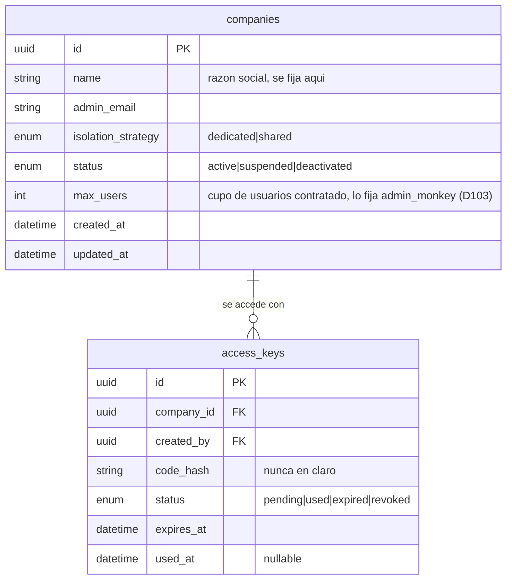

# Modelo de datos — §4 Monkey Admin

> Parte de [`modelo-datos.md`](../modelo-datos.md) (índice). **Qué responde:** Registro del tenant y aislamiento de datos. **Léelo:** Antes de tocar empresas, tenants, sesión o RLS.
> Los números de sección (§) se conservan: cualquier cita a «§4» apunta aquí.

## 4. Módulo Monkey Admin — registro del tenant

**Qué es:** la aplicación web separada, con dominio propio, donde el equipo de Monkey
registra empresas y cura el catálogo maestro. No comparte UI con Monkey Platform.

**Qué resuelve:** el cliente **nunca se auto-registra**. Monkey lo provisiona primero, fija
cómo se van a aislar sus datos, y le manda una clave para que entre.

### 4.1 Las tablas

**`max_users` (D103).** El modelo de negocio cobra por usuarios creados. `admin_monkey` lo fija al registrar la empresa y lo puede subir después. Cuentan las cuentas `active`, `pending` y `suspended` (de cualquier rol); desactivar libera el cupo. No se puede fijar por debajo de las cuentas que ya cuentan.

### 4.2 El flujo de registro

El formulario de Monkey Admin pide **3 campos**: nombre o razón social, un check de si
requiere base de datos dedicada, y el correo administrativo de la empresa. Al enviarlo:

1. Se crea `companies` con ese `name` y con `isolation_strategy` = `dedicated` si el check
   está marcado, `shared` si no.
2. Se genera una fila en `access_keys`, de un solo uso, con expiración.
3. La clave se envía **al `admin_email` capturado en el formulario** y **no se muestra en pantalla** (D99).
   Si el correo no sale, la empresa queda creada y `admin_monkey` pulsa «reenviar», que anula la clave
   pendiente y manda una nueva (`POST /v1/companies/{id}/access-key/regenerate`). Como solo se guarda el
   hash, la clave anterior no se puede volver a enviar.
4. El cliente usa la clave para crear su cuenta `admin_empresa` en Monkey Platform, **con el
   `admin_email` registrado aquí** (D43). La clave sirve una sola vez; después entra con correo y
   contraseña.
5. Arranca el onboarding (§6). El campo "nombre / razón social" del Componente 1 llega
   **precargado y bloqueado**: ya se fijó aquí.

### 4.2b Archivar y borrar una empresa (D97)

Una empresa se **archiva** (`status = deactivated`, con `deactivated_at` y `archive_until`) y, al vencer el plazo que eligió `admin_monkey` (6 meses por defecto), se **borra definitivamente** con todo lo suyo. Al archivar: sin accesos, sin motores y sin datos nuevos; usuarios, asignaciones y datos quedan guardados y se toma una copia cifrada. Reversible solo dentro del plazo; avisa a los `admin_monkey` 3 días antes (correo y app); los respaldos generales rotan a 35 días. Del borrado solo sobrevive el rastro mínimo (`company_purge_log`: nombre, fecha y hora, quién). Archivar, reactivar y borrar son seguros ante peticiones o réplicas simultáneas: la condición va en el `UPDATE` y la purga toma un candado por empresa. Contrato: `contracts/empresas.md`; requisito: SEG-68; enmienda a D41.

### 4.3 Aislamiento de datos (multi-tenancy)

**Es híbrido: la política del cliente es lo que lo motiva, pero la elección la hace
`admin_monkey`** al crear la empresa en Monkey Admin (decisiones D24 y D25). No es una regla
técnica interna que Monkey aplique sola, ni un campo del onboarding que el cliente rellene.

| Estrategia | Para quién | Cómo aísla |
|---|---|---|
| **`shared`** (por defecto) | El resto de los clientes | **Una sola base de datos** con el catálogo maestro y los datos de todos los tenants en el mismo esquema, aislados por **Row-Level Security sobre `tenant_id`** |
| **`dedicated`** | El cliente que por política propia exige separación total | Réplica completa del esquema (catálogo + sus datos) en su propia base, sin cruzar con nadie |

**Para el MVP no hay "plano central" en una base aparte** (decisión D25): catálogo y
escenario del cliente son tablas de la misma base, con **relaciones reales (FK)**. Si un
cliente le contrata SOC 2 a un servicio, `service_frameworks` referencia directo a
`frameworks` con una foreign key — no una copia ni una llamada entre bases. Son más tablas en
una sola base, pero es más simple de razonar y de consultar al tamaño del MVP.

**La base se llama `monkey`** (más `monkey_shadow` para la shadow de Prisma), y dentro lleva
**cuatro schemas de Postgres**, no por aislamiento —eso lo da RLS— sino para saber dónde vive
cada cosa sin adivinar:

| Schema | Qué contiene | RLS |
|---|---|---|
| `catalog` | El catálogo maestro (§3). Global, ninguna tabla lleva `tenant_id` | **solo de escritura**: cualquiera lo lee, únicamente `admin_monkey` lo modifica (D31) |
| `platform` | Monkey Admin y usuarios (§4, §5) | sí, todas: `companies` y `access_keys` por `admin_monkey` o por su propio tenant (D31) |
| `tenant` | Onboarding, Cumplimiento y Control Técnico (§6 a §9) | sí, todo |
| `audit` | `audit_logs` y `compliance_events`, con `REVOKE UPDATE, DELETE` y **triggers** que garantizan el append-only para todos los roles (D41) | sí (`audit_logs`: lo lee su tenant o `admin_monkey`) |

Las FK **cruzan schemas con normalidad**: `service_frameworks` en `tenant` referencia
`frameworks` en `catalog` con una foreign key real. Un schema es un namespace, no un perímetro.
La variable de conexión es `DATABASE_URL`; las `CENTRAL_DATABASE_URL` y
`TENANT_MIGRATION_DATABASE_URL` del código actual desaparecen con los dos planos.

La estrategia **se decide en el aprovisionamiento, no en el onboarding**, y queda como
columna de `companies` — no de `organizations`, que la crea el cliente después. No se
revierte sin migrar los datos. En el caso compartido, **el aislamiento lo garantiza la
política RLS de Postgres**, nunca un `WHERE tenant_id = ?` que dependa de que cada consulta
lo incluya.

### 4.4 Variables de sesión y reglas de integridad transversales

**Las tres variables que la app fija por transacción** (`set_config(..., true)`, nunca a nivel
de conexión, para que no se filtren a otra petición del pool):

| Variable | Qué es | Quién la lee |
|---|---|---|
| `app.tenant_id` | La empresa activa | Toda política de tenant |
| `app.user_id` | El usuario que actúa | La atribución de `audit_logs` y el autor de lo que se escribe. |
| `app.user_role` | Su rol (`admin_monkey`, …) | Escritura de `catalog`, lectura de `companies`/`access_keys`/`audit_logs` |

**Las búsquedas que ocurren antes de conocer el tenant** no pueden pasar por RLS (falla
cerrado). Cada una tiene una función `SECURITY DEFINER` angosta, que devuelve solo las
columnas que necesita y se ejecuta con `search_path` fijo (D29): `find_login_candidates`
(email → usuario), `find_access_key` (hash → clave), `find_session_by_token` (hash del refresh →
sesión) y `find_api_key` (hash → API key). Con el `company_id` que devuelven, la app fija
`app.tenant_id` y sigue con RLS normal. **Por eso `code_hash`, `refresh_token_hash` y `key_hash`
son únicos.**

**Reglas que RLS no puede imponer y que la aplicación cumple siempre:**

- Una FK no valida que el padre sea del mismo tenant (las comprobaciones de FK ignoran RLS).
  Antes de escribir una fila con FK a otra tabla de tenant, **se lee el padre con el cliente
  ya sujeto a RLS**: si no lo ve, no es suyo.
- `audit_logs` se escribe **dentro de la transacción de la acción** (D52, SEG-36) y **sin `RETURNING`** (`createMany` o SQL directo). Un `INSERT … RETURNING`
  exige que la fila nueva también pase la política de lectura, y una acción de plataforma sin
  tenant no la pasa.
- El `email` de `users` se guarda **en minúsculas** (hay un `CHECK`).
- `evaluations.service_id` debe ser el mismo que `client_controls.service_id` del control evaluado: no hay
  FK compuesta que lo imponga.

**Claves únicas que el modelo exige** (todas con índice; sin ellas el catálogo se duplica al
cargarlo y una regla de negocio depende de que nadie se equivoque):

| Tabla | Único sobre |
|---|---|
| `frameworks` | `code` + `version` |
| `requirements` | `framework_id` + `code` |
| `points_of_focus` | `requirement_id` + `number` |
| `requirement_relations` | `source_requirement_id` + `related_requirement_id` |
| `trust_criteria` | `criterion` |
| `controls` | `code` |
| `users` | `email` (global) |
| `access_keys` · `api_keys` · `sessions` | `code_hash` · `key_hash` · `refresh_token_hash` |
| `user_control_assignments` | `user_id` + `client_control_id` |
| `consultant_assignments` | `consultant_user_id` + `company_id` |
| `service_frameworks` | `service_id` + `framework_id` (un servicio contrata un marco una vez) |
| `client_controls` | `service_id` + `control_id` (se clona una vez por servicio; los propios, con `control_id` nulo, no chocan) y `service_id` + `own_code` |
| `evidence_requirements` | `client_control_id` + `code` |
| `client_control_dimensions` · `client_control_tests` | `client_control_id` + `dimension` · `client_control_id` + `test_id` |
| `evidence_templates` · `control_evidence_templates` | `code` · `control_id` + `evidence_template_id`, y `control_id` + `sequence` |
| `assets` | `organization_id` + `code` |
| `vulnerabilities` | `asset_id` + `cve` + `package_name` |
| `client_risks` · `client_causes` | `service_id` + `code`, y `service_id` + la plantilla de origen |

Además, toda tabla con RLS lleva un índice sobre `tenant_id` (o `company_id`): la política se
evalúa en cada consulta. **Toda FK lleva su índice** (Postgres no los crea solo), salvo las columnas
de "quién lo hizo" (`created_by`, `approved_by`, `assigned_by`…), que no se consultan por sí solas.
No hay ningún `ON DELETE CASCADE`: el histórico (`evaluations`, `findings`, `compliance_events`,
`audit_logs`) no se borra nunca, y un servicio con evaluaciones no se puede eliminar. Tampoco hay
`SET NULL` sobre quién actuó (`user_id`, `confirmed_by`, `approved_by`, `created_by`, `resolved_by`): tocar un usuario
no puede borrar la atribución de un registro inmutable, así que esas FK son `RESTRICT`.

**Datos de arranque:** `access_keys.created_by` es FK obligatoria a `users`, y `users.company_id`
también. Antes de crear la primera empresa hace falta una `companies` interna de Monkey y un primer
`admin_monkey` (seed). Sin eso el sistema no puede registrar a nadie. `catalog_versions.published_by`
es **opcional** (D35): la carga inicial del catálogo no necesita ningún usuario.

---
