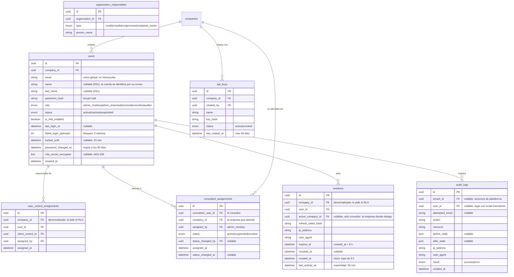

# Modelo de datos — §5 Usuarios

> Parte de [`modelo-datos.md`](../modelo-datos.md) (índice). **Qué responde:** Los 5 roles, tablas, políticas de seguridad, responsables y matriz de permisos. **Léelo:** Antes de tocar usuarios, roles o permisos.
> Los números de sección (§) se conservan: cualquier cita a «§5» apunta aquí.

## 5. Módulo Usuarios

**Qué es:** quién puede entrar, con qué rol, y qué controles tiene asignados dentro de su
empresa.

**Qué resuelve:** que el auditor no vea todos los tenants, que el control owner solo toque lo
suyo, y que la revocación de un acceso sea demostrable ante un auditor.

Definido y cerrado por el comité en su modelo de gestión de usuarios, transcrito en esta §5
(ver §0).

### 5.1 Los 5 roles

| Rol | Quién es | Alcance | MFA |
|---|---|---|---|
| `admin_monkey` | Equipo Monkey | Global: acceso de todos los tenants **y el catálogo maestro** | Sí |
| `admin_empresa` | CISO, Compliance Leader | Su empresa. **Aporta la evidencia; no la aprueba** (D84) | Sí |
| `funcional` | Control Owners | **Solo los controles asignados** | Sí |
| `consultor` | Consultor de Next (la empresa dueña de Monkey) que **prepara al cliente para la auditoría**. Una sola cuenta, que **crea y asigna `admin_monkey`** a las empresas que atiende | Todo el cumplimiento de **todos** los servicios de la empresa **en la que trabaja** (elige una de las asignadas), con vista técnica. **Da el veredicto de los tests documentales y manuales y aprueba los cambios de controles** | Sí |
| `auditor` | Quien audita el cumplimiento de la empresa dentro de Monkey (suele ser una persona externa a la empresa, pero su cuenta **pertenece a la empresa**) | Lectura de **todo** el cumplimiento de **todos** los servicios de su empresa + módulo de auditoría. **Registra observaciones**, igual que el consultor | Sí |

**Correcciones obligadas al enum actual** (`MONKEY_ADMIN`, `CLIENT_ADMIN`, `USER`, `VIEWER`):

- **Falta `auditor`.** `VIEWER` no sirve: el auditor **escribe** observaciones (§7.6).
- **`VIEWER` no existe** en el modelo del comité — decidir si se conserva.
- `USER` ≈ `funcional`, pero **le falta la asignación de controles**, sin la cual no hay
  "control owner".

### El auditor es un rol aparte (D63)

`auditor` es un **rol aparte**, con sus propios permisos y su propia experiencia al entrar. Esto fija seis cosas:

1. **Lo crea solo `admin_empresa`**, desde la gestión de usuarios de su empresa. `admin_monkey` no crea auditores.
2. **Su cuenta pertenece a la empresa** (`users.company_id`). Por eso ve únicamente su empresa y no existe ninguna
   excepción de aislamiento para él. Cuando termina su trabajo, la empresa lo desactiva (`status = inactive`, `CC6.3`).
3. **Ve todo el cumplimiento de su empresa, en solo lectura**: todos los servicios, sus controles, tests, evidencias,
   evaluaciones y el audit trail, con la **vista técnica** (códigos de requisito y de control, resultados por check).
4. **La vista técnica es del auditor** y del consultor y, desde D81 y mientras no se definan los permisos por pantalla (`P3`), también del `admin_empresa`. El `funcional` solo ve la vista de negocio: en qué está
   fallando y su porcentaje.
5. **Escribe observaciones** (§7.6), descarga evidencias y exporta reportes. Revisa la evidencia por su cuenta, en el momento de la auditoría (D84); no crea ni edita
   controles ni riesgos, y no ejecuta tests.
6. **MFA TOTP obligatoria** (§5.3). Entra al MVP; su ticket está aplazado de sprint, no descartado.

### El consultor prepara; el auditor certifica (D64)

**Consultoría** es preparar al cliente para la auditoría; **auditoría** es el examen final que da la certificación del marco. Hacen prácticamente
lo mismo, y el consultor prepara el terreno. Por eso `consultor` y `auditor` son dos roles hermanos, con una diferencia de origen:

1. **El consultor es de Next.** Es **una sola cuenta con un solo correo**, que **crea `admin_monkey` desde Monkey Admin** y asigna a las empresas que atiende (`consultant_assignments`). La asignación dura hasta que se quita. El **auditor**, en cambio, lo crea `admin_empresa` y pertenece a una sola empresa (D63).
2. **Al iniciar sesión elige en qué empresa trabajar y ve una a la vez.** Dentro de ella ve todo el cumplimiento de todos los servicios, con la vista técnica, y puede registrar observaciones y exportar reportes igual que el auditor (§7.6). El sistema comprueba su asignación en cada petición.
3. **La empresa puede cortarle el acceso.** `admin_empresa` ve qué consultores tiene asignados, en solo lectura, y puede suspender a uno (`CC6.3`).
4. **Da el veredicto** (cumple / no cumple) de los tests **documentales y manuales**. La IA sugiere y nunca decide (§7.5).
5. **Aprueba las exclusiones** que propone la empresa (§7.2, D78).
6. **Aprueba los cambios de controles que propone la empresa**: crear un control propio, darlo de baja y editar sus dimensiones o su interpretación (§7.1).
7. **MFA TOTP obligatoria**, como todos los roles (§5.3).

**Que `admin_monkey` no pueda crear controles no contradice que Monkey cure el catálogo**
(decisión D9): la matriz de permisos describe el **escenario del cliente**, donde Monkey no
le inventa controles a nadie. El catálogo maestro se administra en Monkey Admin (§3).

### 5.2 Las tablas

**`sessions`:** access token de 15 min; refresh token rotado en cada uso; la sesión se cierra a los **30 min sin actividad** (`last_activity_at`) y a las **8 h de creada** (`created_at`, `expires_at`), como pide §5.3. Las dos columnas se añadieron el 2026-09-30 (migración `platform_sessions_activity_tracking`): sin ellas el servidor no podía aplicar esa política.

**`consultant_assignments` es el único acceso entre empresas** (una excepción de RLS: el consultor ve las asignaciones propias sin importar el tenant activo). Su estado
es `active` (puede entrar), `suspended` (la empresa le cortó el acceso) o `revoked` (`admin_monkey` la retiró). Una asignación suspendida por la empresa no la reactiva `admin_monkey`:
solo la empresa. La cuenta del consultor vive en la empresa interna de Monkey (`users.company_id`), como la de `admin_monkey`. Elegir o cambiar de empresa queda en `audit_logs`.

**El estado del usuario no es cosmético:** `CC6.3` (deprovisioning) se cumple pasando el
usuario a `inactive` y cerrando su sesión. Es un control auditable, no una preferencia de UI.

**`user_control_assignments` apunta a `client_controls`, no a `controls`.** Un usuario es
responsable del control *de su empresa*, no del control del catálogo maestro.

> **Corregido el 2026-09-26 al auditar los contratos:** `users` no tenía ningún campo de
> nombre de persona, pero el modelo de usuarios del comité lo exige (*"Email,
> nombre, rol, empresa, controles asignados"*). Gana el documento del comité: se añaden `name`
> y `last_name`.
>
> **Después, D51 (2026-10-06) los volvió opcionales:** la cuenta se identifica por el correo y el nombre se completará en el
> perfil. La activación ya no los pide.

### 5.3 Políticas de seguridad de la plataforma

**Requisitos, no sugerencias.** Cada uno responde a una norma concreta, que es lo que lo hace
no negociable:

| Política | Valor | Por qué ese valor |
|---|---|---|
| Sesión | 30 min de inactividad, 8 h máximo | Reduce la ventana de una sesión robada |
| Contraseña — longitud | 12+ caracteres | NIST SP 800-63 |
| Contraseña — complejidad | mayúscula + minúscula + número + símbolo | Encarece la fuerza bruta |
| Contraseña — expiración | 90 días | Requisito SOC 2 |
| MFA | TOTP obligatoria para **los 5 roles** | Protege el acceso crítico |
| Cifrado en reposo | AES-256 (bcrypt+salt para contraseñas, secreto MFA cifrado) | Requisito NIST |
| Cifrado en tránsito | TLS 1.3 + HSTS | Requisito PCI DSS |
| Rotación de API keys | 90 días | Acota el daño de una key comprometida |
| Rate limiting | 100/min por usuario, 1000/min por empresa | Previene abuso y DoS |
| Retención del audit trail | 7 años, inmutable, append-only | SOC 2 Type II |
| IP whitelist | opcional, configurable | Control adicional de acceso |
| Bloqueo de cuenta | 5 intentos fallidos, 15 min | Previene fuerza bruta |

> **MFA es un requisito de seguridad sin excepciones.** Es TOTP con 10 códigos de recuperación y se exige en el ingreso de los 5 roles (D94); `MFA_REQUIRED=false` solo se admite fuera de producción.

La autorización se verifica **en cada request** (*"no confiar en el frontend"*), con caché de
5 min.

### 5.4 Responsables organizacionales

**Distinto del rol de aplicación:** el cargo responde ante el auditor, el rol dice qué puede
tocar en el sistema. Los cargos (`organization_responsibles.type`): **`coo`** (autoriza
accesos), **`it`** (ejecuta lo técnico), **`compliance`**, **`process`**, **`ciso`**,
**`asset_owner`**.

**El cargo y la persona viven ambos en el escenario del cliente**, en `organization_responsibles`
(`type` es el cargo, `person_name` quien lo ocupa hoy), y la persona puede cambiar sin tocar
quien apunta al cargo (decisión A1, precisada por D30: no existe un catálogo global de cargos). Hay responsable **por
nivel de objeto** — activo, control, cumplimiento y riesgo (§9).

---

### 5.5 Matriz de permisos

Lo que puede hacer cada rol. Parte de las 13 acciones del modelo de usuarios del comité y se completó con D63 y D64. El comité entrega un Excel con los
permisos **por pantalla**; cuando llegue, esta matriz se ajusta a él (P3).

| Acción | `admin_monkey` | `admin_empresa` | `funcional` | `consultor` | `auditor` |
|---|---|---|---|---|---|
| Crear empresa | ✓ | | | | |
| Crear usuario | ✓ | ✓ | | | |
| Crear usuario `auditor` | | ✓ | | | |
| Crear usuario `consultor` y asignarlo a una empresa | ✓ | | | | |
| Ver los consultores asignados y suspender uno | | ✓ | | | |
| Proponer un control propio, su baja o un cambio de sus dimensiones o interpretación | | ✓ | ✓ solo el suyo (cambios) | | |
| **Aprobar** esa propuesta | | | | ✓ | |
| Ver control | ✓ | ✓ | ✓ solo el suyo | ✓ | ✓ |
| Crear riesgo | | ✓ | | | |
| Ver riesgo | | ✓ | ✓ solo el suyo | ✓ | ✓ |
| Subir evidencia | | ✓ | ✓ | | |
| Aprobar evidencia | | ✓ | | | |
| Ver evidencia | | ✓ | ✓ solo la suya | ✓ | ✓ |
| Dar el veredicto de un test documental o manual | | | | ✓ | |
| Ejecutar test | | ✓ | ✓ solo el suyo | | solo lectura |
| Proponer una exclusión (de un activo, un test o un check) | | ✓ | | | |
| Aprobar una exclusión | | | | ✓ | |
| Vista técnica (códigos, requisitos, todas las pruebas y resultados por check; D81) | | ✓ | | ✓ | ✓ |
| Módulo de auditoría y registrar observaciones (§7.6) | | | | ✓ | ✓ |
| Responder una observación | | ✓ | ✓ solo de su control | | |
| Ver audit trail | ✓ | ✓ | limitado | ✓ | ✓ |
| Exportar reportes (PDF y Excel) | ✓ | ✓ | | ✓ | ✓ |
| Crear API key | | ✓ | | | |

Cuatro cosas que se leen mal si no se dicen:

- **`admin_monkey` no crea controles ni riesgos de un cliente**: administra la plataforma y el catálogo maestro, no el escenario de nadie.
- **`funcional` está siempre acotado a lo que tiene asignado** vía `user_control_assignments`.
- **El `auditor` ve toda su empresa y el `consultor` toda la empresa en la que trabaja** (D63, D64), sin restricción de asignación de controles. Cada uno revisa la evidencia por su lado y ninguno depende del otro; el auditor no ve la revisión del consultor (D84). La vista técnica la ve también `admin_empresa` (D81); el `funcional`, nunca.
- **La empresa propone y el consultor decide**: ni `admin_empresa` ni `funcional` pueden aplicar por sí solos un cambio de controles, una exclusión ni el veredicto de un test (D65, D78).

> ⚠️ El material del comité habla de **"34 permisos"**, pero la matriz que entregó tiene 13 acciones. No repetir "34 permisos" como si estuviera documentado aquí.

No hay roles personalizados: los 5 roles son fijos (D64).

### 5.6 Cómo el modelo de usuarios sostiene SOC 2

El propio modelo de acceso es evidencia para el marco. Mapeo del comité:

| TSC | Qué exige | Con qué se cumple |
|---|---|---|
| CC6.1 | Aprovisionamiento de accesos | `users` + `user_control_assignments` |
| CC6.2 | Derechos de acceso | La matriz de §5.5 |
| CC6.3 | Desaprovisionamiento | `users.status` a `inactive` + cierre de sesión |
| CC7.1 | Monitoreo del sistema | `audit_logs` inmutable |
| CC7.2 | Detección de actividad no autorizada | Registro de intentos de acceso denegados |
| CC7.3 | Detección de excepciones | Alerta ante 403 y cambios anómalos |
| CC9.1 | Autenticación | MFA TOTP + política de contraseña (§5.3) |
| CC9.2 | Gestión de cambios | `audit_logs` con estado antes y después |
| C1.2 | Confidencialidad | Aislamiento por tenant (§4.3) + AES-256 |

Es la razón por la que las políticas de §5.3 son requisitos y no preferencias: cada una responde
a un criterio que el auditor va a pedir.

---
