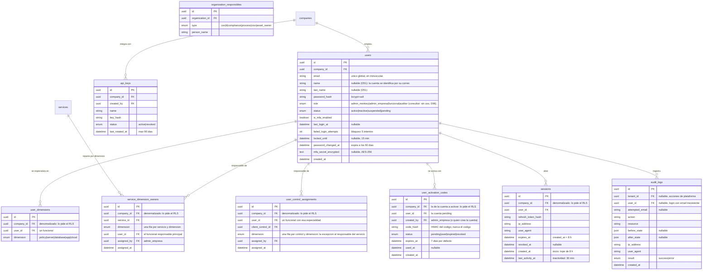

# Modelo de datos — §5 Usuarios

> Parte de [`modelo-datos.md`](../modelo-datos.md) (índice). **Qué responde:** Los 4 roles, la especialidad del funcional y el responsable por dimensión, tablas, políticas de seguridad, responsables y matriz de permisos. **Léelo:** Antes de tocar usuarios, roles o permisos.
> Los números de sección (§) se conservan: cualquier cita a «§5» apunta aquí.

## 5. Módulo Usuarios

**Qué es:** quién puede entrar, con qué rol, y qué parte del trabajo le toca dentro de su empresa.

**Qué resuelve:** que el auditor no vea todos los tenants, que el `funcional` solo toque lo suyo, que quien valida sea el experto de la empresa, y que la revocación de un acceso sea demostrable ante un auditor.

Definido por el comité en su modelo de gestión de usuarios (hoja «Modelo de Gestión usuarios» del TSC integral, ver §0) y ajustado por D96. **Ante una duda de roles y permisos manda esa hoja.**

### 5.1 Los 4 roles (D96)

| Rol | Quién es | Alcance | MFA |
|---|---|---|---|
| `admin_monkey` | Equipo Monkey | Global: registra empresas y su primer administrador, y administra **el catálogo maestro**. No entra al cumplimiento de un cliente (MD-146 le dará una vista de solo lectura) | Sí |
| `admin_empresa` | CISO, Compliance Leader: **el experto en compliance de la empresa** | Su empresa. **Valida la evidencia, da el veredicto de las pruebas manuales, decide las exclusiones, edita controles, riesgos y causas, invita a su equipo y reparte el trabajo por dimensión** | Sí |
| `funcional` | Quien ejecuta: sube la evidencia, arregla lo que falla en servidores, bases de datos, aplicación o nube | **Solo las pruebas de las que es responsable** (según su especialidad). No valida nada | Sí |
| `auditor` | Quien audita el cumplimiento de la empresa dentro de Monkey (suele ser una persona externa, pero su cuenta **pertenece a la empresa**) | Lectura de **todo** el cumplimiento de **todos** los servicios de su empresa + módulo de auditoría. **Registra observaciones.** No califica por ahora (`P35`) | Sí |

El enum `user_role` conserva un quinto valor, `consultor`, **sin uso** (D96): no se crea, no se asigna y no aparece en ninguna pantalla ni contrato.

**Quién crea a quién.** `admin_monkey` registra la empresa y su clave de acceso, y con ella entra el primer `admin_empresa` (D43). Desde ahí, **la empresa crea a su gente**: el `admin_empresa` invita a `funcional` y a `auditor`. `admin_monkey` no crea ni desactiva cuentas de una empresa; sí restablece el segundo factor del `admin_empresa` (D94).

### El `admin_empresa` es el experto en compliance (D96)

Sin consultor, lo que antes hacía un tercero lo hace la propia empresa a través de su administrador:

1. **Invita y desactiva** a `funcional` y `auditor` (desactivar es la baja, `CC6.3`).
2. **Reparte el trabajo por dimensión** (ver abajo) y reasigna controles puntuales.
3. **Valida la evidencia** de cada prueba manual, en **una sola revisión humana**: cumple, o rechaza con motivo. Una versión nueva no pisa la anterior. La IA sugiere y nunca decide (§7.5).
4. **Da el veredicto** de las pruebas manuales que no son documentales.
5. **Decide las exclusiones** de un activo en una prueba: las propone y las decide en un solo acto (§7.2, D96).
6. **Crea, edita y da de baja controles propios, riesgos y causas directamente**, con advertencia y confirmación (§7.1, `P33`). Dar de baja no borra: el historial y las evaluaciones inmutables se conservan.
7. Responde las observaciones del auditor.

Puede subir evidencia, pero **no es su foco**: eso lo hace el `funcional`. Que quien valida también pueda subir es un riesgo conocido (`P34`, `LATER`).

### El `funcional` y su especialidad (D96)

Un `funcional` tiene **una o más especialidades**, y una especialidad es una de las **cinco dimensiones** del modelo (`enums.md`, `dimension`): documental (`policy`), aplicación, servidores, bases de datos y nube. Es un **atributo de la persona, no un rol nuevo**: los roles siguen siendo cuatro y no hay roles personalizados.

**Por qué por dimensión y no por control.** Un control mezcla pruebas de varias dimensiones (el Excel tiene una columna de pruebas por dimensión en cada control), y quien lleva las políticas no es quien lleva los servidores. Asignar controles enteros obligaría a repartir a mano unos 600 pares control–dimensión. Además, la dimensión no depende del marco, así que sirve igual cuando lleguen ISO 27001 o PCI DSS.

**Cómo se reparte.**

- Cada **servicio** tiene **un responsable principal por dimensión**: un `funcional` con esa especialidad (`service_dimension_owners`).
- El `admin_empresa` puede asignar a otro `funcional` **un control puntual en una dimensión** (`user_control_assignments`); esa excepción manda sobre la del servicio.
- **El responsable efectivo** de un par (control, dimensión) es la excepción del control si existe; si no, el responsable del servicio para esa dimensión; si tampoco, nadie, y el administrador lo ve como «sin responsable». **No se guarda una fila por control**: cambiar al responsable del servicio cambia a todos los controles que no tienen excepción.
- Solo se puede asignar a un `funcional` que tenga esa especialidad.
- El `funcional` ve **su bandeja**: las pruebas de las que es responsable. Lo automático que falla en una dimensión le llega al responsable de esa dimensión. Un `funcional` sin responsabilidades no ve nada (no falla: lista vacía).

**Cómo llega una prueba manual a «cumple».** El `funcional` responsable sube la evidencia → queda **en revisión** → el `admin_empresa` valida o rechaza con motivo → si rechaza, el `funcional` rehace. Para una prueba técnica automática, el `funcional` corrige en la infraestructura y la siguiente corrida de la sonda lo confirma; si lleva validación manual complementaria, la valida el `admin_empresa`.

### El auditor es un rol aparte (D63, ajustado por D96)

`auditor` es un **rol aparte**, con sus propios permisos y su propia experiencia al entrar. Esto fija seis cosas:

1. **Lo crea solo `admin_empresa`**, desde la gestión de usuarios de su empresa, para una auditoría concreta. `admin_monkey` no crea auditores.
2. **Su cuenta pertenece a la empresa** (`users.company_id`). Por eso ve únicamente su empresa y no existe ninguna excepción de aislamiento para él. Cuando termina su trabajo, la empresa lo desactiva (`status = inactive`, `CC6.3`).
3. **Ve todo el cumplimiento de su empresa, en solo lectura**: todos los servicios, sus controles, tests, evidencias y el audit trail, con la **vista técnica** (códigos de requisito y de control, resultados por check).
4. **La vista técnica es del auditor y del `admin_empresa`** (D81, mientras no se definan los permisos por pantalla: `P3`). El `funcional` solo ve la vista de negocio: en qué está fallando y su porcentaje.
5. **Escribe observaciones** (§7.6), descarga evidencias y exporta reportes. **No valida** la evidencia, no crea ni edita controles ni riesgos, y no ejecuta tests.
6. **MFA TOTP obligatoria** (§5.3).

Su **calificación** (certificar o no el marco, D77) queda en pausa (`P35`): volverá según lo que pida el Excel.

**Que `admin_monkey` no pueda crear controles no contradice que Monkey cure el catálogo** (decisión D9): la matriz de permisos describe el **escenario del cliente**, donde Monkey no le inventa controles a nadie. El catálogo maestro se administra en Monkey Admin (§3).

### 5.2 Las tablas

**Sin uso (D96):** `consultant_assignments` y `sessions.active_company_id` existen (o existieron en el diseño) para un consultor que trabaja en varias empresas. Mientras no haya consultor, **nada del producto los toca** y no se construyen endpoints sobre ellos. No se borran: volver a usarlos se decide aparte.

**`sessions`:** access token de 15 min; refresh token rotado en cada uso; la sesión se cierra a los **30 min sin actividad** (`last_activity_at`) y a las **8 h de creada** (`created_at`, `expires_at`), como pide §5.3. Las dos columnas de actividad se añadieron el 2026-09-30 (migración `platform_sessions_activity_tracking`): sin ellas el servidor no podía aplicar esa política.

**`pending` y los códigos de activación (D95, D96).** Una cuenta que crea alguien más (la de `funcional` y `auditor`, que crea el `admin_empresa`) existe desde el alta en estado `pending`, con una contraseña imposible de adivinar (el hash de un secreto aleatorio que se descarta, con el mismo costo que uno real: desde fuera no se distingue de una contraseña mala), y **no puede iniciar sesión**. La persona la activa con un **código de un solo uso**, ligado al correo de la cuenta (`user_activation_codes`): pone su contraseña y la cuenta pasa a `active`, todo en una transacción. El código se guarda solo como HMAC, vence (7 días), se puede reemitir mientras la cuenta siga `pending` (el anterior queda `revoked`) y comparte el freno de intentos de las claves de acceso. Es el mismo mecanismo de la clave de acceso de una empresa (D43, D51), pero de una persona y no de una empresa.

**El estado del usuario no es cosmético:** `CC6.3` (deprovisioning) se cumple pasando el usuario a `inactive` y cerrando su sesión. Es un control auditable, no una preferencia de UI.

**`user_control_assignments` apunta a `client_controls`, no a `controls`, y lleva la dimensión.** Un usuario es responsable del control *de su empresa*, no del control del catálogo maestro, y de una dimensión de ese control. Hay **una fila por control y dimensión** como máximo.

> **Corregido el 2026-09-26 al auditar los contratos:** `users` no tenía ningún campo de nombre de persona, pero el modelo de usuarios del comité lo exige (*"Email, nombre, rol, empresa, controles asignados"*). Gana el documento del comité: se añaden `name` y `last_name`.
>
> **Después, D51 (2026-10-06) los volvió opcionales:** la cuenta se identifica por el correo y el nombre se completará en el perfil. La activación ya no los pide.

### 5.3 Políticas de seguridad de la plataforma

**Requisitos, no sugerencias.** Cada uno responde a una norma concreta, que es lo que lo hace no negociable:

| Política | Valor | Por qué ese valor |
|---|---|---|
| Sesión | 30 min de inactividad, 8 h máximo | Reduce la ventana de una sesión robada |
| Contraseña — longitud | 12+ caracteres | NIST SP 800-63 |
| Contraseña — complejidad | mayúscula + minúscula + número + símbolo | Encarece la fuerza bruta |
| Contraseña — expiración | 90 días | Requisito SOC 2 |
| MFA | TOTP obligatoria para **los 4 roles** (D66, D96: el Excel la deja en «No» para el `funcional`; por ratificar con el comité) | Protege el acceso crítico |
| Cifrado en reposo | AES-256 (bcrypt+salt para contraseñas, secreto MFA cifrado) | Requisito NIST |
| Cifrado en tránsito | TLS 1.3 + HSTS | Requisito PCI DSS |
| Rotación de API keys | 90 días | Acota el daño de una key comprometida |
| Rate limiting | 100/min por usuario, 1000/min por empresa | Previene abuso y DoS |
| Retención del audit trail | 7 años, inmutable, append-only (salvo una empresa dada de baja, D95) | SOC 2 Type II |
| IP whitelist | opcional, configurable | Control adicional de acceso |
| Bloqueo de cuenta | 5 intentos fallidos, 15 min | Previene fuerza bruta |

> **MFA es un requisito de seguridad sin excepciones.** Es TOTP con 10 códigos de recuperación y se exige en el ingreso de los 4 roles (D94); `MFA_REQUIRED=false` solo se admite fuera de producción.

La autorización se verifica **en cada request** (*"no confiar en el frontend"*), con caché de 5 min.

### 5.4 Responsables organizacionales

**Distinto del rol de aplicación:** el cargo responde ante el auditor, el rol dice qué puede tocar en el sistema. Y **distinto del responsable por dimensión** (§5.1): ese es una persona con cuenta que ejecuta pruebas; el cargo es quien responde ante el auditor. Los cargos (`organization_responsibles.type`): **`coo`** (autoriza accesos), **`it`** (ejecuta lo técnico), **`compliance`**, **`process`**, **`ciso`**, **`asset_owner`**.

**El cargo y la persona viven ambos en el escenario del cliente**, en `organization_responsibles` (`type` es el cargo, `person_name` quien lo ocupa hoy), y la persona puede cambiar sin tocar quien apunta al cargo (decisión A1, precisada por D30: no existe un catálogo global de cargos). Hay responsable **por nivel de objeto** — activo, control, cumplimiento y riesgo (§9).

---

### 5.5 Matriz de permisos

Lo que puede hacer cada rol. Parte de las acciones de la hoja «Modelo de Gestión usuarios» del comité (Tabla 2) y se ajustó con D63 y D96. El comité entrega un Excel con los permisos **por pantalla**; cuando llegue, esta matriz se ajusta a él (P3).

| Acción | `admin_monkey` | `admin_empresa` | `funcional` | `auditor` |
|---|---|---|---|---|
| Crear empresa | ✓ | | | |
| Ver y editar la configuración de la empresa | ✓ | ✓ | | |
| Crear (invitar) usuarios `funcional` y `auditor` | | ✓ | | |
| Editar, desactivar y reactivar usuarios de la empresa | | ✓ | | |
| Asignar especialidades y responsables por dimensión; reasignar controles | | ✓ | | |
| Gestionar la MFA de un usuario | ✓ solo al `admin_empresa` | ✓ a su equipo | | |
| Crear control propio, riesgo o causa | | ✓ | | |
| Editar control, riesgo o causa | | ✓ | | |
| Dar de baja control, riesgo o causa (con confirmación) | | ✓ | | |
| Ver control | | ✓ | ✓ solo los suyos | ✓ |
| Ver riesgo | | ✓ | ✓ solo los suyos | ✓ |
| Subir evidencia | | ✓ (no es su foco) | ✓ solo la de su dimensión | |
| **Validar (aprobar o rechazar) evidencia** | | ✓ | | |
| Ver evidencia | | ✓ | ✓ solo la suya | ✓ |
| Dar el veredicto de una prueba manual que no es documental | | ✓ | | |
| Ejecutar o relanzar una prueba | | ✓ | ✓ solo la suya | solo lectura |
| Decidir una exclusión (proponer y aprobar en un acto) | | ✓ | | |
| Vista técnica (códigos, requisitos, todas las pruebas y resultados por check; D81) | | ✓ | | ✓ |
| Módulo de auditoría y registrar observaciones (§7.6) | | | | ✓ |
| Responder una observación | | ✓ | ✓ solo de su control | |
| Ver audit trail | ✓ | ✓ | limitado | ✓ |
| Exportar reportes (PDF y Excel) | ✓ | ✓ | | ✓ |
| Crear API key y configurar conectores | ✓ | ✓ | | |
| Editar su propio perfil y configurar su propia MFA | ✓ | ✓ | ✓ | ✓ |

Cuatro cosas que se leen mal si no se dicen:

- **`admin_monkey` no crea controles ni riesgos de un cliente**: administra la plataforma y el catálogo maestro, no el escenario de nadie. El Excel le marca algunas acciones de lectura sobre el cumplimiento (ver control, evidencia, riesgo); hasta que MD-146 defina su vista de solo lectura, los endpoints de Cumplimiento le responden `403`.
- **`funcional` está siempre acotado a lo que es responsable** (§5.1): el responsable efectivo de cada par (control, dimensión). El Excel marca «editar control» y «editar riesgo» como ⊗ para el `funcional`; mientras `P3` siga abierta, **no edita**.
- **El `auditor` ve toda su empresa** (D63), sin restricción de asignación. No valida: el estado de una prueba lo mueve solo el `admin_empresa` (o la sonda). Su calificación queda en pausa (`P35`).
- **Nadie borra una evidencia**: las versiones nuevas no sobrescriben a las anteriores (REQ-018 del Excel). El Excel deja «eliminar evidencia» al administrador; aquí se traduce en una versión nueva o en una baja con rastro.

No hay roles personalizados: los 4 roles son fijos.

### 5.6 Cómo el modelo de usuarios sostiene SOC 2

El propio modelo de acceso es evidencia para el marco. Mapeo del comité:

| TSC | Qué exige | Con qué se cumple |
|---|---|---|
| CC6.1 | Aprovisionamiento de accesos | `users` + `user_dimensions` + `service_dimension_owners` + `user_control_assignments` |
| CC6.2 | Derechos de acceso | La matriz de §5.5 |
| CC6.3 | Desaprovisionamiento | `users.status` a `inactive` + cierre de sesión |
| CC7.1 | Monitoreo del sistema | `audit_logs` inmutable |
| CC7.2 | Detección de actividad no autorizada | Registro de intentos de acceso denegados |
| CC7.3 | Detección de excepciones | Alerta ante 403 y cambios anómalos |
| CC9.1 | Autenticación | MFA TOTP + política de contraseña (§5.3) |
| CC9.2 | Gestión de cambios | `audit_logs` con estado antes y después |
| C1.2 | Confidencialidad | Aislamiento por tenant (§4.3) + AES-256 |

Es la razón por la que las políticas de §5.3 son requisitos y no preferencias: cada una responde a un criterio que el auditor va a pedir.

---
