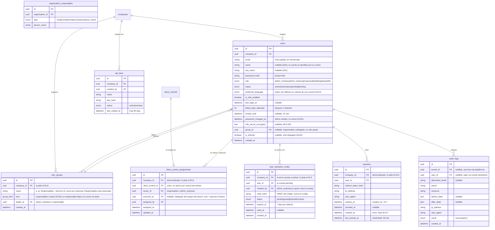

# Modelo de datos — §5 Usuarios

> Parte de [`modelo-datos.md`](../modelo-datos.md) (índice). **Qué responde:** Los 4 roles de empresa, los grupos, el dueño y el ejecutor de cada control, tablas, políticas de seguridad, cargos y matriz de permisos. **Léelo:** Antes de tocar usuarios, roles o permisos.
> Los números de sección (§) se conservan: cualquier cita a «§5» apunta aquí.

## 5. Módulo Usuarios

**Qué es:** quién puede entrar, con qué rol, y qué parte del trabajo le toca dentro de su empresa.

**Qué resuelve:** que el auditor no vea todos los tenants, que cada persona solo toque lo suyo, que quien valida sea el experto de la empresa, y que la revocación de un acceso sea demostrable ante un auditor.

Definido por el comité en su modelo de gestión de usuarios (hoja «Modelo de Gestión usuarios» del TSC integral, ver §0), ajustado por D96 y rediseñado por D102 (2026-11-03): la cadena de asignación es `admin_empresa` → `responsable` → `delegado`. **Ante una duda de roles y permisos manda esa hoja.**

### 5.1 Los roles (D96, D102)

| Rol | Quién es | Alcance | MFA |
|---|---|---|---|
| `admin_monkey` | Equipo Monkey | Global: registra y archiva empresas y su primer administrador, administra **el catálogo maestro** y fija el **cupo de usuarios** de cada empresa (D103). No entra al cumplimiento de un cliente (MD-146 le dará una vista de solo lectura) | Sí |
| `admin_empresa` | CISO, Compliance Leader: **el experto en compliance de la empresa** y líder de la cadena | Su empresa. **Crea a todo el equipo y sus grupos, asigna el dueño de cada control, ve todo, revisa y valida cualquier evidencia, decide las exclusiones y edita controles, riesgos y causas** | Sí |
| `responsable` | **Dueño** de los controles que el administrador le asigna; lidera un equipo | Solo **sus controles** (los suyos y los que ejecutan sus delegados). Sube evidencia, asigna ejecutor a su equipo y **revisa** lo que suben sus delegados | Sí |
| `delegado` | Miembro del equipo de un `responsable`; **ejecuta** los controles que su responsable le asigna | Solo los controles en los que es ejecutor. Sube evidencia y registra resultados; no revisa | Sí |
| `auditor` | Quien audita el cumplimiento de la empresa dentro de Monkey (suele ser una persona externa, pero su cuenta **pertenece a la empresa**) | Lectura de **todo** el cumplimiento de **todos** los servicios de su empresa, incluida la cadena (dueño y ejecutor de cada control) + módulo de auditoría. **Registra observaciones.** No califica por ahora (`P35`) | Sí |

**El `funcional` desapareció (D102):** su lugar lo ocupan el `responsable` (dueño) y el `delegado` (ejecutor). El «responsable» del modelo
anterior, el cargo ante el auditor, se llama ahora **cargo de la organización** (§5.4).

**Quién crea a quién.** `admin_monkey` registra la empresa y su clave de acceso, y con ella entra el primer `admin_empresa` (D43). Desde ahí,
**la empresa crea a su gente**: el `admin_empresa` crea `responsable`, `delegado`, `auditor` y otros `admin_empresa`; un `responsable` puede crear
`delegado` solo para su equipo. El `delegado` no crea a nadie. `admin_monkey` no crea ni desactiva cuentas de una empresa; sí restablece el segundo
factor del `admin_empresa` (D94).

**Cupo de usuarios (D103).** `companies.max_users` lo fija `admin_monkey`. Cuentan las cuentas `active`, `pending` y `suspended` de cualquier rol; una
`inactive` no. Al llegar al tope no se crea ni se reactiva a nadie (`USER_LIMIT_REACHED`).

### El `admin_empresa` es el experto en compliance (D96, D102)

1. **Crea y desactiva** a su equipo (desactivar es la baja, `CC6.3`) y organiza los **grupos**.
2. **Asigna el dueño de cada control**: a un `responsable` o a sí mismo. Es el único que lo hace y el único que lo reasigna. Un control sin dueño queda **«Sin asignar»**.
3. **Ve todo**, incluido cuántos controles tiene cada persona y su avance (sin tope).
4. **Revisa cualquier evidencia** y puede aprobarla o rechazarla encima de la revisión del responsable (ver abajo).
5. **Da el veredicto** de las pruebas manuales que no son documentales, con el mismo flujo de dueño y ejecutor.
6. **Decide las exclusiones** de un activo en una prueba (§7.2, D96).
7. **Crea, edita y da de baja controles propios, riesgos y causas** directamente, con advertencia y confirmación (§7.1, `P33`). Dar de baja no borra.
8. Responde las observaciones del auditor.

Puede subir evidencia, pero **no es su foco**. Que quien sube también revise es un riesgo conocido (`P34`, `LATER`): ninguna persona revisa lo que subió ella misma, salvo el `admin_empresa` cuando es dueño del control y quien sube.

### Grupos, dueño y ejecutor (D102)

- **Un grupo** (`user_groups`) tiene un nombre y un líder. El `admin_empresa` lidera uno o varios grupos de responsables (p. ej. «Responsables - Servicio IA»); cada `responsable` queda en el grupo «Responsables» y lidera **a lo sumo un** equipo de delegados, que **crea él cuando quiere** o el administrador por él (D104): no nace con su cuenta. **Cada persona pertenece a un solo grupo** (`users.group_id`). El tipo del grupo es `user_groups.kind` (`group_kind`: `responsables` o `team`) y un índice único parcial por `leader_id` donde `kind = 'team'` garantiza un solo equipo por responsable. Que un `team` lo lidere un `responsable` es una **invariante de aplicación** (un `CHECK` no cruza tablas): la mantiene la creación de grupos. Al migrar, si un responsable tenía varios equipos, el más antiguo conserva a todos los miembros y los demás quedan vacíos como grupos de responsables renombrados «… (fusionado n)»; nada se borra. Un delegado no existe sin equipo; sin equipo, la persona es un `responsable` que trabaja solo. Solo el `admin_empresa` mueve a un delegado de equipo.
- **La unidad de asignación es el control completo** (`client_controls`, que cuelga de un servicio). No hay dimensión ni especialidad: quien responde por un control responde por **todas** sus pruebas. Las personas son de la empresa, no de un servicio: el mismo control en el servicio A y en el B se asigna por separado, y un control nuevo llega sin dueño.
- **Dueño:** un `responsable` o el `admin_empresa`. **Ejecutor:** un `delegado` del equipo del dueño; si no hay, **ejecuta el dueño**. Un control tiene un dueño y a lo sumo un ejecutor.
- **Quién asigna:** el `admin_empresa` el dueño; el `responsable` el ejecutor, entre sus delegados. Un responsable no asigna a otro responsable; el administrador no asigna directo a un delegado. Al cambiar el dueño, el ejecutor se limpia.
- **La asignación es seguimiento, no un candado:** dueño, ejecutor y `admin_empresa` pueden subir evidencia y registrar resultados.
- **Baja:** al desactivar a alguien con controles se avisa y se pide confirmación. Un delegado desactivado deja sus controles con su dueño, sin ejecutor. Un responsable con delegados `active` o `pending` **no se puede desactivar**; sin delegados, sus controles quedan «Sin asignar». El historial se conserva.
- **`is_internal`:** al crear un delegado se marca si es de la compañía o externo; solo etiqueta, no cambia permisos.

**Cómo llega una prueba manual a «cumple».** El ejecutor (o el dueño, o el `admin_empresa`) sube la evidencia → queda **en revisión** → la revisa el `responsable` dueño (si no la subió él) y el `admin_empresa` puede revisar también. Si revisaron los dos, aprueban los dos; **cualquier rechazo gana** y quien subió rehace con una versión nueva. Si revisó solo uno y aprobó, está aprobada. Un control cumple cuando **todas** sus pruebas están en orden. Para una prueba técnica automática, el ejecutor corrige en la infraestructura y la siguiente corrida de la sonda lo confirma.

**Lo que ve cada uno (D102).** `responsable` y `delegado` ven **solo sus controles** y **el avance de lo suyo**, nunca el de la empresa ni la vista técnica. Su pantalla de entrada es «Mi trabajo». El `admin_empresa` ve todo y la carga de cada persona; el `auditor` ve todo y la cadena.

### El auditor es un rol aparte (D63, ajustado por D96)

`auditor` es un **rol aparte**, con sus propios permisos y su propia experiencia al entrar. Esto fija seis cosas:

1. **Lo crea solo `admin_empresa`**, desde la gestión de usuarios de su empresa, para una auditoría concreta. `admin_monkey` no crea auditores.
2. **Su cuenta pertenece a la empresa** (`users.company_id`). Por eso ve únicamente su empresa y no existe ninguna excepción de aislamiento para él. Cuando termina su trabajo, la empresa lo desactiva (`status = inactive`, `CC6.3`).
3. **Ve todo el cumplimiento de su empresa, en solo lectura**: todos los servicios, sus controles, tests, evidencias y el audit trail, con la **vista técnica** (códigos de requisito y de control, resultados por check).
4. **La vista técnica es del auditor y del `admin_empresa`** (D81, mientras no se definan los permisos por pantalla: `P3`). El `responsable` y el `delegado` ven solo la vista de negocio, de lo suyo.
5. **Escribe observaciones** (§7.6), que llegan al dueño y al ejecutor del control; descarga evidencias y exporta reportes. **No valida** la evidencia, no crea ni edita controles ni riesgos, y no ejecuta tests.
6. **MFA TOTP obligatoria** (§5.3).

Su **calificación** (certificar o no el marco, D77) queda en pausa (`P35`): volverá según lo que pida el Excel.

**Que `admin_monkey` no pueda crear controles no contradice que Monkey cure el catálogo** (decisión D9): la matriz de permisos describe el **escenario del cliente**, donde Monkey no le inventa controles a nadie. El catálogo maestro se administra en Monkey Admin (§3).

### 5.2 Las tablas

**`sessions`:** access token de 15 min; refresh token rotado en cada uso; la sesión se cierra a los **30 min sin actividad** (`last_activity_at`) y a las **8 h de creada** (`created_at`, `expires_at`), como pide §5.3. Las dos columnas de actividad se añadieron el 2026-09-30 (migración `platform_sessions_activity_tracking`): sin ellas el servidor no podía aplicar esa política.

**`pending` y los códigos de activación (D95, D96).** Una cuenta que crea alguien más (las de `responsable`, `delegado` y `auditor`, que crea el `admin_empresa`, o la de `delegado`, que también crea su `responsable`) existe desde el alta en estado `pending`, con una contraseña imposible de adivinar (el hash de un secreto aleatorio que se descarta, con el mismo costo que uno real: desde fuera no se distingue de una contraseña mala), y **no puede iniciar sesión**. La persona la activa con un **código de un solo uso**, ligado al correo de la cuenta (`user_activation_codes`): pone su contraseña y la cuenta pasa a `active`, todo en una transacción. El código se guarda solo como HMAC, vence (7 días), se puede reemitir mientras la cuenta siga `pending` (el anterior queda `revoked`) y comparte el freno de intentos de las claves de acceso. Es el mismo mecanismo de la clave de acceso de una empresa (D43, D51), pero de una persona y no de una empresa.

**El estado del usuario no es cosmético:** `CC6.3` (deprovisioning) se cumple pasando el usuario a `inactive` y cerrando su sesión. Es un control auditable, no una preferencia de UI.

**`client_control_assignments` apunta a `client_controls`, no a `controls`.** Un usuario es dueño o ejecutor del control *de su empresa* (que cuelga de un servicio), no del control del catálogo maestro. Hay **una fila por control del cliente**; sin fila el control está «Sin asignar». La tabla no guarda dimensión: se eliminaron `user_dimensions`, `service_dimension_owners` y la columna `dimension` (D102).

**Cupo.** `companies.max_users` (§4.1) limita las cuentas de la empresa que no están `inactive`.

> **Corregido el 2026-09-26 al auditar los contratos:** `users` no tenía ningún campo de nombre de persona, pero el modelo de usuarios del comité lo exige (*"Email, nombre, rol, empresa, controles asignados"*). Gana el documento del comité: se añaden `name` y `last_name`.
>
> **Después, D51 (2026-10-06) los volvió opcionales:** la cuenta se identifica por el correo y el nombre se completará en el perfil. La activación ya no los pide.

### 5.3 Políticas de seguridad de la plataforma

**Requisitos, no sugerencias.** Cada uno responde a una norma concreta, que es lo que lo hace no negociable:

| Política | Valor | Por qué ese valor |
|---|---|---|
| Sesión | 30 min de inactividad, 8 h máximo | Reduce la ventana de una sesión robada |
| Contraseña — longitud | 12+ caracteres | NIST SP 800-63 |
| Contraseña — complejidad | mayúscula + minúscula + número + símbolo | Encarece la fuerza bruta |
| Contraseña — expiración | No vence (D101). Cambio voluntario con contraseña actual + segundo factor; recuperación por correo + segundo factor | Fatiga de contraseñas (NIST SP 800-63B) |
| MFA | TOTP obligatoria para **todos los roles** (D66, D96, D102: se mantiene hasta que existan otras formas de ingreso) | Protege el acceso crítico |
| Cifrado en reposo | AES-256 (bcrypt+salt para contraseñas, secreto MFA cifrado) | Requisito NIST |
| Cifrado en tránsito | TLS 1.3 + HSTS | Requisito PCI DSS |
| Rotación de API keys | 90 días | Acota el daño de una key comprometida |
| Rate limiting | 100/min por usuario, 1000/min por empresa | Previene abuso y DoS |
| Retención del audit trail | 7 años, inmutable, append-only (salvo una empresa dada de baja, D97) | SOC 2 Type II |
| IP whitelist | opcional, configurable | Control adicional de acceso |
| Bloqueo de cuenta | 5 intentos fallidos, 15 min | Previene fuerza bruta |

> **MFA es un requisito de seguridad sin excepciones.** Es TOTP con 10 códigos de recuperación y se exige en el ingreso de todos los roles (D94, D102); `MFA_REQUIRED=false` solo se admite fuera de producción.

La autorización se verifica **en cada request** (*"no confiar en el frontend"*), con caché de 5 min.

### 5.4 Responsables organizacionales

**Se llama «cargo de la organización» (D102) para no confundirlo con el rol `responsable`.** Distinto del rol de aplicación: el cargo responde ante el auditor, el rol dice qué puede tocar en el sistema. Y **distinto del responsable por dimensión** (§5.1): ese es una persona con cuenta que ejecuta pruebas; el cargo es quien responde ante el auditor. Los cargos (`organization_responsibles.type`): **`coo`** (autoriza accesos), **`it`** (ejecuta lo técnico), **`compliance`**, **`process`**, **`ciso`**, **`asset_owner`**.

**El cargo y la persona viven ambos en el escenario del cliente**, en `organization_responsibles` (`type` es el cargo, `person_name` quien lo ocupa hoy), y la persona puede cambiar sin tocar quien apunta al cargo (decisión A1, precisada por D30: no existe un catálogo global de cargos). Hay responsable **por nivel de objeto** — activo, control, cumplimiento y riesgo (§9).

---

### 5.5 Matriz de permisos

Lo que puede hacer cada rol. Parte de las acciones de la hoja «Modelo de Gestión usuarios» del comité (Tabla 2) y se ajustó con D63 y D96. El comité confirmó el 2026-11-03 que no entregará el Excel de permisos por pantalla: esta matriz manda (D102).

| Acción | `admin_monkey` | `admin_empresa` | `responsable` | `delegado` | `auditor` |
|---|---|---|---|---|---|
| Crear empresa, archivarla y fijar su cupo de usuarios | ✓ | | | | |
| Ver y editar la configuración de la empresa | ✓ | ✓ | | | |
| Crear (invitar) `responsable`, `auditor` y otro `admin_empresa` | | ✓ | | | |
| Crear (invitar) `delegado` | | ✓ | ✓ solo de su equipo | | |
| Editar, desactivar y reactivar usuarios | | ✓ | | | |
| Crear grupos de responsables y mover un delegado de equipo | | ✓ | | | |
| Crear el equipo de delegados de un responsable | | ✓ | ✓ solo el suyo | | |
| Asignar el dueño de un control (a un responsable o a sí mismo) y reasignarlo | | ✓ | | | |
| Asignar el ejecutor de un control (un delegado de su equipo) | | | ✓ solo los suyos | | |
| Ver la carga de trabajo de cada persona | | ✓ | | | |
| Gestionar la MFA de un usuario | ✓ solo al `admin_empresa` | ✓ a su equipo | | | |
| Crear control propio, riesgo o causa | | ✓ | | | |
| Editar control, riesgo o causa | | ✓ | | | |
| Dar de baja control, riesgo o causa (con confirmación) | | ✓ | | | |
| Ver control y riesgo | | ✓ todos | ✓ solo los suyos | ✓ solo los que ejecuta | ✓ todos |
| Ver la cadena (dueño y ejecutor de cada control) | | ✓ | ✓ solo la suya | | ✓ |
| Subir evidencia | | ✓ | ✓ de sus controles | ✓ de los que ejecuta | |
| **Revisar (aprobar o rechazar) evidencia** | | ✓ cualquiera | ✓ la de sus controles que no subió él | | |
| Ver evidencia | | ✓ | ✓ de sus controles | ✓ de los que ejecuta | ✓ |
| Dar el veredicto de una prueba manual que no es documental | | ✓ | ✓ de sus controles | ✓ registra, no revisa | |
| Ejecutar o relanzar una prueba | | ✓ | ✓ solo la suya | ✓ solo la suya | solo lectura |
| Decidir una exclusión (proponer y aprobar en un acto) | | ✓ | | | |
| Ver las integraciones de la empresa, su estado y su detalle (D110) | | ✓ | | | ✓ solo lectura, las conectadas |
| Ver el catálogo de integraciones y conectar una (D110) | | ✓ | | | |
| Vista técnica (códigos, requisitos, todas las pruebas y resultados por check; D81) | | ✓ | | | ✓ |
| Porcentaje de cumplimiento | | ✓ el de la empresa | ✓ el de lo suyo | ✓ el de lo suyo | ✓ |
| Módulo de auditoría y registrar observaciones (§7.6) | | | | | ✓ |
| Responder una observación | | ✓ | ✓ de su control | ✓ de los que ejecuta | |
| Ver audit trail | ✓ | ✓ | limitado | limitado | ✓ |
| Exportar reportes (PDF y Excel) | ✓ | ✓ | | | ✓ |
| Crear API key y configurar conectores | ✓ | ✓ | | | |
| Editar su propio perfil y configurar su propia MFA | ✓ | ✓ | ✓ | ✓ | ✓ |

Cuatro cosas que se leen mal si no se dicen:

- **`admin_monkey` no crea controles ni riesgos de un cliente**: administra la plataforma y el catálogo maestro, no el escenario de nadie. El Excel le marca algunas acciones de lectura sobre el cumplimiento (ver control, evidencia, riesgo); hasta que MD-146 defina su vista de solo lectura, los endpoints de Cumplimiento le responden `403`.
- **`responsable` y `delegado` están siempre acotados a sus controles** (§5.1), sin dimensión. El Excel marcaba «editar control» y «editar riesgo» como ⊗ para el `funcional`; ninguno de los dos edita.
- **El `auditor` ve toda su empresa** (D63), sin restricción de asignación. No valida: el estado de una prueba lo mueven las revisiones del `responsable`, del `admin_empresa` (o la sonda). Su calificación queda en pausa (`P35`).
- **Nadie borra una evidencia**: las versiones nuevas no sobrescriben a las anteriores (REQ-018 del Excel). El Excel deja «eliminar evidencia» al administrador; aquí se traduce en una versión nueva o en una baja con rastro.

No hay roles personalizados: los roles son fijos. La matriz sustituye al Excel de permisos por pantalla (`P3`): el comité confirmó el 2026-11-03 que no se espera (D102).

### 5.6 Cómo el modelo de usuarios sostiene SOC 2

El propio modelo de acceso es evidencia para el marco. Mapeo del comité:

| TSC | Qué exige | Con qué se cumple |
|---|---|---|
| CC6.1 | Aprovisionamiento de accesos | `users` + `user_groups` + `client_control_assignments` + el cupo `companies.max_users` |
| CC6.2 | Derechos de acceso | La matriz de §5.5 |
| CC6.3 | Desaprovisionamiento | `users.status` a `inactive` + cierre de sesión |
| CC7.1 | Monitoreo del sistema | `audit_logs` inmutable |
| CC7.2 | Detección de actividad no autorizada | Registro de intentos de acceso denegados |
| CC7.3 | Detección de excepciones | Alerta ante 403 y cambios anómalos |
| CC9.1 | Autenticación | MFA TOTP + política de contraseña (§5.3) |
| CC9.2 | Gestión de cambios | `audit_logs` con estado antes y después |
| C1.2 | Confidencialidad | Aislamiento por tenant (§4.3) + AES-256 |

Es la razón por la que las políticas de §5.3 son requisitos y no preferencias: cada una responde a un criterio que el auditor va a pedir.

---
