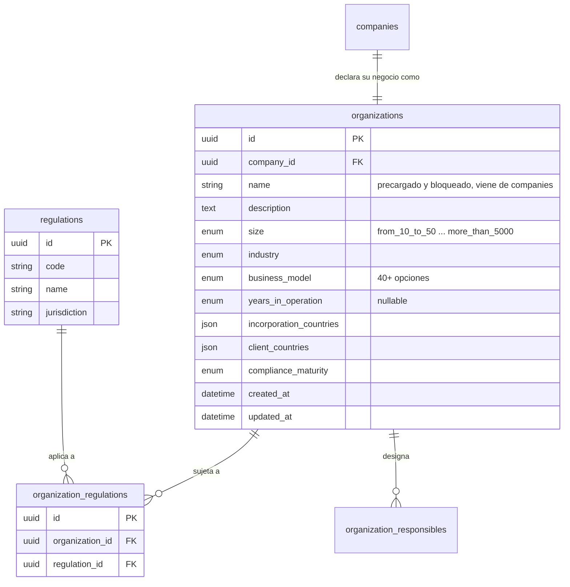
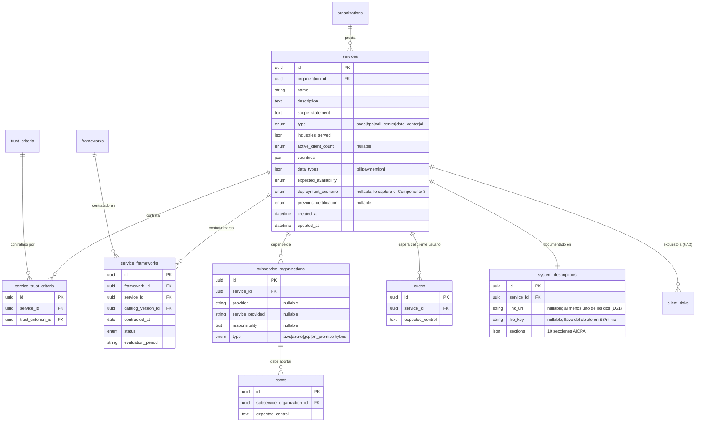
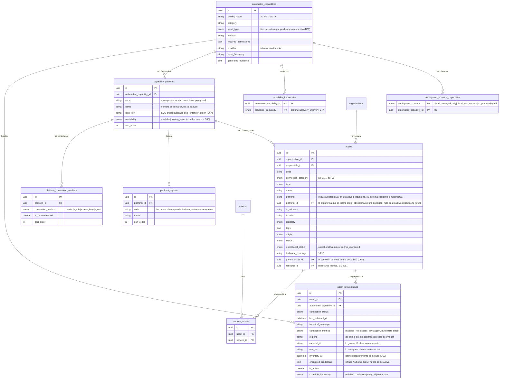

# Modelo de datos — §6 Onboarding

> Parte de [`modelo-datos.md`](../modelo-datos.md) (índice). **Qué responde:** Los 3 componentes que capturan el contexto del cliente. **Léelo:** Antes de tocar el onboarding.
> Los números de sección (§) se conservan: cualquier cita a «§6» apunta aquí.

## 6. Módulo Onboarding

**Qué es:** los 3 componentes que capturan el contexto del cliente antes de que exista ningún
cálculo de cumplimiento. Detalle campo por campo en `modulos/onboarding.md`.

**Qué resuelve:** sin organización y servicio declarados no hay nada que medir. Es el
único flujo del producto que es secuencial y obligatorio.

**Cumplimiento no es un 4º componente** (decisión D23, confirmada por el comité el
2026-09-26): al elegir marco en el Componente 2 el
catálogo se clona solo, y personalizarlo es un módulo aparte que no bloquea nada (§7).

### 6.1 Componente 1 — Contexto Organizacional

Se llena **una vez por empresa**. Diez campos: identidad, perfil y jurisdicción.

**`companies` y `organizations` son dos cosas distintas y conviene no fusionarlas.**
`companies` es el tenant: existe desde Monkey Admin, antes de que el cliente entre, y lleva
el aislamiento de datos. `organizations` es el contenido de negocio que el cliente declara
dentro de ese tenant. El `name` se fija en `companies` y se refleja bloqueado aquí.

**Los rangos numéricos se nombran con prefijo.** `size` y `active_client_count` son rangos
(«10-50», «1-10»…), y un valor de enum no puede empezar por dígito: se escriben
`from_10_to_50`, `from_51_to_200`, … `more_than_5000`. Las etiquetas que ve el usuario salen
de i18n, no del enum — la tabla de correspondencia está en `contracts/enums.md`.

> **Corregido el 2026-09-26:** `organizations` y `services` no llevaban `created_at`/`updated_at`
> mientras `companies` sí, sin razón. Se añaden por consistencia con la convención de fechas
> (`_at`). No es una decisión de producto, es la misma columna de auditoría del resto.

**`regulations` es tabla propia y no se puntúa** (decisión D10): nadie "contrata" la Ley
1581, pero sí determina qué le aplica. No entra al cálculo de cumplimiento.

> **Actualizado por D47:** el **cliente** sigue sin elegir un marco a nivel de empresa (no hay tal pregunta en
> este Componente 1), pero **Monkey Admin sí contrata el marco para la empresa al registrarla**
> (`platform.company_frameworks`, hoy solo SOC 2) y, al declarar un servicio, el cliente solo puede elegir
> entre los marcos que su empresa tiene contratados. Lo que dice el párrafo siguiente es la versión anterior.
>
> **Se vetó a propósito el campo "framework que desea gestionar" a nivel de empresa.** Los
> marcos se contratan **por servicio** — cada servicio puede perseguir uno distinto y no
> existe un framework "de la empresa". Esa pregunta vive en el Componente 2.

### 6.2 Componente 2 — Contexto del Servicio

Se llena **una vez por servicio** (un cliente puede declarar varios). Dieciséis campos,
incluida la carga de la Descripción del Sistema.

**El servicio es la unidad de evaluación.** Todo el cumplimiento se mide por par
(servicio × marco). No existe un porcentaje de la empresa (§9).

**`trust_criteria` son dos cosas y hay que separarlas.** El criterio en sí (los 5 TSC) es
**catálogo** — clasifica a los requisitos (§3.1). Qué criterios contrató un servicio concreto
es **escenario del cliente**, y va en el puente `service_trust_criteria`. Modelarlo como una
sola tabla colgada del servicio rompía la FK de `requirements`, que necesita apuntar al
criterio del catálogo, no a la contratación de un cliente.

El filtro funciona así: si el servicio no contrata `privacy`, los requisitos clasificados
como `P*` no entran a su cálculo. **`security` es obligatorio siempre.**

**`service_frameworks` es el disparador del clonado.** Al crearse esta fila, el catálogo de
ese marco (riesgos, causas, controles) se clona al escenario del cliente (§3.5). Guarda
también **contra qué versión del catálogo** (`catalog_version_id`) y **desde qué periodo**
(`evaluation_period`) aplica, que es lo que evita que un control nuevo mueva el número a
mitad de periodo.

**La regulación se declara solo a nivel de empresa** (D51, que revierte D45). `organization_regulations` dice a qué
normas de protección de datos está sujeta la empresa; **no hay `service_regulations`**: esas leyes aplican a la empresa,
no al servicio. No se puntúa (D10).

**La Descripción del Sistema se entrega con un enlace, un archivo o los dos** (D51): `system_descriptions.link_url` y
`file_key` (ambos opcionales, `CHECK` de que haya al menos uno). El archivo vive en S3 / minio; el modelo solo guarda la
llave. **Los marcos y sus categorías (D50):** `frameworks.availability` (`available` | `coming_soon`) distingue lo construido
de la oferta comercial. Hoy las categorías de los requisitos son las 5 de SOC 2 (`trust_criteria`); cuando se siembre otro
marco, cada marco usará las suyas (ISO 27001: 4 temas, PCI DSS: 12 requisitos, NIST CSF: 6 funciones): `trust_criteria` se
generaliza a dominios por marco (DT-38).

**`deployment_scenario` y el detalle del subservicio son opcionales al declarar el servicio** (D45):
el escenario de despliegue se captura en el Componente 3, así que no puede ser obligatorio al
crear el servicio; y de un proveedor solo el `type` es obligatorio (el "detalle" del Excel lo es).

**`csocs` y `cuecs` son tablas propias marcadas como no medibles por Monkey** (decisión D11).
Salen de las secciones 7 y 8 de la Descripción del Sistema. Existen porque el auditor los
pide, no porque Monkey los evalúe.

### 6.3 Componente 3 — Control Técnico

El cliente conecta su infraestructura real. **Nunca ve el nombre del proveedor del motor de
monitoreo**: se le habla de "sonda" o "capacidad automática".

**`assets` es lo que Monkey encuentra al conectar.** El cliente no declara cuántos activos tiene: los registra conectando
y ve lo que la conexión reconoció (D59). Se retiró el scope declarado (`scopes`, D60). **Cada recurso descubierto es un `asset` propio**, hijo de su
conexión de nube (`parent_asset_id`) y respaldado por su recurso técnico (`resource_id`); el servicio elige cuáles son suyos con `service_assets` (D61).

**El activo cuelga de la organización, no del servicio** (decisión A2). Un servidor puede dar
soporte a varios servicios y **no se duplica**: por eso existe el puente `service_assets`. Se
evalúa una vez y el resultado se lee desde cada servicio.

**Un aprovisionamiento nace inactivo** (`is_active = false`) y solo se activa al validar la
conexión: el flujo es conectar → validar → activar → programar. `encrypted_credentials` es
opcional porque las conexiones agentless no guardan credenciales.

**`operational_status` es un enum, no un booleano:** 🟢 `operational` · 🟡 `warning` ·
🔴 `error` · ⚪ **`not_monitored`**. Regla del comité: **"Automatizado ≠ Operativo"**.

**El `deployment_scenario` del servicio determina qué conexiones se le ofrecen:**

| Código | Categoría | Plataformas que el cliente elige | Método | Frecuencia |
|---|---|---|---|---|
| `ac_01` | Servicios cloud gestionados | AWS, Azure, GCP, Microsoft 365, Google Workspace | API / OAuth read-only | **6-24 h** |
| `ac_02` | Servidores en nube / VPS | Linux, Windows, HP-UX, AIX, Solaris | Agente ligero o agentless | **Continuo** |
| `ac_03` | BD en nube | PostgreSQL, MySQL, SQL Server, Oracle, MongoDB | Agente + usuario read-only | Continuo |
| `ac_04` | Servidores on-premise | Linux, Windows, HP-UX, AIX, Solaris | Agente ligero | Continuo |
| `ac_05` | BD on-premise | PostgreSQL, MySQL/MariaDB, SQL Server, Oracle, MongoDB | Agente + usuario read-only | Continuo |
| `ac_06` | **Endpoints / estaciones de trabajo** | Windows, macOS, Linux | Agente ligero | Continuo |

**El cliente elige una plataforma, no una categoría (D67).** Es lo que muestra la pantalla, como un marketplace: cada plataforma con su logo y su propio paso a paso. En servidores y
equipos la plataforma es el **sistema operativo**; en bases de datos, el **motor**. Dónde vive (EC2, Azure VM, RDS, Cloud SQL, Atlas, un VPS) lo dice el escenario, no la plataforma:
así lo define la hoja del comité. Cada plataforma tiene `availability`: solo las `available` se pueden elegir, las `coming_soon` se muestran **bloqueadas**. Hoy solo AWS está disponible.

**Las reglas del paso 3 son datos, no constantes de código (D67):** qué conexiones ofrece cada escenario (`deployment_scenario_capabilities`; «híbrido» son sus seis filas), con qué
frecuencia corre cada una (`capability_frequencies`), qué canales admite cada plataforma (`platform_connection_methods`; el recomendado va marcado), qué regiones puede declarar el
cliente (`platform_regions`) y qué tipo de activo produce cada conexión (`automated_capabilities.asset_type`). Todas viven en `catalog`: se leen libre y solo `admin_monkey` las escribe
(SEG-06), y nacen con las políticas del catálogo (SEG-05). Los enums que comparten catálogo y tenant (`connection_method`, `schedule_frequency`, `asset_type`) son del Backend: dónde se
declaran es un detalle de `schema-implementacion.md`.

Solo nube → `ac_01` · nube con servidores → `ac_01`+`ac_02`+`ac_03` · on-premise → `ac_04`+`ac_05`+`ac_06` · híbrido → **las seis** (el cliente usa las que le sirvan, D46).

**El tipo del activo se deduce de la conexión** con que se registra (D46; hoy en `automated_capabilities.asset_type`, D67): `ac_01` servicio en nube ·
`ac_02`/`ac_04` servidor · `ac_03`/`ac_05` base de datos · `ac_06` endpoint. El cliente ya no declara cuántos
activos tiene (D60): los ve al conectar.

**Honestidad: Automatizado ≠ Operativo.** Mientras no haya una sonda real, una conexión no puede declararse
`operational`: la comprobación está `unavailable` (503, el activo sigue `pending`) o `simulated` (solo
desarrollo y demostración, el activo queda en `warning`). Ver D46 y `deuda-tecnica/README.md` DT-1.

**El flujo de cada conexión es conectar → validar → activar → programar.**

> **Cambios al schema:** el enum de `assets.type` gana `application`, `documentation` y
> `endpoint`. `network_device` y `endpoint` se monitorean pero **no son dimensiones**.

---
