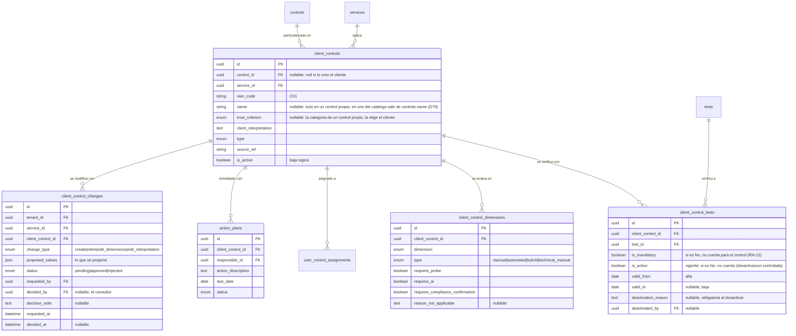
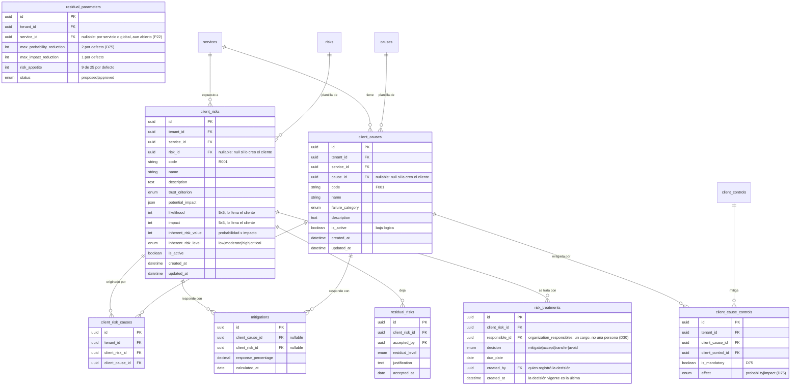
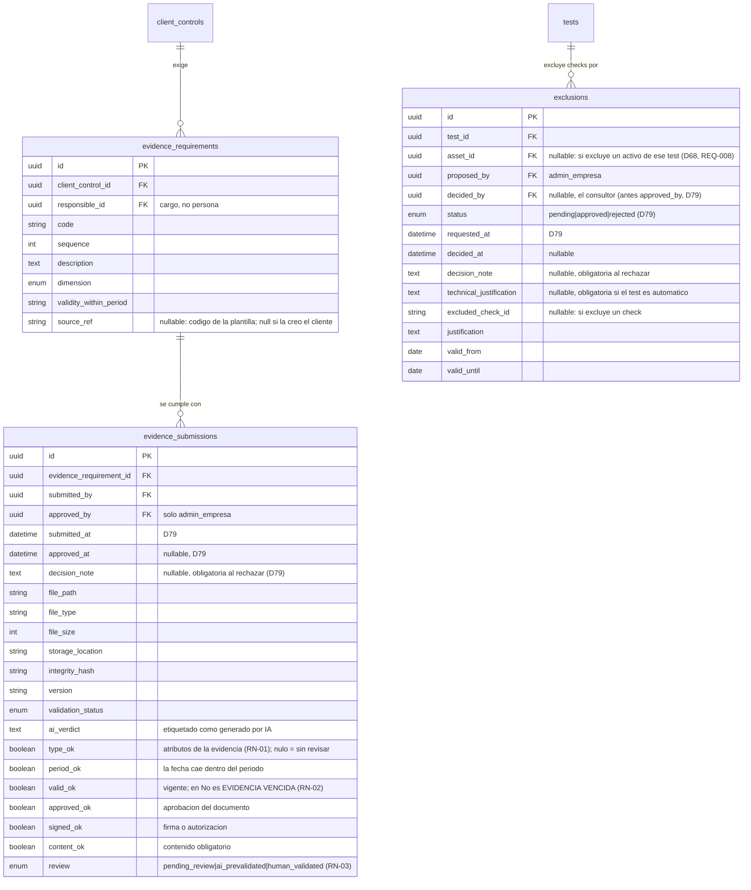
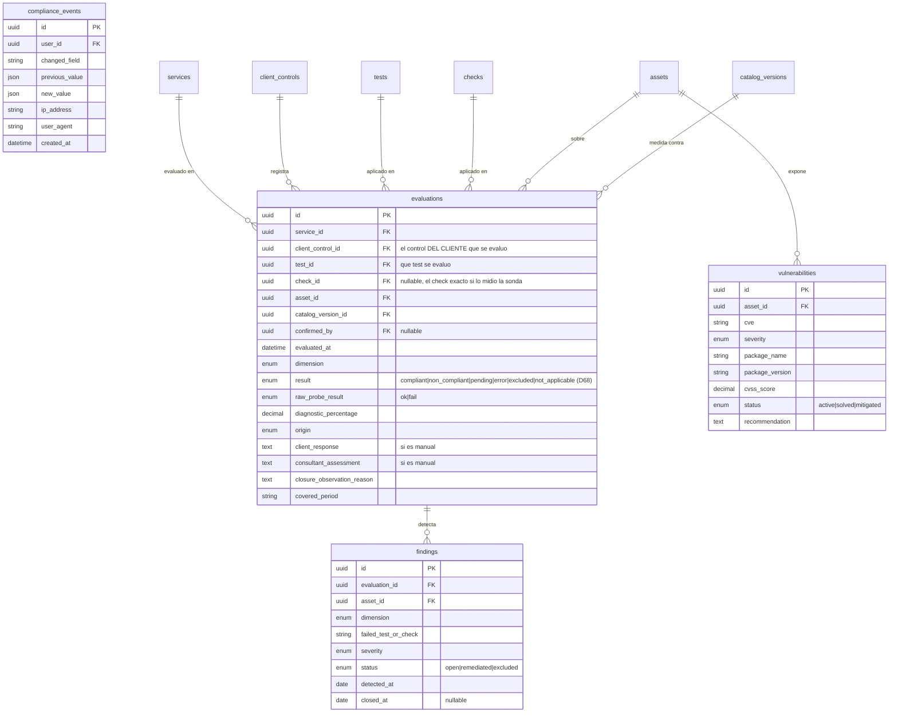
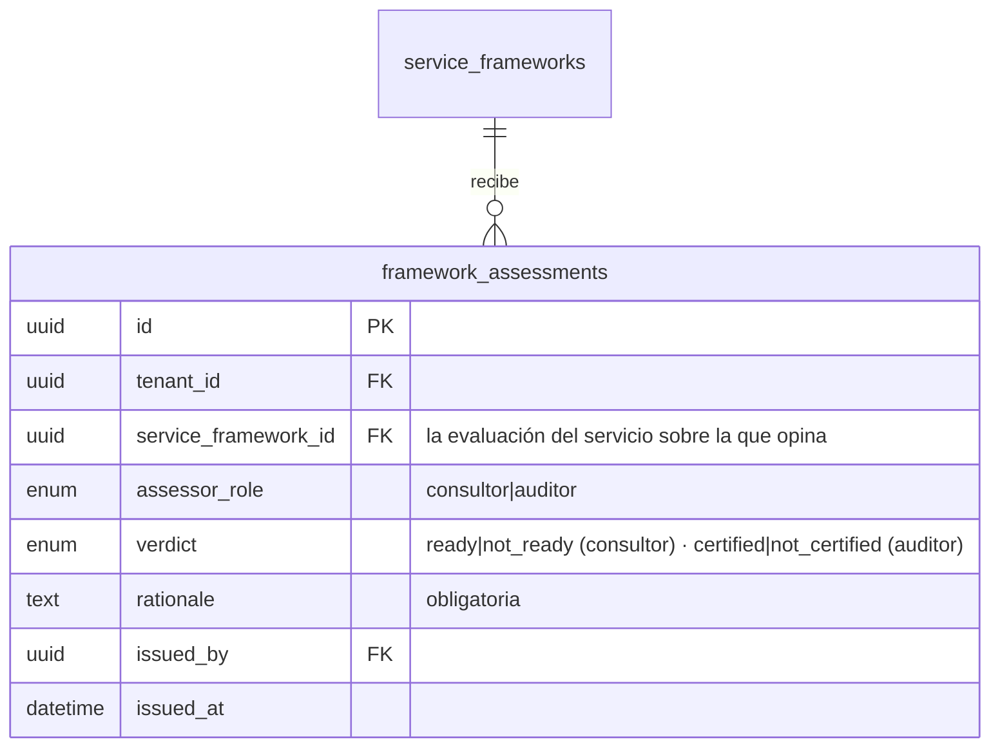
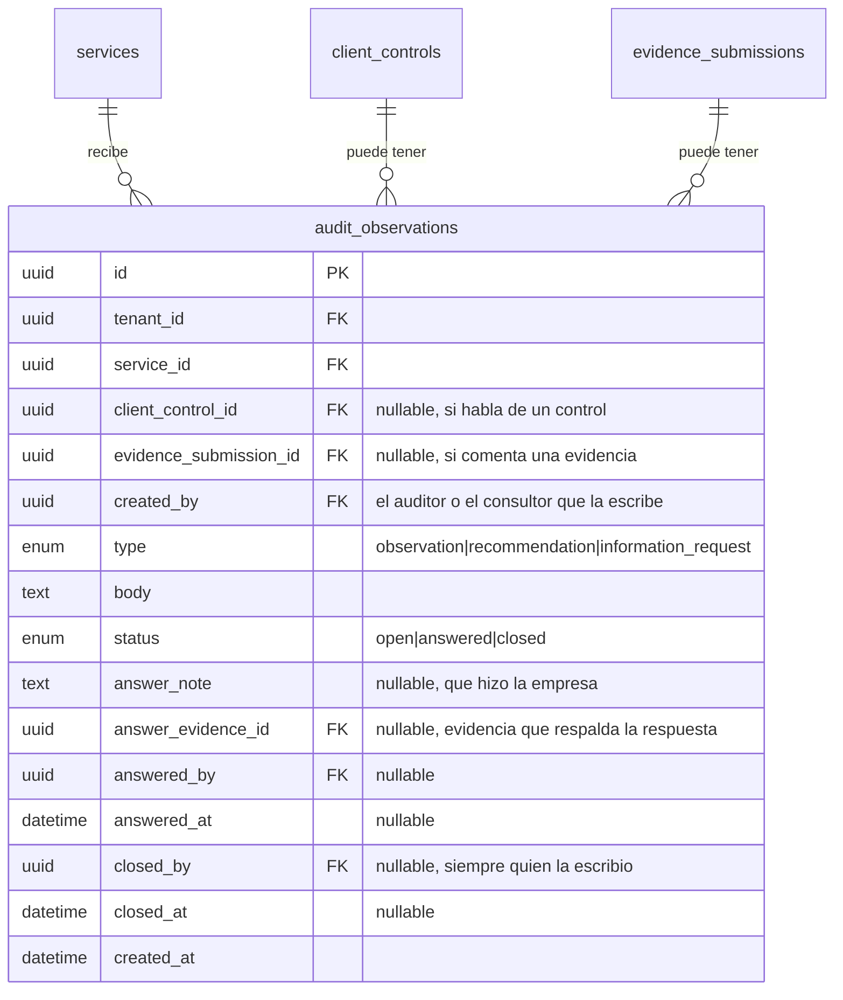

# Modelo de datos — §7 Cumplimiento

> Parte de [`modelo-datos.md`](../modelo-datos.md) (índice). **Qué responde:** Control del cliente, riesgos, evidencias, evaluaciones y observaciones. **Léelo:** Antes de tocar controles del cliente, evidencias o hallazgos.
> Los números de sección (§) se conservan: cualquier cita a «§7» apunta aquí.

## 7. Módulo Cumplimiento

**Qué es:** donde el cliente trabaja su cumplimiento día a día — ajusta los controles que
heredó, sube evidencia, gestiona riesgos y remedia hallazgos.

**Qué resuelve:** el catálogo clonado es genérico; el cumplimiento real exige decir *"este
control, en mi empresa, se cumple con estas herramientas concretas"*.

**No bloquea nada** (decisión D23, confirmada por el comité el 2026-09-26). Un cliente
que termina el onboarding ya tiene
cumplimiento midiéndose con el catálogo por defecto; este módulo es donde lo afina, sin
límite de tiempo. Lo usa `admin_empresa`.

### 7.1 El control del cliente

**`client_controls` es tabla propia, no columnas extra del control clonado** (decisión D3). El
cliente reescribe la interpretación con sus herramientas reales, y el `source_ref` mantiene el
rastro al control del catálogo para que una actualización del catálogo sepa a quién afecta.

**El mismo control puede estar cumplido en un servicio e incumplido en otro**, porque se
evalúa sobre insumos distintos. Por eso `client_controls` cuelga del servicio.

**El cliente puede proponer crear, editar y dar de baja controles** (matriz §5.5), y por eso todo lo que se mide
cuelga de `client_controls` y no del catálogo: `evaluations` (§7.4) y `evidence_requirements` (§7.3)
apuntan a `client_control_id`. `control_id` es la plantilla de origen y es nulo en un control propio.
**Eliminar es dar de baja** (`is_active = false`): las evaluaciones son inmutables y las FK son
`RESTRICT`, así que un control con histórico no se borra. Lo mismo vale para `client_causes` y
`client_risks`.

**Un control propio es solo documental** (su única dimensión es `policy`, tipo `manual`) y **lo ubica el cliente en una categoría** (`trust_criterion`). No tiene
punto de enfoque (el puente `point_of_focus_controls` es del catálogo): cuenta para el porcentaje de su categoría y del marco, pero no cierra ningún requisito (D65).

**`own_code`** es el código del catálogo (`IAC-12`) en un control clonado y la numeración propia (`C01…`) en uno que creó la empresa; el código se muestra siempre, también al cliente (D80); el backend aún lo manda solo dentro de `technical` (ver el pendiente D80 de `compliance-controls.md`). Un control propio lleva además `name` y `trust_criterion` (D79).

**Los cambios de controles los decide el consultor** (D65). Crear un control propio, darlo de baja y editar las dimensiones o la interpretación de un control —del
catálogo o propio— son **propuestas** (`client_control_changes`) que la empresa hace y el consultor aprueba o rechaza:

- **Crear:** el control existe desde que se propone y **cuenta en el porcentaje mientras está pendiente**. Si el consultor lo rechaza, se da de baja y deja de contar.
- **Dar de baja y editar:** el control sigue como estaba (y contando) hasta que el consultor aprueba; entonces se aplica el cambio.
- **Una propuesta pendiente por tipo y por control** (índice único parcial), y una decidida lleva quién y cuándo; rechazar exige motivo (restricciones de la base).

### 7.2 Riesgos del cliente y sus indicadores

**El impacto potencial de un riesgo se guarda como el texto que trae el comité** (`["Reputacional", "Sanción regulatoria"]`), igual en el catálogo y en lo que crea la empresa; la API lo expone como valores `loss_type` (`contracts/enums.md`).

**Cada cliente trabaja sobre su propia copia** (decisión D28). Al crearse `service_frameworks`
se copian los riesgos y causas base a `client_risks` y `client_causes` **de ese servicio**, con
sus relaciones (`client_risk_causes` replica `risk_causes`; `client_cause_controls` replica
`cause_controls` (con `is_mandatory` y `effect`, D75) pero apuntando al control **del cliente**, `client_controls`, que es el que él
particulariza). `risk_id` / `cause_id` guardan la plantilla de origen —para que una actualización
del catálogo sepa a quién afecta (§3.5)— y son `null` en lo que el cliente creó desde cero.

Por eso **editar o eliminar un riesgo o una causa no afecta al catálogo ni a ningún otro
cliente**: cada uno ve lo que tiene. Es lo que permite lo que dice el comité, que en este
módulo el cliente "crea, edita y elimina riesgos y causas según su propio entendimiento".

**Los tres indicadores no se mezclan** (reglas R-11 y R-12): cumplimiento (controles frente
al marco), mitigación (respuesta frente a una causa o riesgo) y riesgo residual son
**cálculos separados**. Un 93% de cumplimiento no dice que el riesgo residual sea del 7%.
`mitigations` apunta a **exactamente una** de las dos, causa o riesgo (hay un `CHECK`).

### 7.3 Evidencias

**Lo que D68 agrega a estas tablas** (la regla está en §9): `client_control_tests` lleva *obligatorio*, *vigente*, fechas y la justificación de una desactivación; `evidence_submissions` guarda los seis atributos que se
validan por evidencia y la **revisión** (`pending_review`, `ai_prevalidated`, `human_validated`), de donde se **deriva** su estado (`evidence_state`). **`validation_status` sigue siendo la aprobación de la empresa**
(solo `admin_empresa`) y no es el estado de cumplimiento de la evidencia. `exclusions` puede excluir un **activo** de un test además de un check, siempre con justificación, aprobador y vigencia. Un `evaluations.result` ahora
distingue `error` y `excluded`.

**El responsable de la evidencia es cargo *y* persona, en planos distintos** (decisión A1):
`evidence_requirements.responsible_id` apunta a `organization_responsibles`, es decir, al
**cargo** dentro de la organización del cliente (§5.4); quién lo ocupa hoy es su `person_name`.
Se cerró así en D30 (P4): no hay catálogo global de cargos, y `evidence_requirements` se
clona con el `responsible_id` vacío hasta que el cliente designa a sus responsables. Se clonan desde
`evidence_templates` (§3.2), una fila por plantilla ligada al control, con `code` = código de la
plantilla, `sequence` = su orden en el control y `validity_within_period` = el periodo de evaluación.

**La evidencia es válida si cae dentro del periodo de evaluación** del marco (decisión C1), no
por una fecha de caducidad fija.

**La exclusión la propone la empresa (`admin_empresa`) y la aprueba el consultor (rol `consultor`), y vence** (D78, que invirtió A3). Una
exclusión sin justificación aprobada no cambia el denominador — y un check que sale por
omisión es un agujero, no una exclusión.

**Solo `admin_empresa` aprueba evidencia.** La IA puede sugerir un veredicto (`ai_verdict`),
siempre etiquetado como generado por IA, pero **nunca cierra un control**.

### 7.4 Evaluaciones y hallazgos (el histórico)

**Una evaluación dice qué se evaluó** (D27, D36): el control del cliente (`client_control_id`), `test_id` siempre —el test es lo que define la
dimensión y a qué exclusiones responde— y `check_id` cuando la midió la sonda. Sin esos dos campos
no se puede "señalar el activo y el check exactos" de una falla (§9). `evaluated_at` es un
**instante**, no un día: la sonda corre cada 6 horas y "la última evaluación" tiene que ser
inequívoca.

**Cuatro reglas que no se negocian:**

- **La evaluación es inmutable.** Una nueva se agrega, no pisa la anterior. Es lo que permite
  demostrar cumplimiento **durante un periodo**, requisito de SOC 2 Tipo II. La base lo impone:
  el rol de la app **no puede `DELETE`** y solo puede hacer `UPDATE` de `confirmed_by` y
  `closure_observation_reason` — el cierre humano de §7.5, que no cambia lo medido (D27).
- **El estado no puede vivir en la definición.** Hoy `ManualCheckItem` lleva `status` y
  `evaluated_at` en la misma fila que la definición: evaluar pisa la evaluación anterior. Eso
  se corrige separando definición de evaluación.
- **Se guarda el dato crudo junto a la interpretación.** La sonda dice `ok`/`fail`
  (`raw_probe_result`); Monkey dice `compliant`/`non_compliant` (`result`). Sobrescribir el
  crudo haría imposible auditar el veredicto.
- **El hallazgo lo detecta el sistema, nunca una persona** (D63). Lo que el auditor escribe a mano es una
  **observación** (§7.6), que es otra tabla y otro ciclo de vida.

**`compliance_events` y `audit_logs` son dos tablas distintas.** `audit_logs` (§5.2) registra
acciones sobre la plataforma (quién cambió qué en el sistema); `compliance_events` registra
cambios en el estado de cumplimiento. Las dos son **append-only, 7 años, inmutables**.

**Las vulnerabilidades son solo insumo en el MVP** (decisión D7): alimentan los hallazgos de
los controles de gestión de vulnerabilidades y parches (`CC7.1` / `A.8.8`). El módulo con
vida propia no entra al MVP.

### 7.5 La IA y el veredicto

La IA evalúa evidencia, sugiere una conclusión y recomendaciones; **nunca da el veredicto**. El veredicto de un test documental o manual lo da el
**consultor** (`evaluations.confirmed_by`), y si lo da con observaciones abiertas se documenta la razón (`evaluations.closure_observation_reason`).

**El consultor y el auditor evalúan el cumplimiento con distinto enfoque** (D68, D77): el consultor **prepara** a la empresa y el auditor **certifica**, cada uno sobre los mismos datos.
Cada uno emite su evaluación del servicio en `framework_assessments`, ligada a la evaluación del servicio (`service_frameworks`: servicio + marco + versión + período + fecha de corte):

- **Cada rol emite solo la suya** (`SEG-56`): el consultor, `ready`/`not_ready` («lista» o «no lista para la auditoría»); el auditor, `certified`/`not_certified`.
- **No cambia el estado calculado** (§9): se muestra al lado. La del auditor es su opinión; el estado lo mueven solo los datos medidos.
- **Inmutable una vez emitida**: para cambiarla se emite otra, y la vigente es la última de ese rol sobre esa evaluación. Se escribe en la misma transacción que la acción (`audit_logs`, D52).
- El veredicto **por test** del consultor sigue en `evaluations.confirmed_by`; este es el general.

### 7.6 Las observaciones

Lo que escriben el `auditor` y el `consultor` (§5.1) son **observaciones**, no hallazgos: un hallazgo lo detecta el sistema (§7.4) y una observación la redacta una
persona. Cada una la tiene que atender la empresa, y debe quedar constancia de que lo hizo.

- **Tres tipos:** observación, recomendación y solicitud de información (pedirle más datos a la empresa).
- **Tres estados:** `open` → `answered` → `closed`. La empresa (`admin_empresa`, o el `funcional` dueño del control) **responde** dejando su nota y, si hace falta, una evidencia;
  **solo quien la escribió la cierra**. Si no queda conforme, la devuelve a `open`.
- **Una observación cerrada no se reabre**: si hace falta algo más, se crea otra. Mientras no esté cerrada, su autor puede modificarla.
- **Una observación no mueve el porcentaje.** El cumplimiento solo cambia por el camino de siempre: si la respuesta es un documento, entra como evidencia, se aprueba y
  el consultor da el veredicto del test **documental**. Si ese veredicto es negativo, el test falla y el porcentaje baja.
- **Se escribe en la misma transacción que la acción** (`audit_logs`, D52). La observación no se borra.

---
