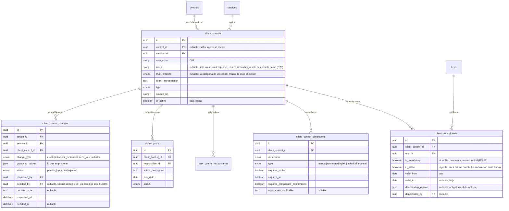
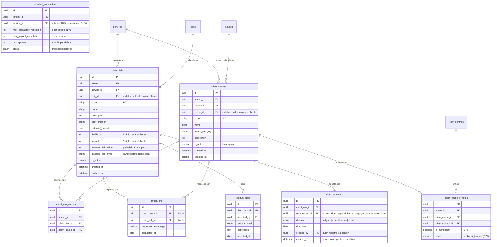
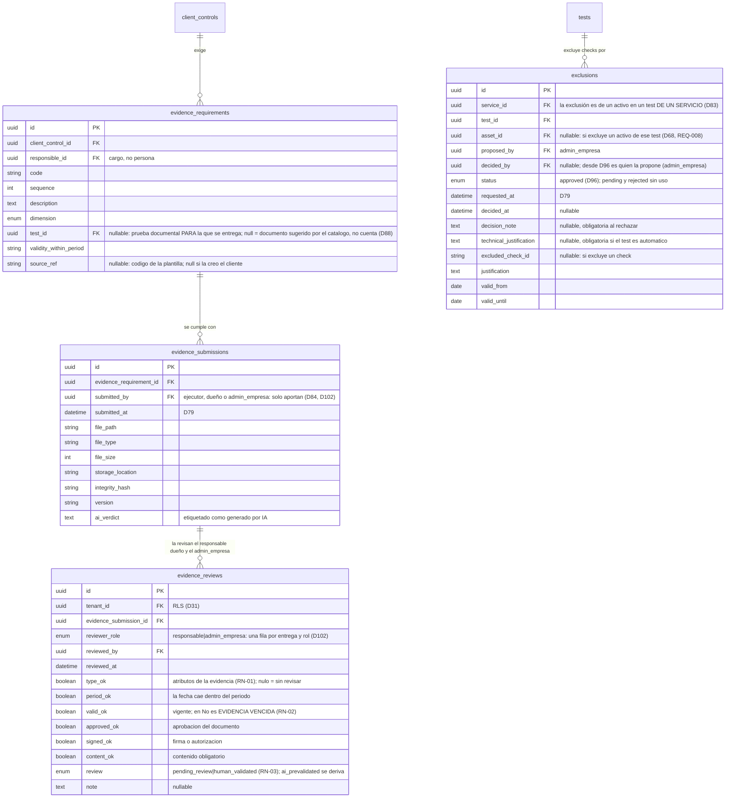
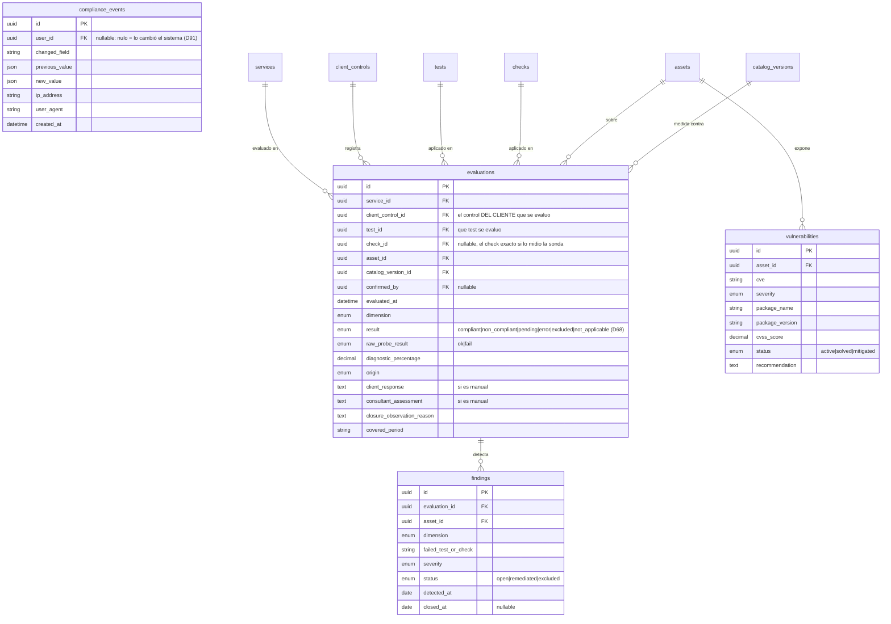
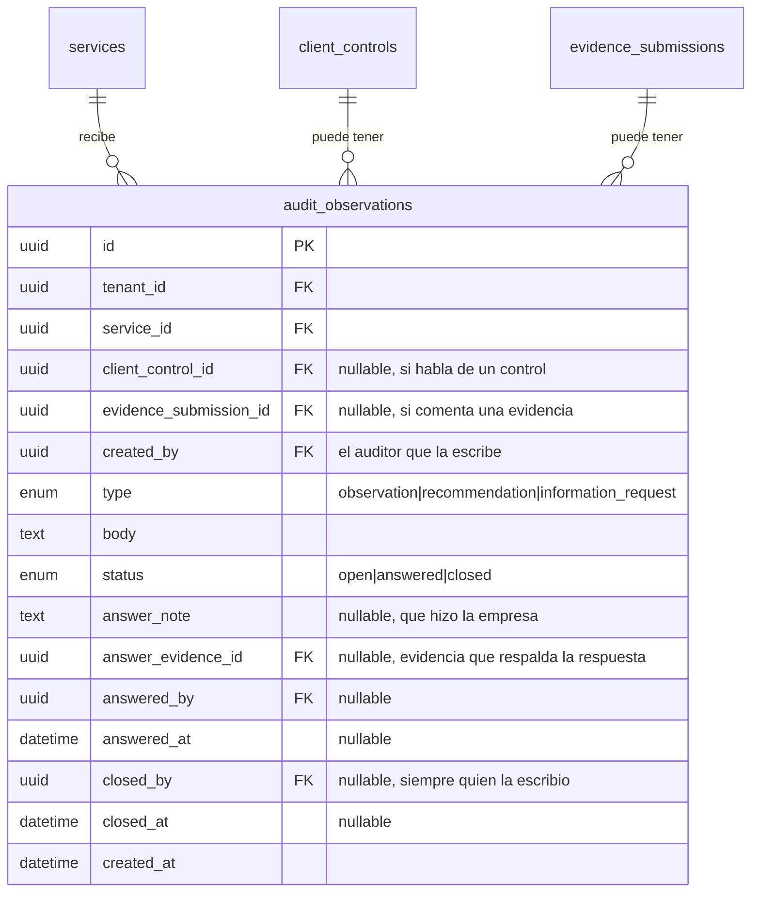

# Modelo de datos — §7 Cumplimiento

> Parte de [`modelo-datos.md`](../modelo-datos.md) (índice). **Qué responde:** Control del cliente, riesgos, evidencias, evaluaciones y observaciones. **Léelo:** Antes de tocar controles del cliente, evidencias o hallazgos.
> Los números de sección (§) se conservan: cualquier cita a «§7» apunta aquí.

## 7. Módulo Cumplimiento

**Qué es:** donde el cliente trabaja su cumplimiento día a día — ajusta los controles que
heredó, sube evidencia, gestiona riesgos y remedia hallazgos.

**Qué resuelve:** el catálogo clonado es genérico; el cumplimiento real exige decir *"este
control, en mi empresa, se cumple con estas herramientas concretas"*.

**No bloquea nada** (decisión D23, confirmada por el comité el 2026-09-26). Un cliente
que termina el onboarding ya tiene
cumplimiento midiéndose con el catálogo por defecto; este módulo es donde lo afina, sin
límite de tiempo. Lo usa `admin_empresa`.

### 7.0 Lo que cambia con la VF18 (catálogo v2)

> **Lo de abajo describe lo construido con el catálogo v1.** La VF18 (D128) cambia lo siguiente; el cálculo está en §9 y los
> documentos en §11. Los nombres de las tablas nuevas son propuesta de desarrollo y se fijan en el contrato de cada RC.
>
> | Hoy (v1) | Con la VF18 |
> |---|---|
> | `evidence_requirements`, clonadas de plantillas de evidencia | **Requisitos del control del cliente**, uno por `control_requirements` y control del cliente, con su periodicidad configurada y su «No aplica» justificado y aprobado (D129, RC-02). Los documentos son de la empresa (§11) |
> | `client_control_tests` (N:M control ↔ test) | Se retira: la prueba pertenece a su control (D129) |
> | Revisión de cada evidencia por rol (`evidence_reviews`, D102) y del veredicto en dos niveles (`test_verdict_reviews`, D121) | **La aprobación es del control** (D132): estados de gestión y dos aprobaciones (responsable y, al final, `admin_empresa`), con motivo al devolver. La evidencia que causa una devolución queda «devuelta». El resultado de una prueba manual lo registra el responsable al revisar la evidencia del delegado (D140) |
> | La evidencia vale si cae en el período (C1) | Además, **por ventana** de la periodicidad del control o del requisito (D131); el `admin_empresa` cambia la periodicidad con justificación (G-10). El período auditado dura 6 meses como mínimo |
> | `exclusions`: un activo sale del denominador de una prueba hasta el fin del período | **Excepción de un check en un activo**: cuenta como PASS marcado, con fecha de fin de 90 días como máximo (D135) |
> | `client_cause_controls.is_mandatory` y `effect`; `residual_parameters` | Se retiran: el residual sale de la cobertura verificada y de PR-08 a PR-10; el apetito, de las zonas de color (D134) |
> | `client_risks` sin valoración hasta que el cliente la pone | La valoración inherente del catálogo llega prellenada al asistente (D134) |
> | Sin alertas | Alertas por evento y tickets opcionales (D138) |

**`client_control_requirements` (MD-498).** El requisito del control del cliente: una fila por cada `catalog.control_requirements` del control que el servicio heredó, creada al clonar el servicio (y para los servicios ya clonados, por la migración). Campos: `id`, `tenant_id`, `client_control_id`, `control_requirement_id` (el del catálogo), `periodicity` (copiada del catálogo; el `admin_empresa` la cambia por control, para todos los requisitos a la vez, D147), `is_applicable` (por defecto `true`) y `not_applicable_reason` (el «No aplica» justificado y aprobado llega con la gestión del control, RC-07), `created_at`. Único por (`client_control_id`, `control_requirement_id`), con RLS por `tenant_id`. **No guarda estado:** el estado del requisito se deriva en cada lectura (§9). Las pruebas de cada requisito se leen del catálogo (`control_requirement_tests`); la v1 (`client_control_tests`) deja de usarse para calcular y se retira en MD-509.

**El cambio de periodicidad (MD-500, G-10, D147)** se guarda en `client_controls`: `periodicity_justification` (text, nullable), `periodicity_changed_at` (timestamptz, nullable) y `periodicity_changed_by` (uuid, nullable, el `users.id` del `admin_empresa`). Con `periodicity_changed_at` en `null` el control usa la sugerida del catálogo (`periodicity_source = catalog`). Volver a la sugerida copia otra vez la periodicidad del catálogo en cada requisito y deja las tres columnas en `null`. El historial completo está en el rastro (`client_control.periodicity_set`).

### 7.1 El control del cliente

**`client_controls` es tabla propia, no columnas extra del control clonado** (decisión D3). El
cliente reescribe la interpretación con sus herramientas reales, y el `source_ref` mantiene el
rastro al control del catálogo para que una actualización del catálogo sepa a quién afecta.

**El mismo control puede estar cumplido en un servicio e incumplido en otro**, porque se
evalúa sobre insumos distintos. Por eso `client_controls` cuelga del servicio.

**El cliente puede proponer crear, editar y dar de baja controles** (matriz §5.5), y por eso todo lo que se mide
cuelga de `client_controls` y no del catálogo: `evaluations` (§7.4) y `evidence_requirements` (§7.3)
apuntan a `client_control_id`. `control_id` es la plantilla de origen y es nulo en un control propio.
**Eliminar es dar de baja** (`is_active = false`): las evaluaciones son inmutables y las FK son
`RESTRICT`, así que un control con histórico no se borra. Lo mismo vale para `client_causes` y
`client_risks`.

**Un control propio es solo documental** (su única dimensión es `policy`, tipo `manual`) y **lo ubica el cliente en una categoría** (`trust_criterion`). No tiene
punto de enfoque (el puente `point_of_focus_controls` es del catálogo): cuenta para el porcentaje de su categoría y del marco, pero no cierra ningún requisito (D65).

**`own_code`** es el código del catálogo (`IAC-12`) en un control clonado y la numeración propia (`C01…`) en uno que creó la empresa; el código se muestra siempre, también al cliente (D80); el backend aún lo manda solo dentro de `technical` (ver el pendiente D80 de `contracts/cumplimiento/controles.md`). Un control propio lleva además `name` y `trust_criterion` (D79).

**Los cambios de controles los hace el `admin_empresa` directamente** (D96, que reemplaza el circuito de propuestas de D65). Crear un control propio, darlo de baja y editar las dimensiones o la interpretación de un control —del catálogo o propio— se aplican **al instante**, con advertencia y confirmación en pantalla (`P33`):

- **Crear:** el control existe y **cuenta en el porcentaje desde que se crea** (`approval = approved`).
- **Dar de baja:** `is_active = false`, el control deja de contar y de verse; **no se borra** (las evaluaciones son inmutables y un auditor necesita el historial).
- **Editar:** la interpretación o las dimensiones cambian al instante; cada cambio deja su `audit_logs` (con estado anterior y nuevo) y, si altera lo que se mide, un `compliance_events`.
- La tabla `client_control_changes` y sus enums **quedan sin uso** (no se borran): no hay propuestas pendientes que decidir.
### 7.2 Riesgos del cliente y sus indicadores

**El impacto potencial de un riesgo se guarda como el texto que trae el comité** (`["Reputacional", "Sanción regulatoria"]`), igual en el catálogo y en lo que crea la empresa; la API lo expone como valores `loss_type` (`contracts/enums.md`).

**Cada cliente trabaja sobre su propia copia** (decisión D28). Al crearse `service_frameworks`
se copian los riesgos y causas base a `client_risks` y `client_causes` **de ese servicio**, con
sus relaciones (`client_risk_causes` replica `risk_causes`; `client_cause_controls` replica
`cause_controls` (con `is_mandatory` y `effect`, D75) pero apuntando al control **del cliente**, `client_controls`, que es el que él
particulariza). `risk_id` / `cause_id` guardan la plantilla de origen —para que una actualización
del catálogo sepa a quién afecta (§3.5)— y son `null` en lo que el cliente creó desde cero.

Por eso **editar o eliminar un riesgo o una causa no afecta al catálogo ni a ningún otro
cliente**: cada uno ve lo que tiene. Es lo que permite lo que dice el comité, que en este
módulo el cliente "crea, edita y elimina riesgos y causas según su propio entendimiento".

**Los tres indicadores no se mezclan** (reglas R-11 y R-12): cumplimiento (controles frente
al marco), mitigación (respuesta frente a una causa o riesgo) y riesgo residual son
**cálculos separados**. Un 93% de cumplimiento no dice que el riesgo residual sea del 7%.
`mitigations` apunta a **exactamente una** de las dos, causa o riesgo (hay un `CHECK`).

### 7.3 Evidencias

**Lo que D68 agrega a estas tablas** (la regla está en §9): `client_control_tests` lleva *obligatorio*, *vigente*, fechas y la justificación de una desactivación; `evidence_reviews` guarda los seis atributos que se
validan por evidencia y la **revisión** (`pending_review`, `human_validated`; `ai_prevalidated` se **deriva** cuando la entrega tiene `ai_verdict` y ninguna revisión humana), de donde se **deriva** su estado (`evidence_state`). **La revisan el `responsable` dueño y el `admin_empresa`** (D102, que ajusta D96): no hay `validation_status` en la entrega, la revisión es otra fila por rol. `exclusions` puede excluir un **activo** de un test además de un check, siempre con justificación, aprobador y vigencia. Un `evaluations.result` ahora
distingue `error` y `excluded`.

**El responsable de la evidencia es cargo *y* persona, en planos distintos** (decisión A1):
`evidence_requirements.responsible_id` apunta a `organization_responsibles`, es decir, al
**cargo** dentro de la organización del cliente (§5.4); quién lo ocupa hoy es su `person_name`.
Se cerró así en D30 (P4): no hay catálogo global de cargos, y `evidence_requirements` se
clona con el `responsible_id` vacío hasta que el cliente designa a sus responsables. Se clonan desde
`evidence_templates` (§3.2), una fila por plantilla ligada al control, con `code` = código de la
plantilla, `sequence` = su orden en el control y `validity_within_period` = el periodo de evaluación.

**La evidencia es válida si cae dentro del periodo de evaluación** del marco (decisión C1), no
por una fecha de caducidad fija.

**La evidencia de una prueba documental es de esa prueba en su control (D88; reemplazada por D133: con la VF18 la prueba documental es una por documento, §11).** La persona sube su documento bajo la prueba y el servidor lo guarda en el requerimiento de esa prueba (`evidence_requirements.test_id`), que crea en la primera entrega. `test_id` nulo es un documento que el catálogo
sugiere para el control sin decir a qué prueba sirve (las 89 asignaciones del Excel): no cuenta para ninguna prueba. El estado de la prueba en ese control sale solo de lo entregado para ella (§9); el de un requerimiento, de su **entrega más reciente**.
**La exclusión la propone y la decide el `admin_empresa` en un solo acto, y vence** (D96, que reemplaza a D78). Una
exclusión sin justificación aprobada no cambia el denominador — y un check que sale por
omisión es un agujero, no una exclusión.

**La evidencia la sube el ejecutor, el dueño o el `admin_empresa`; la revisa el `responsable` dueño (si no la subió él) y el `admin_empresa` siempre puede** (D102; con la VF18 la aprobación pasa al control, D132); el `auditor` la lee, no la revisa. **Cada entrega tiene a lo sumo una revisión por rol** (`evidence_submission_id` + `reviewer_role` único). El estado que consume el motor sale de combinarlas: **si hay algún rechazo, rechazada; si no hay rechazos y hay al menos una validación, validada** (con dos revisiones, aprueban las dos); sin revisión, pendiente. Una revisión no se edita: se rehace con una entrega nueva. Una entrega es histórico: la app solo la inserta y la lee (sin `UPDATE` ni `DELETE`) y `(evidence_requirement_id, version)` es único (MD-126). La IA puede sugerir un veredicto (`ai_verdict`),
siempre etiquetado como generado por IA, pero **nunca cierra un control**.

### 7.4 Evaluaciones y hallazgos (el histórico)

**Una evaluación dice qué se evaluó** (D27, D36): el control del cliente (`client_control_id`), `test_id` siempre —el test es lo que define la
dimensión y a qué exclusiones responde— y `check_id` cuando la midió la sonda. Sin esos dos campos
no se puede "señalar el activo y el check exactos" de una falla (§9). `evaluated_at` es un
**instante**, no un día: la sonda corre cada 6 horas y "la última evaluación" tiene que ser
inequívoca.

**Cuatro reglas que no se negocian:**

- **La evaluación es inmutable.** Una nueva se agrega, no pisa la anterior. Es lo que permite
  demostrar cumplimiento **durante un periodo**, requisito de SOC 2 Tipo II. La base lo impone
  **para todos los roles**, también el dueño de la tabla (triggers, `SEG-38`): no hay `DELETE` ni
  `TRUNCATE`, y solo se puede hacer `UPDATE` de `confirmed_by` y `closure_observation_reason` — el
  cierre humano de §7.5, que no cambia lo medido (D27).
- **El estado no puede vivir en la definición.** Hoy `ManualCheckItem` lleva `status` y
  `evaluated_at` en la misma fila que la definición: evaluar pisa la evaluación anterior. Eso
  se corrige separando definición de evaluación.
- **Se guarda el dato crudo junto a la interpretación.** La sonda dice `ok`/`fail`
  (`raw_probe_result`); Monkey dice `compliant`/`non_compliant` (`result`). Sobrescribir el
  crudo haría imposible auditar el veredicto.
- **El hallazgo lo detecta el sistema, nunca una persona** (D63). Lo que el auditor escribe a mano es una
  **observación** (§7.6), que es otra tabla y otro ciclo de vida.

**`compliance_events` y `audit_logs` son dos tablas distintas.** `audit_logs` (§5.2) registra
acciones sobre la plataforma (quién cambió qué en el sistema); `compliance_events` registra
cambios en el estado de cumplimiento. Las dos son **append-only, 7 años, inmutables** (salvo una empresa dada de baja, D97).

**Todo cambio de estado de un control deja un evento** (D91, REQ-044): `changed_field = 'control.state'`,
con el estado y el semáforo anteriores en `previous_value` y los nuevos —más el control, el servicio y la
causa— en `new_value`. Lo escribe, en la misma transacción, la escritura que lo mueve: el veredicto de un
test manual, la entrega de una evidencia, la validación del administrador, decidir una exclusión y lo que mide la
sonda. Si lo causa el sistema (la sonda), `user_id`, `ip_address` y `user_agent` van nulos.

**Las vulnerabilidades son solo insumo en el MVP** (decisión D7; con la VF18, la detección de vulnerabilidades es check Directo de VUL-1 y Complementario de VUL-2, y pasa si no hay hallazgos críticos ni altos abiertos, D141): alimentan los hallazgos de
los controles de gestión de vulnerabilidades y parches (`CC7.1` / `A.8.8`). El módulo con
vida propia no entra al MVP.

### 7.4b Veredicto en dos niveles (D102, D121)

> **Reemplazado por D132** con la VF18: la revisión en dos niveles pasa al control completo (7.0).

El veredicto de una prueba manual **no documental** se registra y se revisa como la evidencia.

| Tabla | Columnas | Reglas |
|---|---|---|
| `test_verdicts` | `id`, `tenant_id` (RLS), `service_id`, `client_control_id` (control de origen), `test_id`, `result` (`verdict_result`), `note`, `closure_observation_reason`, `registered_by` (FK `users`), `registered_at` | Inmutable: nunca se edita ni se borra. El **último** registrado de un test en un servicio decide el estado del test |
| `test_verdict_reviews` | `id`, `tenant_id` (RLS), `test_verdict_id`, `reviewer_role` (`reviewer_role`), `decision` (`verdict_review_decision`), `note`, `reviewed_by` (FK `users`), `reviewed_at` | Única por (`test_verdict_id`, `reviewer_role`); un segundo `PUT` del mismo rol la reemplaza. `note` obligatoria al rechazar |

**Estado (`verdict_state`, derivado):** algún rechazo → `rejected`; al menos una aprobación sin rechazos → `approved`; ninguna → `pending`. Solo un veredicto `approved` cuenta en el motor (§9): da su `result` a todos los controles del servicio que llevan el test (D85). Si lo registra el `admin_empresa`, nace con su aprobación. Las evaluaciones manuales que ya existían en `evaluations` se migran como veredictos aprobados por quien las dio (no hay empresas reales, D102).

### 7.5 La IA y el veredicto

La IA evalúa evidencia, sugiere una conclusión y recomendaciones; **nunca da el veredicto**. El veredicto de un test documental o manual lo da el
**`admin_empresa`** (`evaluations.confirmed_by`), y si lo da con observaciones abiertas se documenta la razón (`evaluations.closure_observation_reason`).

**La evaluación del servicio por el auditor está en pausa** (D68 punto 11, D77, D96). La calificación del auditor (certificar o no) se retoma después, según el Excel y sin cambiar el estado calculado (`P35`). La tabla `framework_assessments` queda sin uso, solo con el rol `auditor` y los veredictos `certified`/`not_certified`; el veredicto **por test** del administrador sigue en `evaluations.confirmed_by` y su nota en `evaluations.verdict_note`.
### 7.6 Las observaciones

Lo que escribe el `auditor` (§5.1) son **observaciones**, no hallazgos: un hallazgo lo detecta el sistema (§7.4) y una observación la redacta una
persona. Cada una la tiene que atender la empresa, y debe quedar constancia de que lo hizo.

- **Tres tipos:** observación, recomendación y solicitud de información (pedirle más datos a la empresa).
- **Tres estados:** `open` → `answered` → `closed`. La empresa (`admin_empresa`, o el dueño o el ejecutor del control) **responde** dejando su nota y, si hace falta, una evidencia;
  **solo quien la escribió la cierra**. Si no queda conforme, la devuelve a `open`.
- **Una observación cerrada no se reabre**: si hace falta algo más, se crea otra. Mientras no esté cerrada, su autor puede modificarla.
- **Una observación no mueve el porcentaje.** El cumplimiento solo cambia por el camino de siempre: si la respuesta es un documento, entra como evidencia, se valida y
  el `admin_empresa` da el veredicto del test **documental**. Si ese veredicto es negativo, el test falla y el porcentaje baja.
- **Se escribe en la misma transacción que la acción** (`audit_logs`, D52). La observación no se borra.

**Cómo quedó construido (MD-154)** — decisiones que el modelo no fijaba y que el PO debe ratificar (`P37`):

- **Una entrega pertenece a un único control**, así que si el auditor solo manda la evidencia, `client_control_id` se completa con el de esa entrega (la ve su responsable). Si manda las dos, deben coincidir.
- **Sobre un control dado de baja no se abren observaciones nuevas**; las que ya tenía se conservan.
- **`answer_evidence_id` es una entrega de un control del mismo servicio.**
- **«Abierta» es `status = open`.** Con observaciones abiertas en el **control de origen**, el veredicto exige `closure_observation_reason` (D85, criterio provisional); una respondida o cerrada deja de pedirla.
- **Devolver a `open` conserva la última respuesta**; la anterior queda en `audit_logs` (`before_state`). No hay tabla de historial de respuestas.
- **La base lo impone** (SEG-69): `audit_observations` no admite `DELETE` ni `TRUNCATE`, una cerrada no admite ningún `UPDATE`, lo que identifica a la observación (`tenant_id`, `service_id`, `client_control_id`, `evidence_submission_id`, `created_by`, `type`, `created_at`) no cambia nunca y solo existen los pasos `open → answered`, `answered → open` y `answered → closed`. La única forma de borrarla es el borrado definitivo de una empresa archivada (D97). `CHECK`: quien la cierra es siempre quien la escribió, y respondida o cerrada exige su respuesta.
- **Un servicio con observaciones no se borra** (son historia, igual que las evaluaciones).

---
