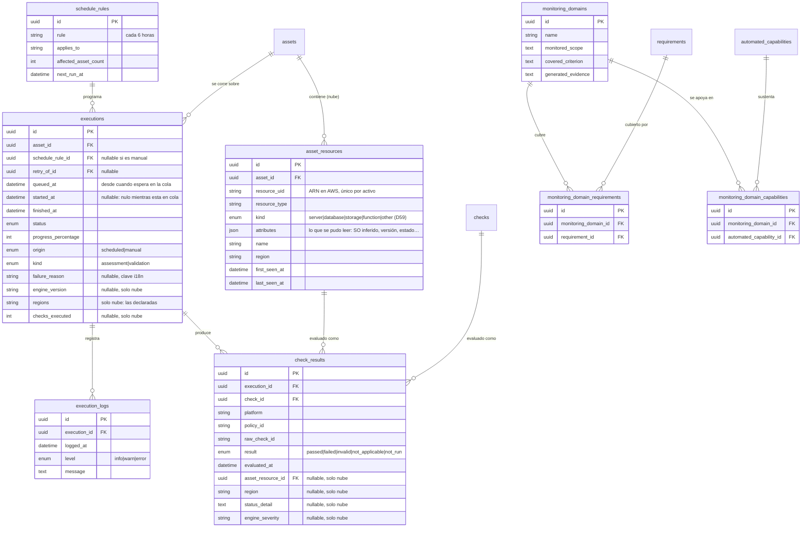

# Modelo de datos — §8 Control Técnico

> Parte de [`modelo-datos.md`](../modelo-datos.md) (índice). **Qué responde:** La operación continua de la sonda. **Léelo:** Antes de tocar sondas, programación o ejecuciones.
> Los números de sección (§) se conservan: cualquier cita a «§8» apunta aquí.

## 8. Módulo Control Técnico — la operación continua

**Qué es:** la cara operativa de la sonda. El Componente 3 del onboarding conecta los
activos; este módulo es lo que pasa después, corrida tras corrida.

**Qué resuelve:** distinguir *"el control falla"* de *"la conexión falla"*. Sin esto, un
hallazgo técnico sin diagnóstico de conectividad es un falso negativo.

Principio del blueprint: **la unidad de seguimiento es el activo, no la sonda**. El recorrido
es **activo → estado → ejecución → resultado → log**.

`monitoring_domain_requirements` y `monitoring_domain_capabilities` son las dos tablas puente de
las `N:M` (`id`, las dos FK y un único sobre el par), nombradas según la convención. Un dominio se
apoya en varias capacidades y una capacidad puede servir a varios dominios (D32).

**Dos tipos de ejecución (D58):** una `validation` comprueba que se puede acceder a la cuenta del cliente (segundos, el cliente espera en pantalla) y una
`assessment` corre el motor (minutos). Corren en carriles distintos y el historial de evaluaciones solo muestra las segundas.

**Ciclo de vida de una ejecución (D57).** `queued` → `running` → `completed` | `failed`. «Evaluar ahora» la deja en cola; el trabajador la reclama
(una función SQL angosta busca entre empresas y la pasa a `running`) y la cierra con el resultado, o como `failed` con su `failure_reason`: un
fallo de ejecución es un problema de **conexión**, no un incumplimiento, y no mueve la preparación. **Un activo no puede tener dos ejecuciones
abiertas** (`queued` o `running`): lo impone un índice único parcial, no una comprobación previa. Las que llevan más de 30 minutos en curso
se barren a `failed` (`execution.timed_out`).

**La nube (D53, D56).** El activo es la **cuenta** (o suscripción, o proyecto); sus recursos cuelgan de él en `asset_resources` y cada
`check_results` apunta al recurso evaluado, no lo repite. Las regiones que se evalúan son las que el cliente declara
(`asset_provisionings.regions`), y el canal de conexión se guarda en `asset_provisionings.connection_method`. **Lo que el motor no
devuelve para un check de una corrida es `not_applicable`, no «no ejecutado»**: el motor omite los checks sin recursos, así que el
conjunto ejecutado es el catálogo de esa `engine_version` (DT-50).

**Tres reglas:**

- **`executions` ≠ `evaluations`.** Una es "corrió la sonda"; la otra, "se midió el
  cumplimiento". Colapsarlas impide distinguir *el control falla* de *la conexión falla*.
  `check_results` es el dato crudo de una corrida; `evaluations` (§7.4) es la interpretación.
- **La frecuencia vive en la conexión y en la regla, no en el control.** Al vencer **avisa sin
  mover el porcentaje**: vencido ≠ incumplido. La regla la editan `admin_monkey` y
  `admin_empresa`, con mínimos que Monkey define (decisión B6).
- **La cobertura técnica es un número aparte** del cumplimiento. Mezclarlos produce un número
  falso.

Cada capa tiene dos caras — lo que ve el cliente y el motor interno, que es confidencial:
conexión (self-service / aprovisionar agente) · recolección (estado "Conectado" / recolección
real) · análisis (hallazgos en lenguaje de negocio / reglas y SCA) · evidencia continua ·
cumplimiento por marco.

**Dos motores con roles distintos (D100, cierra P14 A1; acota el «validador único» del comité):** Prowler maneja todo lo de la nube (AWS, Azure, GCP y demás; D53–D58, `arquitectura/control-tecnico/motores/prowler.md`) y Wazuh sigue con servidores, BD y endpoints: configuración (SCA), monitoreo de amenazas en tiempo real y respuesta ante incidentes (`arquitectura/control-tecnico/motores/wazuh.md`). La verificación de D48 (la sonda solo ingiere registros de la nube) ya lo anticipaba. `automated_capabilities.provider` los distingue.

**Vínculo activo ↔ agente (D113, aprobada el 2026-11-18; construido).** Antes `assets` no sabía qué agente de la sonda era. La tabla `asset_agents` (`tenant`, con RLS) lo enlaza:

| Campo | Qué guarda |
|---|---|
| `tenant_id`, `asset_id` | La empresa y el activo. **Un activo, un agente** (`asset_id` único) |
| `sca_policy_id` | **La versión que el cliente declaró** («Ubuntu 22.04 LTS»): una política del catálogo (`catalog.sca_policies`). De ella sale el sistema (`linux`, `windows`, `macos`), y con él el comando de instalación. Ya **no** hay una «familia» aparte: un solo script de Linux detecta si usar `apt`, `dnf` o `zypper` |
| `agent_id` | El identificador del agente en la sonda. **Nulo hasta que Monkey crea el agente** (el servidor se declara antes). **Único en toda la base**: un agente no puede pertenecer a dos activos. Con la forma que da la sonda (3 a 8 dígitos) |
| *(derivados)* | El **nombre** del agente en la sonda es siempre el `asset_id` (la sonda exige nombres únicos en todo el manager) y su **grupo** es siempre el `tenant_id` (UUID, nunca el nombre de la empresa). No se guardan: se calculan |
| `status` | `pending` (pre-registrado, sin conectar) · `connected` · `disconnected` · `removed` |
| `registered_at`, `first_seen_at`, `last_seen_at`, `last_sync_at` | Cuándo se pre-registró, se vio por primera vez, se vio por última vez y se sincronizó |

**El catálogo de versiones (D113).** La tabla `catalog.sca_policies`, que existía vacía, pasa a ser la fuente única de tres cosas: la **traducción nombre ↔ id** de cada política (el comité nombra la política por su *nombre*, la sonda por su *id*), **qué versiones se ofrecen al cliente** y cuántos checks tiene cada una. Gana `os_code` (`linux`, `windows`, `macos`, `solaris`, `hp_ux`; nulo si es un motor de base de datos o un servidor de aplicaciones), `distribution` y `distribution_name` (`ubuntu` / «Ubuntu»), `version_label` («22.04 LTS»), **`version_code`** (`ubuntu_22_04_lts`, único; lo define Monkey, no la sonda, así un cambio de id en la sonda no llega a la API ni a la pantalla), `sort_order` e **`is_offerable`**: solo se ofrece lo que la sonda realmente trae. Una política del catálogo que la sonda no entrega queda cargada pero **no ofrecida**: no se promete una evaluación que no existe. La pantalla las lee de `GET /v1/catalogs/<sistema>_version` (`linux_version`, `windows_version`…), igual que las regiones de `aws_region`.

**La clave del agente no se guarda:** sale una sola vez, dentro del comando de instalación. Sin este vínculo, un resultado de la sonda no se acepta (`AGENT_NOT_LINKED`); y si el grupo real del agente no es el `tenant_id` del activo, tampoco (`AGENT_GROUP_MISMATCH`, `SEG-45`).
