# Modelo de datos — §10 Diagrama global

> Parte de [`modelo-datos.md`](../modelo-datos.md) (índice). **Qué responde:** Todo el modelo junto. **Léelo:** Para ver la relación entre módulos.
> Los números de sección (§) se conservan: cualquier cita a «§10» apunta aquí.

## 10. Diagrama global

Con el catálogo v2 de la VF18 (D129): requisitos del control, la prueba que pertenece a su control, documentos (§11), procedimientos, categorías de integración y el rol del check.

```mermaid
erDiagram
    companies ||--o{ access_keys : "se accede con"
    companies ||--o{ users : "emplea"
    companies ||--|| organizations : "declara su negocio como"

    organizations ||--o{ services : "presta"
    organizations ||--o{ assets : "inventaria"
    organizations }o--o{ regulations : "sujeta a"
    organizations ||--o{ organization_responsibles : "designa"

    services }o--o{ assets : "usa"
    services ||--o{ service_trust_criteria : "contrata"
    trust_criteria ||--o{ service_trust_criteria : "contratado por"
    services ||--o{ subservice_organizations : "depende de"
    services ||--|| system_descriptions : "documentado en"
    subservice_organizations ||--o{ csocs : "debe aportar"
    services ||--o{ cuecs : "espera del usuario"

    services ||--o{ service_frameworks : "contrata"
    frameworks ||--o{ service_frameworks : "contratado en"
    frameworks ||--o{ requirements : "exige"
    requirements ||--o{ points_of_focus : "precisa"
    trust_criteria ||--o{ requirements : "clasifica"
    points_of_focus }o--o{ controls : "satisfecho por"

    risks }o--o{ causes : "originado por"
    causes }o--o{ controls : "mitigada por"
    risks ||--o{ client_risks : "plantilla de"
    causes ||--o{ client_causes : "plantilla de"
    services ||--o{ client_risks : "expuesto a"
    services ||--o{ client_causes : "tiene"
    client_risks }o--o{ client_causes : "originado por"
    client_causes }o--o{ client_controls : "mitigada por"
    client_risks ||--o{ residual_risks : "deja"
    client_risks ||--o{ risk_treatments : "se trata con"
    client_causes ||--o{ mitigations : "responde con"

    controls ||--o{ client_controls : "particularizado en"
    client_controls ||--o| client_control_assignments : "asignado a"
    controls ||--o{ control_dimensions : "se evalua en"
    controls ||--|{ control_requirements : "se prueba con"
    control_requirements }o--|{ tests : "probado por"
    controls ||--o{ tests : "es dueno de"
    controls }o--o{ documents : "depende de"
    documents ||--|| tests : "su T-DOC"
    documents ||--o{ company_documents : "plantilla de"
    company_documents ||--|{ document_versions : "tiene"
    client_controls ||--o{ evidence_requirements : "exige (por requisito del control)"
    client_controls ||--o{ client_control_dimensions : "se evalua en"
    standard_procedures ||--o{ tests : "guia"
    integration_categories ||--o{ tests : "aporta evidencia a"
    controls ||--o{ control_framework_mappings : "responde a"

    tests }o--o{ checks : "se automatiza con (rol: directo, complementario, dependencia)"
    checks ||--o{ exclusions : "exceptuado en un activo (D135)"
    tests ||--o{ evaluations : "aplicado en"
    checks ||--o{ evaluations : "aplicado en"
    monitoring_domains }o--o{ requirements : "cubre"
    monitoring_domains }o--o{ automated_capabilities : "se apoya en"
    checks ||--o{ check_mappings : "mapea a"
    sca_policies ||--o{ checks : "contiene"
    evidence_requirements ||--o{ evidence_submissions : "se cumple con"

    assets ||--o{ asset_provisionings : "se prepara con"
    automated_capabilities ||--o{ asset_provisionings : "habilita"
    automated_capabilities ||--o{ capability_platforms : "se ofrece sobre"
    capability_platforms ||--o{ assets : "se conecta como"
    schedule_rules ||--o{ executions : "programa"
    assets ||--o{ executions : "se corre sobre"
    executions ||--o{ check_results : "produce"
    executions ||--o{ execution_logs : "registra"
    checks ||--o{ check_results : "evaluado como"

    services ||--o{ evaluations : "evaluado en"
    client_controls ||--o{ evaluations : "registra"
    assets ||--o{ evaluations : "sobre"
    catalog_versions ||--o{ evaluations : "medida contra"
    evaluations ||--o{ findings : "detecta"
    assets ||--o{ vulnerabilities : "expone"
```

