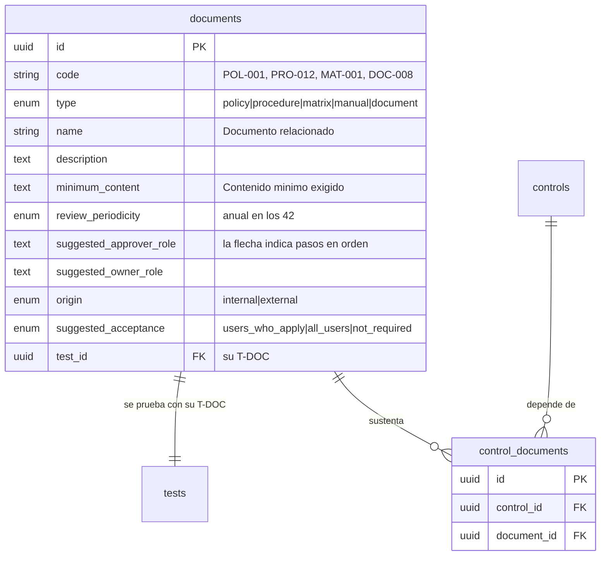
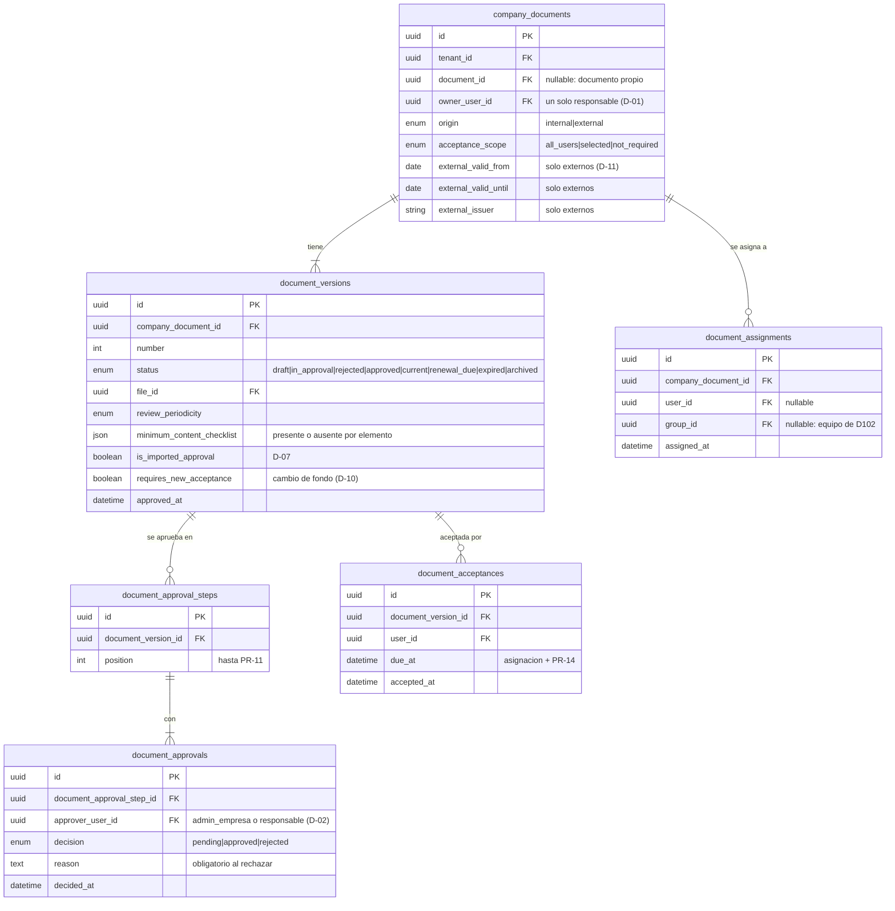

# Modelo de datos — §11 Documentos

> Parte de [`modelo-datos.md`](../modelo-datos.md) (índice). **Qué responde:** Las tablas de los documentos: el documento sugerido del catálogo y el documento de la empresa con sus versiones, su flujo de aprobación y su aceptación. **Léelo:** Antes de tocar el módulo Documentos o la prueba documental (`T-DOC`).
> Es un § nuevo de la VF18 (D133); los anteriores no se renumeran.

## 11. Documentos

**Qué es:** las políticas, procedimientos, manuales, planes y matrices que una empresa **crea o importa, aprueba y
divulga dentro de Monkey** (D133). El catálogo trae 42 documentos sugeridos (hoja `Documentos`); cada empresa tiene
los suyos, con un responsable, versiones, un flujo de aprobación y la aceptación del personal.

**Por qué importa:** la **prueba documental** de un documento (`T-DOC`) se resuelve con ese flujo (T-01, §9), y si el
documento base de un control no está aprobado y vigente, el control **no pasa de Débil** (R2).

**No está construido.** Las tablas de abajo son la propuesta de desarrollo para el contrato de RC-09
(un archivo nuevo en `contracts/`, por escribir); las reglas sí están decididas (D133).

### 11.1 El documento del catálogo

42 documentos: 26 procedimientos, 9 documentos, 3 políticas, 3 manuales y 1 matriz; 41 internos y 1 externo (la
póliza de seguro); todos de revisión anual. Aceptación sugerida: 27 por los usuarios que lo aplican, 4 por todos y 11
sin aceptación. Los roles sugeridos son solo una guía (D-14): los usuarios reales se definen en Monkey. Reemplaza a
`policies` y a `evidence_templates` de la v1 (D129).

### 11.2 El documento de la empresa

**Las reglas que explican las tablas** (todas de D133):

- **Un documento, un responsable** (D-01), aunque sirva a varios controles con responsables distintos.
- **Una versión vigente**; cada cambio crea una versión nueva y las anteriores se archivan sin borrarse (D-06). Una
  versión en aprobación no se edita (D-05).
- **Aprueban todos los aprobadores de todos los pasos**, en orden; un rechazo exige motivo y devuelve la versión a
  borrador (D-04). Quien la envió no puede ser su único aprobador (D-03, PR-13).
- **La aceptación corre por usuario**: quien entra después a un grupo asignado recibe el documento con su propio
  plazo (D-08). Un documento sin aceptación queda publicado para quienes indique el responsable (D-15).
- **La vigencia** sale de la periodicidad de revisión: «por renovar» desde la alerta (PR-06) y «vencido» al cumplirse
  sin una nueva aprobación (D-09). Un documento externo vence con su fecha de fin (D-11).
- **Todo queda en el registro de auditoría** (D-13), con la retención de siete años de §5.

**Cómo resuelve la prueba documental** (D-12, T-01): Correcta con la versión vigente, o aprobada con la aceptación
dentro del plazo, y con todo el contenido mínimo; Excepción sin aprobación completa o vencida (y el control queda con
tope Débil, R2); Observación con el plazo vencido y alguien sin aceptar (PR-15), o si un documento sin aceptación no
quedó publicado para todos sus destinatarios.

---
