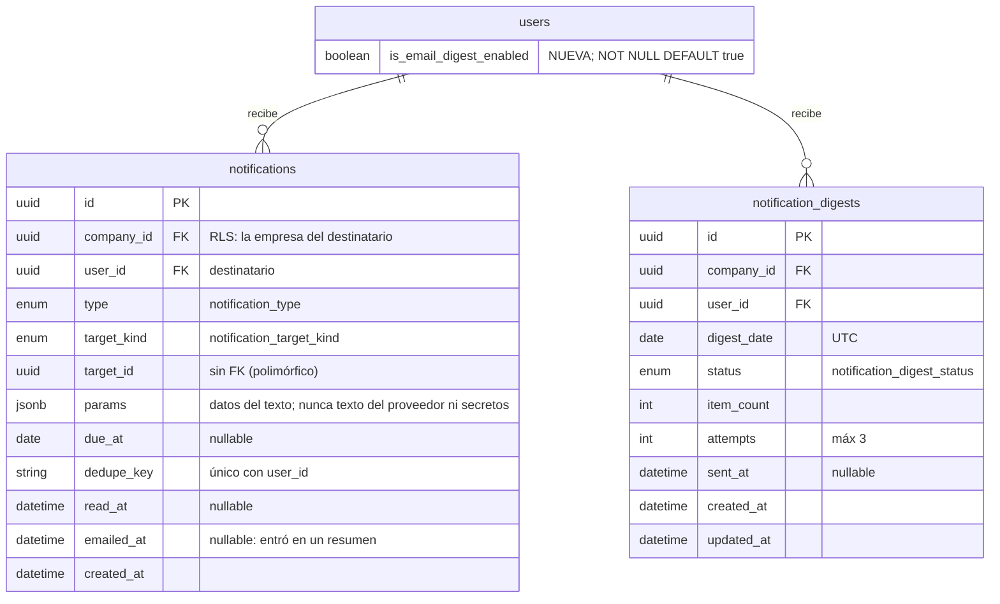

# Modelo de datos — §12 Notificaciones

> Parte de [`modelo-datos.md`](../modelo-datos.md) (índice). **Qué responde:** dónde viven los avisos de cada persona, su preferencia de correo y el resumen diario. **Léelo:** antes de tocar la campana, el resumen por correo o un emisor de avisos (MD-515, MD-504, MD-506, MD-508).
> **Construido (MD-515, 2026-11-25)**; migraciones `20261125100000..100300` y `20261125110000_notification_guards`. MD-508 (D153) añade `catalog.evaluation_parameter_changes` (migraciones `20261125120000..120200`), al final, y el disparador `notifications_publish` (`platform.publish_notification`, migración `20261125130000`): cada fila insertada en `platform.notifications` se publica en el canal en vivo `{ i, u, c }` al confirmar; un duplicado descartado por la clave no publica.
> Es un § nuevo (D143, D151); los anteriores no se renumeran.

## 12. Notificaciones

**Qué es:** cada aviso es de **una persona**. Nace en la misma transacción que el hecho que lo causa (o en la pasada
diaria de las ventanas), llega a la campana al instante y entra una vez en el resumen diario por correo. Dura 90 días.
Contrato: [`contracts/notificaciones.md`](../../../../../../contracts/notificaciones.md).

Todo vive en el schema **`platform`**, porque es de la persona e incluye a los `admin_monkey`: no hay claves foráneas
hacia `tenant`. El destino es polimórfico (`target_kind`, `target_id`) y los datos del texto van en `params` (`target_kind`: `control`, `service`, `document`, `company`; el aviso agrupado de «Sin asignar» es `service` con `control_count` y `control_codes` en `params`).

**Reglas que explican las tablas** (D151):

- **RLS por persona** (SEG-87): un aviso solo lo lee y marca su destinatario (`app.user_id`); el sistema inserta sin
  `RETURNING`, como `audit_logs`. El contenido es inmutable: solo cambian `read_at` y `emailed_at`.
- **Idempotencia:** `UNIQUE (user_id, dedupe_key)`; la pasada diaria y varias réplicas no duplican.
- **Índices:** `(user_id, created_at DESC, id DESC)` para listar, parcial `WHERE read_at IS NULL` para el contador,
  `(company_id, created_at)` para la retención; en `notification_digests`, `UNIQUE (user_id, digest_date)`.
- **Retención:** la lectura filtra 90 días y una pasada diaria borra lo más viejo. La purga de empresas los alcanza sola
  (tienen `company_id`); la purga de una cuenta `admin_monkey` los borra a mano.
- **`notification_digests`** usa el aislamiento estándar por empresa: la tarea lo escribe sin persona.

**`catalog.evaluation_parameter_changes`** (MD-508, D153; schema `catalog`, no `platform`). El historial de cambios de los
parámetros de evaluación (D149): `id`, `parameter_key`, `code` (nullable: dos parámetros no tienen código del libro),
`previous_value` y `new_value` (jsonb), `changed_at` (índice) y `changed_by` (uuid sin clave foránea, como
`audit_logs.user_id`, D117). Lo escribe el `PATCH` de `catalog-admin` en la misma transacción que el cambio; lo lee la
pasada por empresa para emitir `check_parameters_changed`, porque las filas de `audit_logs` de plataforma no tienen
empresa y una sesión de empresa no las ve. RLS: lectura para todos, inserción solo `admin_monkey` (D31), y es
**inmutable** para `monkey_app` (sin `UPDATE`, `DELETE` ni `TRUNCATE`). No lo expone ningún endpoint.
