# Modelo de datos de Monkey

Modelo relacional del dominio: **el plan de construcción**. Conceptual y agnóstico de
motor — el backend decide cómo implementarlo.

**El proyecto está en reconstrucción.** Este archivo es la referencia vigente; el schema
actual del backend es el punto de partida que se está rehaciendo. Dos consecuencias:

- **Si el código hace algo distinto de lo que dice el comité, gana el comité.** Ellos
  hicieron el análisis funcional. Que una tabla o una fórmula ya exista no es argumento.
- **Que algo no esté construido no es un pendiente del modelo.** Si está aquí, está
  decidido. Lo único abierto está en `modelo-datos-pendientes.md`.

| Archivo | Para qué |
|---|---|
| **este** | Qué tablas hay, cómo se relacionan y cómo se calcula el cumplimiento |
| `modelo-datos-decisiones.md` | Por qué se decidió cada cosa, con su fuente |
| `modelo-datos-pendientes.md` | Las preguntas que solo el comité puede responder (hoy, 9: P2, P3, P5, P6, P7, P8, P9, P10 y P11) |
| `flujo-end-to-end.md` | El recorrido de un cliente, módulo por módulo, en orden |
| `modulos/onboarding.md` | El detalle campo por campo de los 3 componentes del onboarding |

## Cómo leer este documento

**Está ordenado por módulos, en el orden en que un cliente los recorre**: primero lo que
existe antes de que haya clientes (el catálogo), después el registro del tenant, los
usuarios, el onboarding con sus 3 componentes, el cumplimiento, y la operación técnica.
Bajando de arriba a abajo se ve cómo se encadena todo.

- Cada módulo abre con **qué es y qué resuelve**, después sus tablas.
- Las tablas se muestran como **diagramas de entidad** con `PK` y `FK` explícitos. **Los
  nombres en los diagramas son los nombres reales de la tabla y de la columna** — se
  implementan tal cual, sin traducir.
- **Las relaciones que no son obvias se explican** debajo del diagrama.

### Convenciones de nomenclatura

Todo identificador de base de datos va **en inglés**. El estándar:

| Elemento | Regla | Ejemplo |
|---|---|---|
| Tabla | `snake_case`, **plural** | `service_frameworks` |
| Columna | `snake_case`, singular | `isolation_strategy` |
| Clave primaria | siempre `id`, tipo `uuid` | `id` |
| Clave foránea | `<tabla_en_singular>_id` | `service_id`, `control_id` |
| Booleano | prefijo `is_`, `has_` o `requires_` | `requires_probe` |
| Fecha/hora | sufijo `_at` | `created_at`, `used_at` |
| Tabla puente | `<tabla_a_singular>_<tabla_b_plural>` | `control_tests` |
| Valor de enum | `snake_case` minúscula | `dedicated`, `not_applicable` |

**La prosa sigue en español** y usa el término del comité (servicio, control, insumo de
revisión); el glosario (§1) da la equivalencia con el nombre de la tabla. El código usa solo
el nombre en inglés.

### Índice

| § | Módulo | Qué contiene |
|---|---|---|
| 0 | Fuentes | Qué documento del comité define qué, y dónde quedó transcrito cada uno |
| 1 | Glosario | Todos los conceptos del dominio, con su tabla |
| 2 | Las 5 dimensiones | El eje transversal que atraviesa todo el modelo |
| 3 | Catálogo maestro | Lo que Monkey administra antes de que exista un cliente |
| 4 | Monkey Admin | Registro del tenant y aislamiento de datos |
| 5 | Usuarios | Los 4 roles, las tablas, las políticas de seguridad, los responsables organizacionales, la matriz de permisos y cómo el modelo de acceso sostiene SOC 2 |
| 6 | Onboarding | Los 3 componentes que capturan el contexto del cliente |
| 7 | Cumplimiento | Controles del cliente, riesgos, evidencias, evaluaciones |
| 8 | Control Técnico | La operación continua de la sonda |
| 9 | El cálculo | Cómo se deriva el cumplimiento, con las 12 reglas |
| 10 | Diagrama global | Todo junto |

---

## 0. Fuentes

Las produce el **comité funcional** y son la fuente de verdad: ante una discrepancia con este
archivo, **gana el documento**.

### La que queda en el repo

| Fuente | Qué define |
|---|---|
| `assets/TSC INTERGRAL SOC 2 DETALLADO VF.xlsx` | **La fuente maestra**, 17 hojas: catálogo maestro (61 requisitos TSC, 302 puntos de enfoque, 119 controles de los que 118 están asignados, 729 relaciones punto de enfoque↔control), 61 TEST de 23 columnas con 284 asignaciones control↔TEST (hoja Pruebas), 89 vínculos documento↔control (50 documentos distintos), 11.352 checks de 77 políticas SCA sobre 18 plataformas con 20 referencias de mapeo, 10 riesgos, 56 causas con 92 relaciones riesgo↔causa, el modelo RBAC, y los formularios de contexto de empresa y de servicio con sus opciones literales |

⚠️ **Las cifras salen de los datos crudos de las hojas, no de la hoja `Resumen`**, que quedó
desactualizada: declara 658 relaciones donde los datos tienen 729, y su desglose por categoría
(A 34 / C 6 / CC 434 / PI 31 / P 153) no coincide con el real (A 39 / C 9 / CC 477 / PI 40 /
P 164). La hoja `Claude Log` del propio archivo confirma "las 729 filas". No corregir hacia 658.

### Fuentes ya transcritas, cuyo archivo no está en el repo

El comité entregó estos documentos y su contenido **ya vive en este archivo**. Se retiraron de
`assets/` el 2026-09-26 para que no hubiera dos versiones de la misma verdad. Dónde quedó cada
uno:

| Fuente original | Dónde está su contenido ahora |
|---|---|
| `MONKEY_Ejemplo_Formula_Cumplimiento.xlsx` | §9: las 12 reglas R-01…R-12 y el ejemplo resuelto. Cerró la decisión D1 |
| `RESUMEN-MODELO-USUARIOS-MONKEY.md` | §5: los 4 roles (§5.1), las tablas (§5.2), las políticas de seguridad con su justificación normativa (§5.3), la matriz de permisos (§5.5) y el mapeo a TSC del modelo de acceso (§5.6) |
| `draft-BLUEPRINT FUNCIONAL-ControlTecnico.docx` | §8: `schedule_rules`, `executions`, `check_results`, `execution_logs`, `monitoring_domains` y las tres reglas de la operación técnica |
| `vision_controles.pptx` | Nada propio: su matriz de evaluación quedó superada por el ejemplo de fórmula |
| `ALCANCE-ONBOARDING-MVP.md` | `sprint-onboarding.md`: alcance, cronograma, prioridades y criterios de aceptación del sprint |
| `PROPUESTA-JIRA-MVP-MONKEY.md` | `mvp-roadmap.md`: los 12 épicos del MVP en orden de dependencia |

> ⚠️ **Un aviso que conviene no perder:** `RESUMEN-MODELO-USUARIOS-MONKEY.md` describía el
> backend como Node.js + Express y el frontend como React, con código de ejemplo en esa forma.
> **Era falso para este proyecto.** Su *modelo* (roles, permisos, tablas, audit trail) es el que
> está transcrito en §5 y es válido; su *implementación* no se copió. El stack real es
> **NestJS 11 + Prisma 7 + Angular 20 standalone** — ver `context/project-context.md`.

### Fuera del repo, en `Monkey/` (carpeta hermana)

No están aquí a propósito: dos tienen datos operativos y uno credenciales.

| Archivo | Qué define |
|---|---|
| `soc2_detalle.py` | La lógica `bool_and`, el tercer veredicto `REVISAR`, la frescura de escaneos y los tres tags de compliance (`tsc` / `soc_2` / `nelson`) — §9 y `wazuh.md` |
| `conexion_api_wazuh_monkey.txt` | Endpoints, flujo del conector, la clave del check, los estados de resultado y la regla de confidencialidad. **Contiene credenciales en texto plano: no copiar a ningún repo; rotar esa password** |
| `Propuesta Proyecto Monkey-1.xlsx` | Alcance comercial de junio 2026 (vulnerabilidades, gestión documental, políticas, notificaciones). **Parcialmente superado**: su "consolidado global de cumplimiento" queda derogado por medir por servicio |
| `SOC2_TSC_Controles_Detallados_Monkey2.xlsx` | Anatomía de requisito, control del cliente y plan de testeo. ⚠️ **No se encuentra en disco** |

### Documentos que estas fuentes citan y no tenemos

Hay que conseguirlos o dejar de citarlos:

| Documento | Quién lo cita | Qué se pierde |
|---|---|---|
| `prompt-user-management-model-monkey.md` | El resumen del modelo de usuarios, como el técnico de 2.500+ líneas | Ahí estaban respondidas: qué pasa si un `admin_empresa` se va, qué pasa con los datos si el cliente cancela, si los auditores externos necesitan MFA, cómo se revoca acceso de inmediato, y la matriz exhaustiva de permisos (la de §5.5 es el resumen) |
| `docs/plan-mapeo-cis-soc2.md` | El código de `monkey-cis-sync` | El plan del mapeo CIS↔SOC 2 |
| `Diseño Funcional APP` | La hoja de roles del archivo maestro | El detalle del modelo de accesos inicial |
| `Guia_Integracion_Wazuh_SCA_MONKEY.docx` | `conexion_api_wazuh_monkey.txt` | Documentación técnica del conector |
| `monkey_soc2_win11.yml` | `soc2_detalle.py` | La política SCA propia de Monkey. Vive en el servidor |

### Procedencia del catálogo de controles

La hoja *Tabla controles SOC 2* del archivo maestro declara su origen: **extraído de Vanta**
(119 registros, `app.vanta.com/c/nextayccom`, 25 de agosto de 2026). El catálogo de Monkey nació
de esa taxonomía y se amplió con los 61 TEST propios y el mapeo a los 11.352 checks. Conviene
tenerlo presente al explicar por qué la estructura (controles ↔ pruebas ↔ documentos ↔
políticas) se parece a la de ese producto.

### Dos reglas que salen de las fuentes y aplican siempre

1. **La dependencia del proveedor del motor de monitoreo es confidencial frente al cliente
   final.** En el producto se dice "sonda", "capacidad automática" o "evaluación automática",
   nunca el proveedor por su nombre. Aplica a UI, notificaciones, reportes y texto generado por
   IA. Ver `philosophy.md`.
2. **El cumplimiento se mide por par servicio × marco**, nunca como un porcentaje de la empresa
   completa.

---

## 1. Glosario

Los conceptos que hay que tener claros antes de leer las tablas, con el nombre de la tabla
que les corresponde.

### Del negocio del cliente

| Término | Tabla | Qué es |
|---|---|---|
| **Organización** | `organizations` | La empresa cliente. Es el contenido de negocio que el cliente declara; el *tenant* como registro técnico es `companies` (§4) |
| **Servicio** | `services` | Lo que se certifica. **Es la unidad de evaluación**: el cumplimiento se mide por servicio, nunca consolidado de empresa |
| **Scope** | `scopes` | Lo **declarado** en el discovery: cuántos servidores, nubes, apps, BD |
| **Insumo de revisión** (activo) | `assets` | Lo **descubierto**: cuáles son exactamente. Puede servir a varios servicios sin duplicarse |
| **Organización de subservicio** | `subservice_organizations` | El proveedor del que depende el servicio (AWS, Azure, un data center) |
| **CSOC** / **CUEC** | `csocs` / `cuecs` | Control complementario que se espera del proveedor (CSOC) o del cliente usuario (CUEC). **Monkey no los mide** |
| **Descripción del Sistema** | `system_descriptions` | Documento con las 10 secciones de los *Description Criteria* de AICPA. Lo sube el cliente |

### Del estándar

| Término | Tabla | Qué es |
|---|---|---|
| **Marco** | `frameworks` | El estándar contratado (en el MVP, solo SOC 2: D37). Contiene requisitos |
| **Requisito** | `requirements` | El criterio del marco: código (`CC6.1`) + criterio + **puntos de enfoque** |
| **Punto de enfoque** | `points_of_focus` | Cada *point of focus* numerado de un requisito. **Es a él que se vincula el control**, no al requisito ni al marco |
| **Criterio de confianza** | `trust_criteria` | Los TSC de SOC 2 (Seguridad, Disponibilidad, Confidencialidad, Integridad, Privacidad). Son catálogo: **clasifican los requisitos**. Qué criterios contrató un servicio es otra tabla (`service_trust_criteria`) y es lo que **filtra qué requisitos le aplican** |
| **Regulación** | `regulations` | Ley aplicable por jurisdicción (Ley 1581, LGPD, GDPR). **No se puntúa** |

### Del cumplimiento

| Término | Tabla | Qué es |
|---|---|---|
| **Control** | `controls` | La medida que ataca una causa. **Atómico**: no pertenece a ningún marco |
| **Control del cliente** | `client_controls` | El control particularizado en el escenario: código propio (`C01`) e **interpretación** reescrita con sus herramientas reales |
| **Riesgo** · **Causa** | `risks` · `causes` | El riesgo se origina en causas; las causas se mitigan con controles. Los tres niveles son `N:M` entre sí |
| **Dimensión** | `control_dimensions` | Dos ejes distintos que no se confunden — ver §2 |
| **Plan de testeo** | `test_plans` | Criterio de auditor: pasos **dependientes**, población y regla de muestreo |
| **Test** | `tests` | Procedimiento de auditoría reutilizable (22 campos propios; la hoja trae 23 columnas y una es su vínculo con los controles). Pertenece a **una** dimensión |
| **Check** | `checks` | La verificación atómica que ejecuta la sonda. Clave natural de tres partes: `platform` + `policy_id` + `check_id` |
| **Evaluación** | `evaluations` | Un test o check aplicado a **un activo**, con su resultado. **Inmutable** |
| **Exclusión** | `exclusions` | Decisión de no medir un check, con justificación aprobada y vigencia |
| **Evidencia requerida** / **entregada** | `evidence_requirements` / `evidence_submissions` | Qué se exige y quién responde / el archivo concreto, con hash de integridad |
| **Hallazgo** | `findings` | Una falla concreta: qué falló, en qué dimensión, sobre qué insumo |
| **Mitigación** · **Riesgo residual** | `mitigations` · `residual_risks` | Indicadores **separados** del cumplimiento (§9). Un 93% de cumplimiento no dice que el riesgo residual sea 7% |
| **Cobertura técnica** | — | Cuánto del scope se puede medir automáticamente. **Número aparte** del cumplimiento |

### De la capa técnica

| Término | Tabla | Qué es |
|---|---|---|
| **Sonda / capacidad automática** | `automated_capabilities` | El mecanismo que evalúa sin intervención humana. Validador único. **Nunca se nombra al proveedor frente al cliente** |
| **Ejecución** | `executions` | Una corrida de la sonda sobre un activo. **No es una Evaluación** |
| **Política SCA** | `sca_policies` | El benchmark que corre la sonda (`cis_alma_linux_8`), con su archivo YAML y su número de checks |
| **Aprovisionamiento** | `asset_provisionings` | El estado de la conexión de un activo: conectado, validado, activo, programado |

### De la plataforma

| Término | Tabla | Qué es |
|---|---|---|
| **Monkey Platform** | — | La aplicación web que usa el cliente |
| **Monkey Admin** | — | Aplicación web separada, con dominio propio, solo para el equipo de Monkey |
| **Tenant** | `companies` | La empresa como unidad de aislamiento de datos |
| **Catálogo maestro** | — | Marcos, requisitos, controles, tests y checks que Monkey administra y que todos los clientes heredan |
| **Escenario del cliente** | — | Lo que se clonó del catálogo a un cliente concreto y él particularizó |

---

## 2. Las 5 dimensiones: el eje transversal

Este es el concepto que atraviesa todo el modelo. **Hay dos ejes distintos y confundirlos
rompe el cálculo.**

| Eje | Valores | Para qué sirve |
|---|---|---|
| **Dimensión de scope** (técnica) | Documental/Política, Servidores, Bases de datos, Aplicación, Nube | Define **sobre qué activos** se evalúa |
| **Dimensión de agrupación** (temática) | Disponibilidad, Seguridad, Confidencialidad, Integridad, Privacidad | Define **cómo se agrega el %** hacia el servicio |

Las temáticas **son los criterios de confianza del marco** (`trust_criteria`, §3.1), que el
servicio contrata. Ejemplo del comité: `C-01` aplica a scope **Servidores + Nube**
(5 activos) y agrupa bajo **Disponibilidad**.

### Las 5 de scope

| Dimensión | Valor del enum | Nota |
|---|---|---|
| Documental / Política (Gobierno) | `policy` | Sin automatización posible: es revisión documental con IA |
| Servidores | `server` | La única con cobertura automática real hoy |
| Bases de datos | `database` | |
| Aplicación | `app` | **0 pruebas definidas todavía** (P9) |
| Nube | `cloud` | **0 checks todavía** (§9) |

Se mantienen exactamente estas 5 (decisión D5). Endpoints y dispositivos de red **se
monitorean pero no son dimensiones**.

### Dónde vive la dimensión: en el control, no en el test

| Tabla | Cuántas dimensiones tiene |
|---|---|
| `controls` | Hasta 5 — una fila de `control_dimensions` por cada dimensión que le aplica (en el escenario del cliente, `client_control_dimensions`, §7.1) |
| `tests` | **Una sola.** El prefijo del código la encodea: `T-DOC-001` es documental, `T-SRV-007` es de servidores |
| `evaluations` | Una: la del test o check que se aplicó, sobre un activo concreto |

Es decir: **el control es el que se evalúa en las 5 dimensiones**; para cada dimensión que le
aplica se usan los tests de esa dimensión. Un control que aplica a Servidores + Nube usa
tests `T-SRV-*` y `T-CLD-*`, y produce evaluaciones en las dos dimensiones.

Lo confirma el reparto del catálogo: de los 61 TEST, **26 son documentales** y **11 son de
nube** — están segmentados por dimensión, no replicados en todas.

Por cada dimensión de un control se define:

- **El tipo**: `manual` · `automated` · `hybrid` · **`technical_manual`** (decisión D4).
- **Si no aplica, la razón** (`reason_not_applicable`). Una dimensión que no aplica se
  declara con su justificación, no se omite.
- **Tres banderas**: `requires_probe`, `requires_ai` y
  **`requires_compliance_confirmation`** — el gate human-in-the-loop. La tercera decide si
  un porcentaje puede cerrar un control por sí solo.

**De dónde salen (D39):** el catálogo solo trae las dimensiones que **aplican** (las que tienen al menos una
prueba del control; 210 filas, ninguna de `app`), con el tipo y las banderas derivados de sus pruebas. Una
dimensión que no aplica se declara en el escenario del cliente (`client_control_dimensions`) con su
`reason_not_applicable`.

---

## 3. Catálogo maestro

**Qué es:** todo lo que Monkey administra y que existe **antes de que haya un solo cliente**
— los marcos con sus requisitos, los controles, los tests, los checks de la sonda, y el
catálogo base de riesgos y causas. Lo cura el equipo de Monkey desde Monkey Admin.

**Por qué importa:** cuando un cliente contrata un marco, no se le inventa nada: hereda este
catálogo y lo particulariza. Y como el catálogo cambia con el tiempo, se versiona.

### 3.1 El marco y sus requisitos

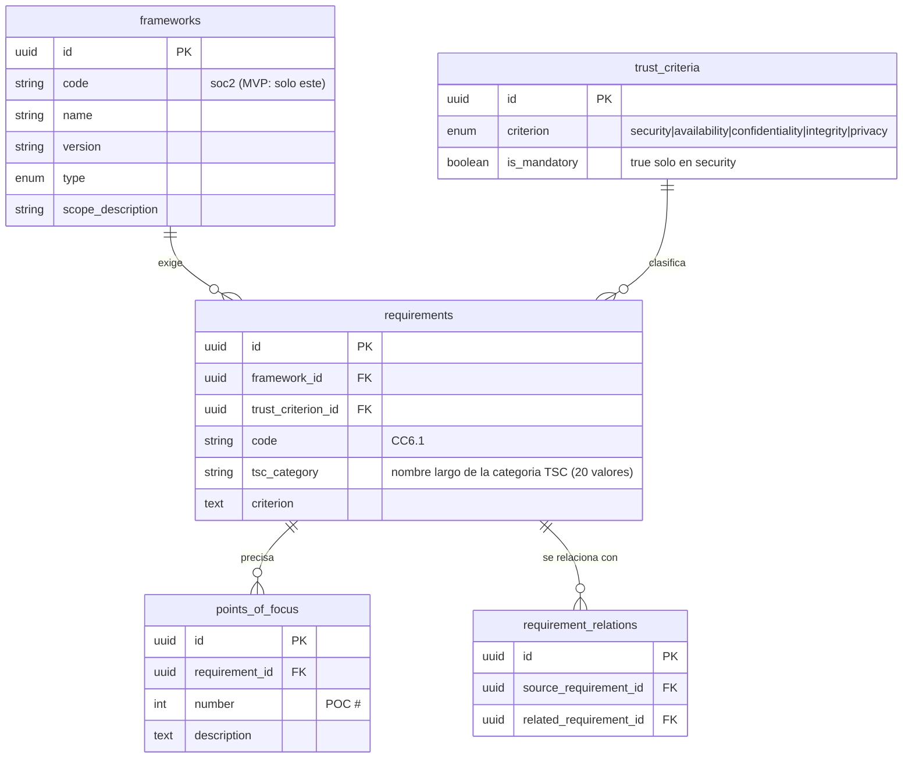

**El punto de enfoque es el punto de anclaje.** No se cuelga nada del marco ni del requisito
directamente: el control se vincula al **punto de enfoque**, que es el nivel de detalle
donde el estándar dice qué se espera.

### 3.2 El control y su desacople del marco

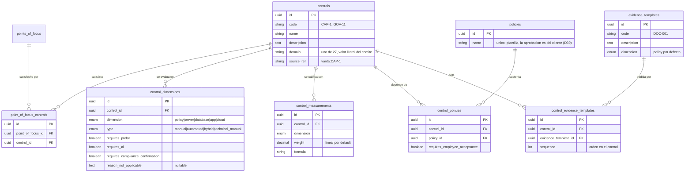

**El desacople es la regla estructural del modelo:** el control **no pertenece a ningún
marco**. Se vincula a puntos de enfoque (`N:M` vía `point_of_focus_controls`), y son los
requisitos los que pertenecen al marco. Datos reales que lo exigen: `MON-4` satisface `A1.1`,
`CC7.2` y `PI1.3` a la vez; la suma de controles por categoría TSC da 131 sobre 118 reales
*"porque varios controles sirven a varias categorías"*; y un solo check trae mapeo a **20
referencias** simultáneas.

**El dominio es del control, no del requisito, y son 27** (`controls.domain`, valor literal del
comité: "Gestión de Activos", "Monitoreo Continuo"…). En el Excel el dominio **cambia dentro de un mismo
requisito en 41 de los 61**, por eso no puede colgar del requisito; y no se deriva del prefijo del código
porque `AST` tiene dos dominios (D35). Prefijos de código: `AST`, `BCD`, `CAP`, `CFG`, `CHG`,
`CPL`, `DCH`, `GOV`, `HRS`, `IAC`/`IAO`, `IRO`, `MON`, `NET`, `SAT`, `TDA`…). Los más
cargados: Privacidad 17, Gobierno 13, Identificación y Autenticación 13.

**Un control depende de políticas y documentos**, no solo de tests: *"el control depende de
la aprobación de la política"*. Los documentos son `evidence_templates` (el comité vincula 89 a 67 de
los 119 controles, 50 documentos distintos; uno sirve a varios controles) y son de donde se
clonan las evidencias requeridas del cliente (§3.5, §7.3, D36).

> **Procedencia:** el catálogo de controles fue **extraído de Vanta** (119 registros,
> 25 ago 2026) y ampliado con los TEST y el mapeo propios. `CPL-1` es el único sin asignar
> porque **es la Descripción del Sistema**, no un control medible.

### 3.3 Tests, checks y plan de testeo

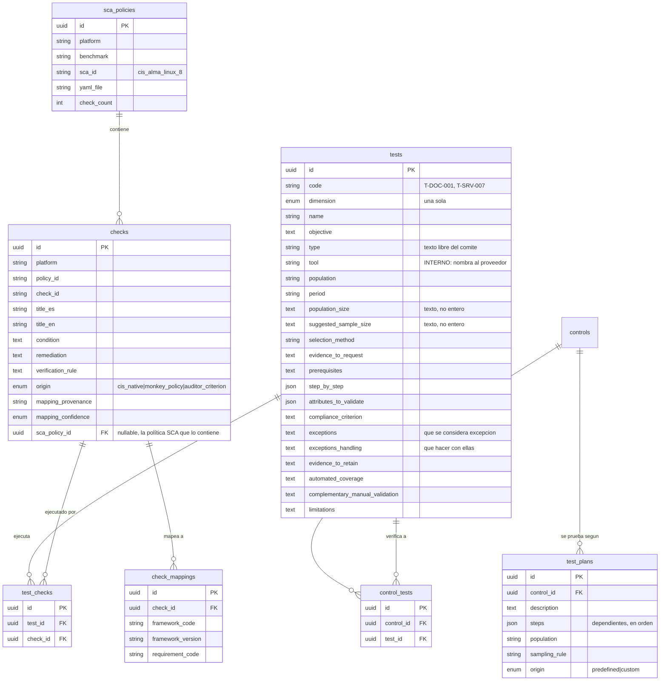

**`tests` es `N:M` con `controls`, y es deliberado.** `T-DOC-001` sirve a 103 controles: los 118
controles asignados y los 61 TEST producen **284 asignaciones** control↔TEST (de 1 a 7 pruebas por control,
2,4 de media). Modelarlo `N:1` duplicaría 61 tests en cientos de filas.

**La fuente de esas 284 es la hoja *Pruebas*** (columna *Controles relacionados*), que cubre las 61 pruebas
y los 118 controles. La matriz *Análisis TEST x Control* trae 248, de las que 27 citan `T-APP-001…006`, que
no existen en *Pruebas* — la propia hoja marca *"FALTAN 6"* — y contiene las otras 221 (D38). Por eso hoy
**la dimensión Aplicación no tiene ninguna prueba definida** (P9).

**Las pruebas son texto interno.** Nombran al proveedor del motor de monitoreo en 15 de sus 23 columnas
(`tool`, `automated_coverage`, `limitations`, `prerequisites`, `step_by_step`…) e incluso en 4 nombres:
ninguno de esos textos sale tal cual a la UI, a un reporte ni a un texto generado por IA (P11). Los campos
`population_size` y `suggested_sample_size` son **texto** porque en el Excel son frases ("Por determinar con
base en el inventario de proveedores"; "N<5 → 100%; si no, 10% de la población (mín. 5, máx. 25)"), no
enteros: el muestreo se guarda como dato y su cálculo se construye después (D8).

**La clave natural del check es de tres partes** (`platform` + `policy_id` + `check_id`) y el
catálogo es grande: **77 políticas, 11.352 checks, 18 plataformas** (Windows 8 políticas de
10 a Server 2025, macOS 12, Ubuntu 6, Debian 7, RHEL 6, más motores: PostgreSQL, MySQL, SQL
Server, Oracle, MongoDB, Apache, NGINX, IIS). El mapeo es **por política** (decisión D6): si
un activo corre una política sin mapeo, ese control queda **sin medir** para ese activo — no
se inventan equivalencias.

**El muestreo es dato, no texto** (decisión D8): *"N<5 → 100%; si no, 10% de la población
(mín. 5, máx. 25)"*. El cálculo de la muestra concreta se construye después; los campos se
guardan ahora.

**Cinco estados del check de la sonda** (distintos de los 4 del resultado de evaluación): `passed`, `failed`, `invalid`, `not_applicable` (llega como
`result` vacío) y `not_run`.

> **Cuidado con la palabra "prueba", que son tres cosas distintas:** los **61 TEST** de
> Monkey (`tests`), las **107 pruebas vinculadas** de Vanta y los **11.352 checks** de la
> sonda (`checks`). Más 89 vínculos a documentos (50 documentos distintos) y 16 vínculos a 10 políticas del catálogo de origen.
>
> **`ChecklistOs` se elimina** del schema y se reemplaza por `sca_policies` + `checks`.

### 3.4 Riesgos y causas (catálogo base)

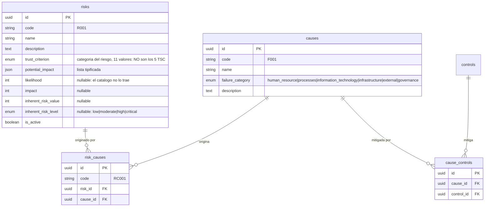

**Los tres niveles se reutilizan**, y por eso las tres relaciones son `N:M`: 10 riesgos y 56
causas en el catálogo, unidos por 92 relaciones riesgo↔causa, y una causa como `F001`
apunta a cuatro controles distintos (209 aristas causa→control en total, sobre los 118 controles). **Diez de
las 56 causas no pertenecen a ningún riesgo** en la hoja del comité (F003, F004, F016, F020, F026, F034,
F042, F045, F053, F054): se cargan tal cual, sin asociar (P9).

**El riesgo cuelga del servicio, no del marco** (ver §7.2). Un riesgo no es "de SOC 2": es
del negocio del cliente, y los controles que lo mitigan sirven a los marcos que sea.

**El catálogo trae los riesgos sin evaluar.** La hoja *Riesgos* del comité define 10 riesgos con
su categoría e impactos potenciales, pero deja **probabilidad, impacto y nivel vacíos**: los
evalúa cada cliente sobre la matriz 5×5 (probabilidad × impacto: Bajo 1-4, Moderado 5-9, Alto
10-16, Crítico 17-25). Por eso esos cuatro campos son opcionales, y la categoría del riesgo
(`trust_criterion`) tiene **11 valores** — Confidencialidad, Integridad, Disponibilidad,
Privacidad, Cumplimiento, Seguridad, Continuidad, Terceros, Fraude, Reputación y Operación—,
que **no son los 5 TSC** de §3.1 pese al nombre de la columna (D33). Las causas se agrupan en 6
categorías de falla: recurso humano, procesos, tecnología de información, infraestructura,
externos y gobierno.

**Este catálogo es solo la plantilla.** Ningún cliente trabaja sobre `risks` ni `causes`: al
elegir marco se **copian** a `client_risks` y `client_causes` (§7.2) y ahí el cliente los
edita, agrega o elimina. Lo que un cliente cambie **solo lo ve él**; el catálogo y los demás
clientes no se enteran (decisión D28).

> "Riesgo residual" es **jerga prohibida** en la superficie del producto (`philosophy.md`).
> Existe como cálculo interno y en modo auditor.

### 3.5 Versionado del catálogo y qué se clona

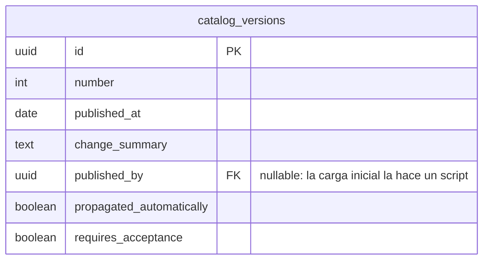

**El catálogo se versiona y cada fila de `evaluations` guarda contra qué versión se midió**
(decisión A4). Sin eso, un histórico no es comparable y un número entregado a un auditor
puede cambiar solo — ya pasó una vez con la reclasificación de 223 checks.

**Qué se clona al escenario del cliente y qué no:**

| Elemento | ¿Se clona? |
|---|---|
| `controls` → `client_controls` | **Sí**, tabla propia: el cliente reescribe su interpretación (D3), **crea controles propios** (`control_id` nulo) y los **da de baja** (`is_active`). Ver D36 |
| `control_dimensions` → `client_control_dimensions` | **Sí** (D36): un control propio declara las suyas y cualquiera puede justificar `reason_not_applicable` |
| `risks` y `causes` → `client_risks` y `client_causes` | **Sí, en dos momentos distintos**, y con tablas propias del cliente (D28). El set base se clona **automáticamente** al elegir marco en el Componente 2 (§6.2), junto con sus relaciones (`client_risk_causes`, `client_cause_controls`); la **personalización** pasa después, en el módulo de Cumplimiento (§7.2), sin bloquear nada. Editar una copia jamás toca el catálogo ni a otro cliente |
| **`requirements` y `points_of_focus`** | **No se clonan — se referencian con FK real.** Viven en la misma base; `client_controls` y `service_frameworks` apuntan directo a ellos. Es texto de un estándar, no hace falta copiarlo |
| `evidence_templates` → `evidence_requirements` | **Sí** (D36): cada plantilla ligada al control se clona por control del cliente, con `source_ref` = código de la plantilla y responsable vacío. La evidencia de un control propio la define el cliente |
| `tests` | **No: se referencian con FK real** (`evaluations.test_id`, `exclusions.test_id`). El cliente no reescribe un test |
| `control_tests` → `client_control_tests` | **Sí** (D36): se copia el **vínculo** control ↔ test, no el test. Lo necesita un control propio y es lo que "cambiar los tests de un control requiere aceptación" (abajo) da por hecho |
| `control_measurements` | **No** (D2: peso lineal, sin configuración). Ausencia de fila = peso 1. Si D2 se revisa, se clonan entonces |

**Qué se propaga solo y qué requiere aceptación del consultor:**

| Tipo de cambio en el catálogo | Se propaga solo | Requiere aceptación |
|---|---|---|
| Corrección de redacción de un control | ✅ | |
| Control nuevo agregado al catálogo | ✅ | |
| Cambio en cómo se mide un control (peso, dimensiones, tests) | | ✅ |
| Control que se elimina del catálogo | | ✅ |
| Cambio en la procedencia o confianza del mapeo de un check | | ✅ |

**Y un control nuevo no baja el % del cliente a mitad de camino.** Entra a contar desde el
**siguiente periodo de evaluación** — el número del periodo en curso no se toca, aunque el
catálogo ya haya cambiado. Por eso `catalog_versions` guarda si cada cambio se propagó solo o
quedó pendiente de aceptación, y `service_frameworks` sabe desde qué periodo aplica cada
versión.

---

## 4. Módulo Monkey Admin — registro del tenant

**Qué es:** la aplicación web separada, con dominio propio, donde el equipo de Monkey
registra empresas y cura el catálogo maestro. No comparte UI con Monkey Platform.

**Qué resuelve:** el cliente **nunca se auto-registra**. Monkey lo provisiona primero, fija
cómo se van a aislar sus datos, y le manda una clave para que entre.

### 4.1 Las tablas

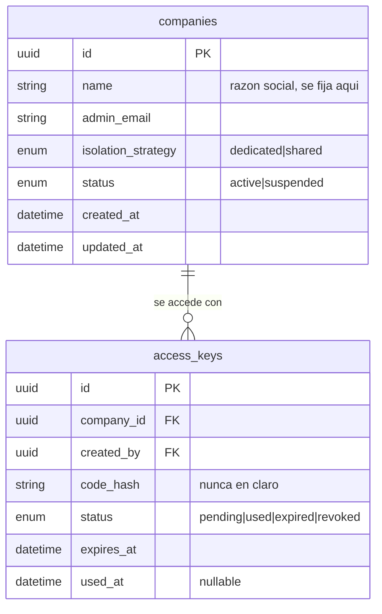

### 4.2 El flujo de registro

El formulario de Monkey Admin pide **3 campos**: nombre o razón social, un check de si
requiere base de datos dedicada, y el correo administrativo de la empresa. Al enviarlo:

1. Se crea `companies` con ese `name` y con `isolation_strategy` = `dedicated` si el check
   está marcado, `shared` si no.
2. Se genera una fila en `access_keys`, de un solo uso, con expiración.
3. La clave se envía **al `admin_email` capturado en el formulario**.
   > ⚠️ **En el sprint de onboarding esto todavía no ocurre.** El envío por correo está
   > aplazado (MD-69), así que `admin_monkey` **copia la clave desde la UI de Monkey Admin**
   > y la entrega por el canal que sea. Por eso el registro debe **mostrar la clave en claro
   > una sola vez**: es el único medio de obtenerla. El destino sigue siendo el `admin_email`.
4. El cliente usa la clave para crear su cuenta `admin_empresa` en Monkey Platform.
5. Arranca el onboarding (§6). El campo "nombre / razón social" del Componente 1 llega
   **precargado y bloqueado**: ya se fijó aquí.

### 4.3 Aislamiento de datos (multi-tenancy)

**Es híbrido: la política del cliente es lo que lo motiva, pero la elección la hace
`admin_monkey`** al crear la empresa en Monkey Admin (decisiones D24 y D25). No es una regla
técnica interna que Monkey aplique sola, ni un campo del onboarding que el cliente rellene.

| Estrategia | Para quién | Cómo aísla |
|---|---|---|
| **`shared`** (por defecto) | El resto de los clientes | **Una sola base de datos** con el catálogo maestro y los datos de todos los tenants en el mismo esquema, aislados por **Row-Level Security sobre `tenant_id`** |
| **`dedicated`** | El cliente que por política propia exige separación total | Réplica completa del esquema (catálogo + sus datos) en su propia base, sin cruzar con nadie |

**Para el MVP no hay "plano central" en una base aparte** (decisión D25): catálogo y
escenario del cliente son tablas de la misma base, con **relaciones reales (FK)**. Si un
cliente le contrata SOC 2 a un servicio, `service_frameworks` referencia directo a
`frameworks` con una foreign key — no una copia ni una llamada entre bases. Son más tablas en
una sola base, pero es más simple de razonar y de consultar al tamaño del MVP.

**La base se llama `monkey`** (más `monkey_shadow` para la shadow de Prisma), y dentro lleva
**cuatro schemas de Postgres**, no por aislamiento —eso lo da RLS— sino para saber dónde vive
cada cosa sin adivinar:

| Schema | Qué contiene | RLS |
|---|---|---|
| `catalog` | El catálogo maestro (§3). Global, ninguna tabla lleva `tenant_id` | **solo de escritura**: cualquiera lo lee, únicamente `admin_monkey` lo modifica (D31) |
| `platform` | Monkey Admin y usuarios (§4, §5) | sí, todas: `companies` y `access_keys` por `admin_monkey` o por su propio tenant (D31) |
| `tenant` | Onboarding, Cumplimiento y Control Técnico (§6 a §9) | sí, todo |
| `audit` | `audit_logs` y `compliance_events`, con `REVOKE UPDATE, DELETE` que refuerza el append-only | sí (`audit_logs`: lo lee su tenant o `admin_monkey`) |

Las FK **cruzan schemas con normalidad**: `service_frameworks` en `tenant` referencia
`frameworks` en `catalog` con una foreign key real. Un schema es un namespace, no un perímetro.
La variable de conexión es `DATABASE_URL`; las `CENTRAL_DATABASE_URL` y
`TENANT_MIGRATION_DATABASE_URL` del código actual desaparecen con los dos planos.

La estrategia **se decide en el aprovisionamiento, no en el onboarding**, y queda como
columna de `companies` — no de `organizations`, que la crea el cliente después. No se
revierte sin migrar los datos. En el caso compartido, **el aislamiento lo garantiza la
política RLS de Postgres**, nunca un `WHERE tenant_id = ?` que dependa de que cada consulta
lo incluya.

### 4.4 Variables de sesión y reglas de integridad transversales

**Las tres variables que la app fija por transacción** (`set_config(..., true)`, nunca a nivel
de conexión, para que no se filtren a otra petición del pool):

| Variable | Qué es | Quién la lee |
|---|---|---|
| `app.tenant_id` | La empresa activa | Toda política de tenant |
| `app.user_id` | El usuario que actúa | `auditor_assignments` (ve las suyas sin importar el tenant) |
| `app.user_role` | Su rol (`admin_monkey`, …) | Escritura de `catalog`, lectura de `companies`/`access_keys`/`audit_logs` |

**Las búsquedas que ocurren antes de conocer el tenant** no pueden pasar por RLS (falla
cerrado). Cada una tiene una función `SECURITY DEFINER` angosta, que devuelve solo las
columnas que necesita y se ejecuta con `search_path` fijo (D29): `find_login_candidates`
(email → usuario), `find_access_key` (hash → clave), `find_session_by_token` (hash del refresh →
sesión) y `find_api_key` (hash → API key). Con el `company_id` que devuelven, la app fija
`app.tenant_id` y sigue con RLS normal. **Por eso `code_hash`, `refresh_token_hash` y `key_hash`
son únicos.**

**Reglas que RLS no puede imponer y que la aplicación cumple siempre:**

- Una FK no valida que el padre sea del mismo tenant (las comprobaciones de FK ignoran RLS).
  Antes de escribir una fila con FK a otra tabla de tenant, **se lee el padre con el cliente
  ya sujeto a RLS**: si no lo ve, no es suyo.
- `audit_logs` se escribe **sin `RETURNING`** (`createMany` o SQL directo). Un `INSERT … RETURNING`
  exige que la fila nueva también pase la política de lectura, y una acción de plataforma sin
  tenant no la pasa.
- El `email` de `users` se guarda **en minúsculas** (hay un `CHECK`).
- `evaluations.service_id` debe ser el mismo que `client_controls.service_id` del control evaluado: no hay
  FK compuesta que lo imponga.

**Claves únicas que el modelo exige** (todas con índice; sin ellas el catálogo se duplica al
cargarlo y una regla de negocio depende de que nadie se equivoque):

| Tabla | Único sobre |
|---|---|
| `frameworks` | `code` + `version` |
| `requirements` | `framework_id` + `code` |
| `points_of_focus` | `requirement_id` + `number` |
| `requirement_relations` | `source_requirement_id` + `related_requirement_id` |
| `trust_criteria` | `criterion` |
| `controls` | `code` |
| `users` | `email` (global) |
| `access_keys` · `api_keys` · `sessions` | `code_hash` · `key_hash` · `refresh_token_hash` |
| `user_control_assignments` | `user_id` + `client_control_id` |
| `auditor_assignments` | `auditor_user_id` + `company_id` (renovar es cambiar `expires_at`) |
| `service_frameworks` | `service_id` + `framework_id` (un servicio contrata un marco una vez) |
| `client_controls` | `service_id` + `control_id` (se clona una vez por servicio; los propios, con `control_id` nulo, no chocan) y `service_id` + `own_code` |
| `evidence_requirements` | `client_control_id` + `code` |
| `client_control_dimensions` · `client_control_tests` | `client_control_id` + `dimension` · `client_control_id` + `test_id` |
| `evidence_templates` · `control_evidence_templates` | `code` · `control_id` + `evidence_template_id`, y `control_id` + `sequence` |
| `assets` | `organization_id` + `code` |
| `vulnerabilities` | `asset_id` + `cve` + `package_name` |
| `client_risks` · `client_causes` | `service_id` + `code`, y `service_id` + la plantilla de origen |

Además, toda tabla con RLS lleva un índice sobre `tenant_id` (o `company_id`): la política se
evalúa en cada consulta. **Toda FK lleva su índice** (Postgres no los crea solo), salvo las columnas
de "quién lo hizo" (`created_by`, `approved_by`, `assigned_by`…), que no se consultan por sí solas.
No hay ningún `ON DELETE CASCADE`: el histórico (`evaluations`, `findings`, `compliance_events`,
`audit_logs`) no se borra nunca, y un servicio con evaluaciones no se puede eliminar. Tampoco hay
`SET NULL` sobre quién actuó (`user_id`, `confirmed_by`, `approved_by`, `reported_by`): tocar un usuario
no puede borrar la atribución de un registro inmutable, así que esas FK son `RESTRICT`.

**Datos de arranque:** `access_keys.created_by` es FK obligatoria a `users`, y `users.company_id`
también. Antes de crear la primera empresa hace falta una `companies` interna de Monkey y un primer
`admin_monkey` (seed). Sin eso el sistema no puede registrar a nadie. `catalog_versions.published_by`
es **opcional** (D35): la carga inicial del catálogo no necesita ningún usuario.

---

## 5. Módulo Usuarios

**Qué es:** quién puede entrar, con qué rol, y qué controles tiene asignados dentro de su
empresa.

**Qué resuelve:** que el auditor no vea todos los tenants, que el control owner solo toque lo
suyo, y que la revocación de un acceso sea demostrable ante un auditor.

Definido y cerrado por el comité en su modelo de gestión de usuarios, transcrito en esta §5
(ver §0).

### 5.1 Los 4 roles

| Rol | Quién es | Alcance | MFA |
|---|---|---|---|
| `admin_monkey` | Equipo Monkey | Global: acceso de todos los tenants **y el catálogo maestro** | Sí |
| `admin_empresa` | CISO, Compliance Leader | Su empresa. **Único que aprueba evidencia** | Sí |
| `funcional` | Control Owners | **Solo los controles asignados** | No |
| `auditor` | Auditores internos/externos | Lectura + módulo de auditoría. **Único que registra hallazgos** | Sí |

**Correcciones obligadas al enum actual** (`MONKEY_ADMIN`, `CLIENT_ADMIN`, `USER`, `VIEWER`):

- **Falta `auditor`.** `VIEWER` no sirve: el auditor **escribe**.
- **`VIEWER` no existe** en el modelo del comité — decidir si se conserva.
- `USER` ≈ `funcional`, pero **le falta la asignación de controles**, sin la cual no hay
  "control owner".

**Que `admin_monkey` no pueda crear controles no contradice que Monkey cure el catálogo**
(decisión D9): la matriz de permisos describe el **escenario del cliente**, donde Monkey no
le inventa controles a nadie. El catálogo maestro se administra en Monkey Admin (§3).

### 5.2 Las tablas

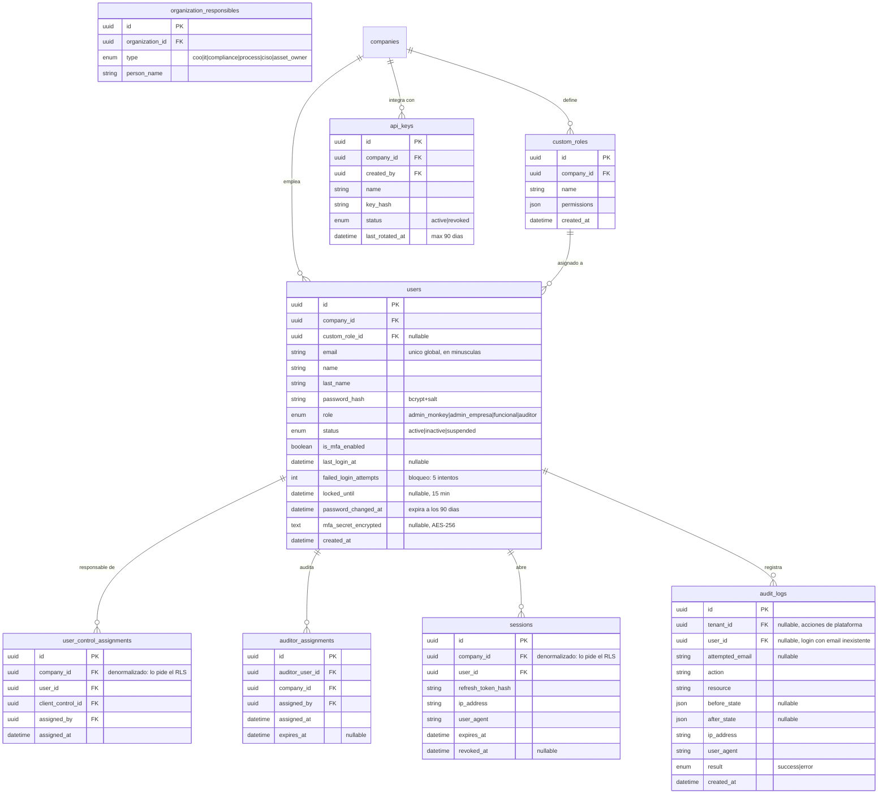

**El estado del usuario no es cosmético:** `CC6.3` (deprovisioning) se cumple pasando el
usuario a `inactive` y cerrando su sesión. Es un control auditable, no una preferencia de UI.

**`user_control_assignments` apunta a `client_controls`, no a `controls`.** Un usuario es
responsable del control *de su empresa*, no del control del catálogo maestro.

> **Corregido el 2026-09-26 al auditar los contratos:** `users` no tenía ningún campo de
> nombre de persona, pero el modelo de usuarios del comité lo exige (*"Email,
> nombre, rol, empresa, controles asignados"*). Gana el documento del comité: se añaden `name`
> y `last_name`.

### 5.3 Políticas de seguridad de la plataforma

**Requisitos, no sugerencias.** Cada uno responde a una norma concreta, que es lo que lo hace
no negociable:

| Política | Valor | Por qué ese valor |
|---|---|---|
| Sesión | 30 min de inactividad, 8 h máximo | Reduce la ventana de una sesión robada |
| Contraseña — longitud | 12+ caracteres | NIST SP 800-63 |
| Contraseña — complejidad | mayúscula + minúscula + número + símbolo | Encarece la fuerza bruta |
| Contraseña — expiración | 90 días | Requisito SOC 2 |
| MFA | TOTP obligatoria para `admin_monkey`, `admin_empresa` y `auditor` | Protege el acceso crítico |
| Cifrado en reposo | AES-256 (bcrypt+salt para contraseñas, secreto MFA cifrado) | Requisito NIST |
| Cifrado en tránsito | TLS 1.3 + HSTS | Requisito PCI DSS |
| Rotación de API keys | 90 días | Acota el daño de una key comprometida |
| Rate limiting | 100/min por usuario, 1000/min por empresa | Previene abuso y DoS |
| Retención del audit trail | 7 años, inmutable, append-only | SOC 2 Type II |
| IP whitelist | opcional, configurable | Control adicional de acceso |
| Bloqueo de cuenta | 5 intentos fallidos, 15 min | Previene fuerza bruta |

> **MFA es requisito vigente, pero su implementación está aplazada a MD-94** y no entra en el
> sprint de onboarding: MD-64 entrega login con JWT y refresh, sin segundo factor. Es deuda
> conocida, no una decisión revertida.

La autorización se verifica **en cada request** (*"no confiar en el frontend"*), con caché de
5 min.

### 5.4 Responsables organizacionales

**Distinto del rol de aplicación:** el cargo responde ante el auditor, el rol dice qué puede
tocar en el sistema. Los cargos (`organization_responsibles.type`): **`coo`** (autoriza
accesos), **`it`** (ejecuta lo técnico), **`compliance`**, **`process`**, **`ciso`**,
**`asset_owner`**.

**El cargo y la persona viven ambos en el escenario del cliente**, en `organization_responsibles`
(`type` es el cargo, `person_name` quien lo ocupa hoy), y la persona puede cambiar sin tocar
quien apunta al cargo (decisión A1, precisada por D30: no existe un catálogo global de cargos). Hay responsable **por
nivel de objeto** — activo, control, cumplimiento y riesgo (§9).

---

### 5.5 Matriz de permisos

Lo que puede hacer cada rol. Transcrita del modelo de usuarios del comité; es el resumen, no la
matriz exhaustiva (esa vivía en `prompt-user-management-model-monkey.md`, que no tenemos).

| Acción | `admin_monkey` | `admin_empresa` | `funcional` | `auditor` |
|---|---|---|---|---|
| Crear empresa | ✓ | | | |
| Crear usuario | ✓ | ✓ | | |
| Crear control | | ✓ | | |
| Editar control | | ✓ | ✓ solo el suyo | |
| Crear riesgo | | ✓ | | |
| Ver riesgo | | ✓ | ✓ solo el suyo | ✓ |
| Subir evidencia | | ✓ | ✓ | |
| Aprobar evidencia | | ✓ | | |
| Ver evidencia | | ✓ | ✓ solo la suya | ✓ |
| Ejecutar test | | ✓ | ✓ solo el suyo | ✓ solo lectura |
| Ver audit trail | ✓ | ✓ | limitado | ✓ |
| Crear API key | | ✓ | | |
| Módulo de auditoría | | | | ✓ |

Dos cosas que se leen mal si no se dicen: **`admin_monkey` no crea controles ni riesgos de un
cliente** — administra la plataforma y el catálogo maestro, no el escenario de nadie; y
**`funcional` está siempre acotado a lo que tiene asignado** vía `user_control_assignments`.

> ⚠️ El material del comité habla de **"34 permisos"**, pero la matriz que entregó tiene 13
> acciones. El número de 34 sale del documento técnico completo, que **no está en el repo**. No
> repetir "34 permisos" como si estuviera documentado aquí.

El detalle fino de qué permisos concretos puede llevar un `custom_role` sigue abierto — ver P3
en `modelo-datos-pendientes.md`.

### 5.6 Cómo el modelo de usuarios sostiene SOC 2

El propio modelo de acceso es evidencia para el marco. Mapeo del comité:

| TSC | Qué exige | Con qué se cumple |
|---|---|---|
| CC6.1 | Aprovisionamiento de accesos | `users` + `user_control_assignments` |
| CC6.2 | Derechos de acceso | La matriz de §5.5 |
| CC6.3 | Desaprovisionamiento | `users.status` a `inactive` + cierre de sesión |
| CC7.1 | Monitoreo del sistema | `audit_logs` inmutable |
| CC7.2 | Detección de actividad no autorizada | Registro de intentos de acceso denegados |
| CC7.3 | Detección de excepciones | Alerta ante 403 y cambios anómalos |
| CC9.1 | Autenticación | MFA TOTP + política de contraseña (§5.3) |
| CC9.2 | Gestión de cambios | `audit_logs` con estado antes y después |
| C1.2 | Confidencialidad | Aislamiento por tenant (§4.3) + AES-256 |

Es la razón por la que las políticas de §5.3 son requisitos y no preferencias: cada una responde
a un criterio que el auditor va a pedir.

---

## 6. Módulo Onboarding

**Qué es:** los 3 componentes que capturan el contexto del cliente antes de que exista ningún
cálculo de cumplimiento. Detalle campo por campo en `modulos/onboarding.md`.

**Qué resuelve:** sin organización, servicio y scope declarados no hay nada que medir. Es el
único flujo del producto que es secuencial y obligatorio.

**Cumplimiento no es un 4º componente** (decisión D23, confirmada por el comité el
2026-09-26): al elegir marco en el Componente 2 el
catálogo se clona solo, y personalizarlo es un módulo aparte que no bloquea nada (§7).

### 6.1 Componente 1 — Contexto Organizacional

Se llena **una vez por empresa**. Diez campos: identidad, perfil y jurisdicción.

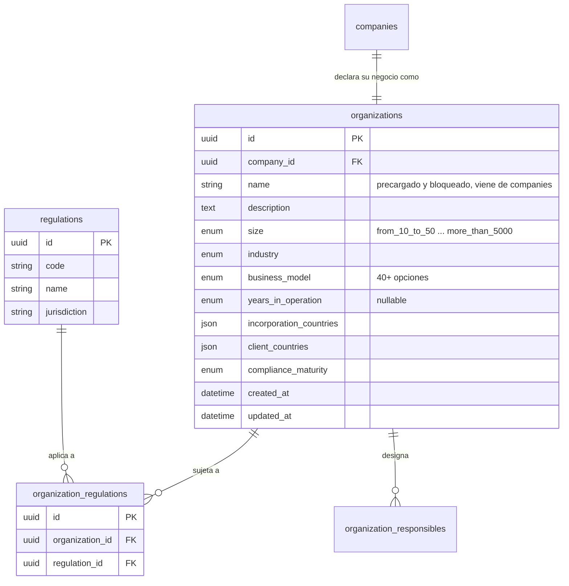

**`companies` y `organizations` son dos cosas distintas y conviene no fusionarlas.**
`companies` es el tenant: existe desde Monkey Admin, antes de que el cliente entre, y lleva
el aislamiento de datos. `organizations` es el contenido de negocio que el cliente declara
dentro de ese tenant. El `name` se fija en `companies` y se refleja bloqueado aquí.

**Los rangos numéricos se nombran con prefijo.** `size` y `active_client_count` son rangos
(«10-50», «1-10»…), y un valor de enum no puede empezar por dígito: se escriben
`from_10_to_50`, `from_51_to_200`, … `more_than_5000`. Las etiquetas que ve el usuario salen
de i18n, no del enum — la tabla de correspondencia está en `contracts/enums.md`.

> **Corregido el 2026-09-26:** `organizations` y `services` no llevaban `created_at`/`updated_at`
> mientras `companies` sí, sin razón. Se añaden por consistencia con la convención de fechas
> (`_at`). No es una decisión de producto, es la misma columna de auditoría del resto.

**`regulations` es tabla propia y no se puntúa** (decisión D10): nadie "contrata" la Ley
1581, pero sí determina qué le aplica. No entra al cálculo de cumplimiento.

> **Se vetó a propósito el campo "framework que desea gestionar" a nivel de empresa.** Los
> marcos se contratan **por servicio** — cada servicio puede perseguir uno distinto y no
> existe un framework "de la empresa". Esa pregunta vive en el Componente 2.

### 6.2 Componente 2 — Contexto del Servicio

Se llena **una vez por servicio** (un cliente puede declarar varios). Dieciséis campos,
incluida la carga de la Descripción del Sistema.

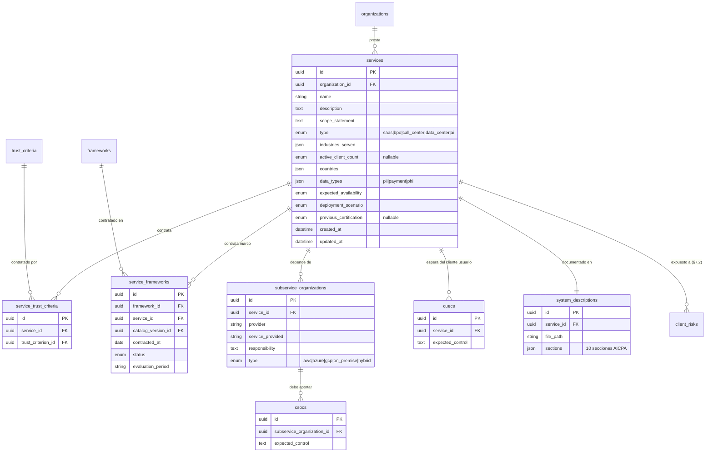

**El servicio es la unidad de evaluación.** Todo el cumplimiento se mide por par
(servicio × marco). No existe un porcentaje de la empresa (§9).

**`trust_criteria` son dos cosas y hay que separarlas.** El criterio en sí (los 5 TSC) es
**catálogo** — clasifica a los requisitos (§3.1). Qué criterios contrató un servicio concreto
es **escenario del cliente**, y va en el puente `service_trust_criteria`. Modelarlo como una
sola tabla colgada del servicio rompía la FK de `requirements`, que necesita apuntar al
criterio del catálogo, no a la contratación de un cliente.

El filtro funciona así: si el servicio no contrata `privacy`, los requisitos clasificados
como `P*` no entran a su cálculo. **`security` es obligatorio siempre.**

**`service_frameworks` es el disparador del clonado.** Al crearse esta fila, el catálogo de
ese marco (riesgos, causas, controles) se clona al escenario del cliente (§3.5). Guarda
también **contra qué versión del catálogo** (`catalog_version_id`) y **desde qué periodo**
(`evaluation_period`) aplica, que es lo que evita que un control nuevo mueva el número a
mitad de periodo.

**`csocs` y `cuecs` son tablas propias marcadas como no medibles por Monkey** (decisión D11).
Salen de las secciones 7 y 8 de la Descripción del Sistema. Existen porque el auditor los
pide, no porque Monkey los evalúe.

### 6.3 Componente 3 — Control Técnico

El cliente conecta su infraestructura real. **Nunca ve el nombre del proveedor del motor de
monitoreo**: se le habla de "sonda" o "capacidad automática".

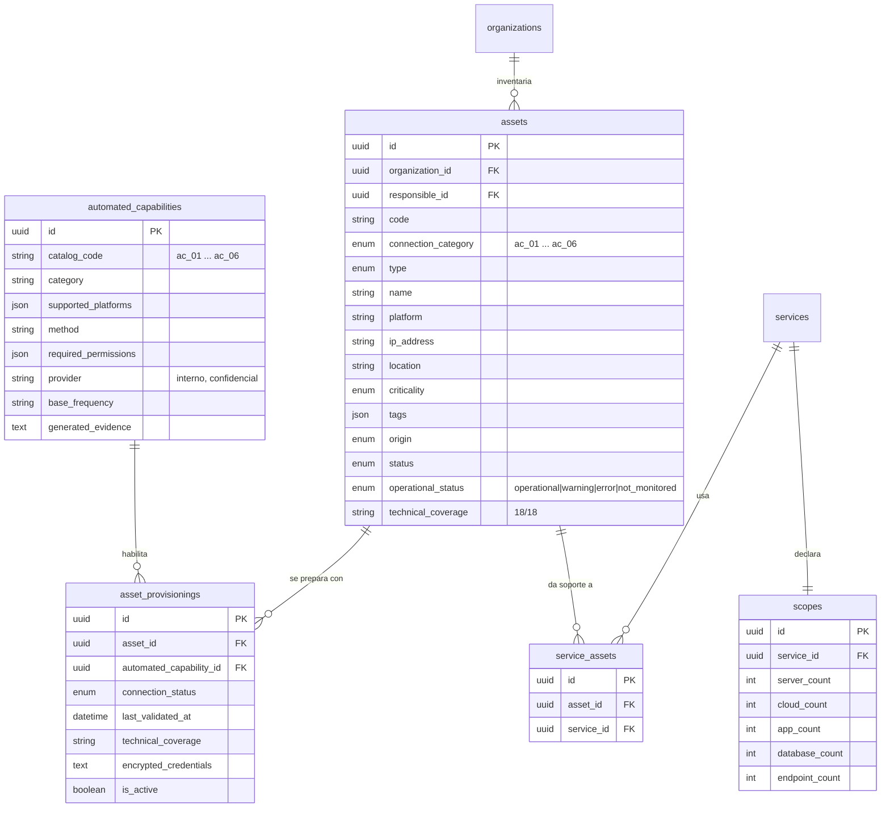

**`scopes` es lo declarado; `assets` lo descubierto.** Un activo declarado y no inventariado
es un hueco visible, no un dato ausente. Esa diferencia es lo que permite decir "declaraste
12 servidores, tengo 9 conectados".

**El activo cuelga de la organización, no del servicio** (decisión A2). Un servidor puede dar
soporte a varios servicios y **no se duplica**: por eso existe el puente `service_assets`. Se
evalúa una vez y el resultado se lee desde cada servicio.

**Un aprovisionamiento nace inactivo** (`is_active = false`) y solo se activa al validar la
conexión: el flujo es conectar → validar → activar → programar. `encrypted_credentials` es
opcional porque las conexiones agentless no guardan credenciales.

**`operational_status` es un enum, no un booleano:** 🟢 `operational` · 🟡 `warning` ·
🔴 `error` · ⚪ **`not_monitored`**. Regla del comité: **"Automatizado ≠ Operativo"**.

**El `deployment_scenario` del servicio determina qué conexiones se le ofrecen:**

| Código | Categoría | Método | Frecuencia |
|---|---|---|---|
| `ac_01` | Servicios cloud gestionados (AWS, Azure, GCP, M365, Workspace) | API / OAuth read-only | **6-24 h** |
| `ac_02` | Servidores en nube / VPS (Linux, Windows, HP-UX, AIX, Solaris) | Agente ligero o agentless | **Continuo** |
| `ac_03` | BD en nube (RDS, Cloud SQL, Atlas) | Agente + usuario read-only | Continuo |
| `ac_04` | Servidores on-premise | Agente ligero | Continuo |
| `ac_05` | BD on-premise | Agente + usuario read-only | Continuo |
| `ac_06` | **Endpoints / estaciones de trabajo** | Agente ligero | Continuo |

Solo nube → `ac_01` · nube con servidores → `ac_01`+`ac_02`+`ac_03` · on-premise →
`ac_04`+`ac_05`+`ac_06` · híbrido → los que apliquen.

**El flujo de cada conexión es conectar → validar → activar → programar.**

> **Cambios al schema:** el enum de `assets.type` gana `application`, `documentation` y
> `endpoint`. `network_device` y `endpoint` se monitorean pero **no son dimensiones**.

---

## 7. Módulo Cumplimiento

**Qué es:** donde el cliente trabaja su cumplimiento día a día — ajusta los controles que
heredó, sube evidencia, gestiona riesgos y remedia hallazgos.

**Qué resuelve:** el catálogo clonado es genérico; el cumplimiento real exige decir *"este
control, en mi empresa, se cumple con estas herramientas concretas"*.

**No bloquea nada** (decisión D23, confirmada por el comité el 2026-09-26). Un cliente
que termina el onboarding ya tiene
cumplimiento midiéndose con el catálogo por defecto; este módulo es donde lo afina, sin
límite de tiempo. Lo usa `admin_empresa`.

### 7.1 El control del cliente

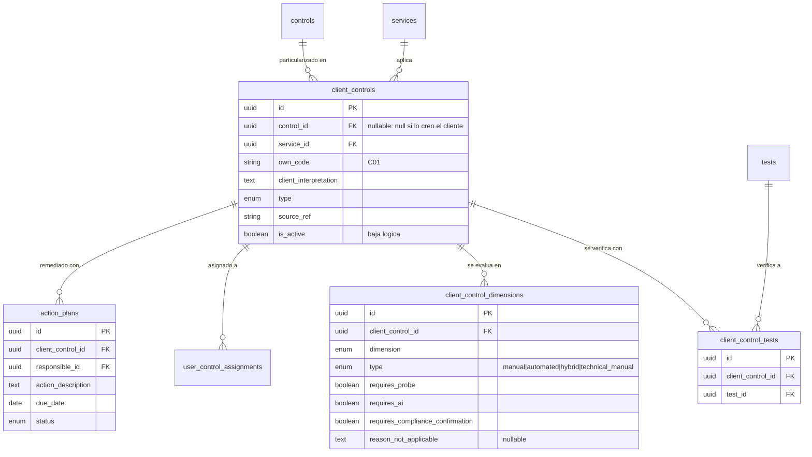

**`client_controls` es tabla propia, no columnas extra del control clonado** (decisión D3). El
cliente reescribe la interpretación con sus herramientas reales, y el `source_ref` mantiene el
rastro al control del catálogo para que una actualización del catálogo sepa a quién afecta.

**El mismo control puede estar cumplido en un servicio e incumplido en otro**, porque se
evalúa sobre insumos distintos. Por eso `client_controls` cuelga del servicio.

**El cliente puede crear, editar y eliminar controles** (matriz §5.5), y por eso todo lo que se mide
cuelga de `client_controls` y no del catálogo: `evaluations` (§7.4) y `evidence_requirements` (§7.3)
apuntan a `client_control_id`. `control_id` es la plantilla de origen y es nulo en un control propio.
**Eliminar es dar de baja** (`is_active = false`): las evaluaciones son inmutables y las FK son
`RESTRICT`, así que un control con histórico no se borra. Lo mismo vale para `client_causes` y
`client_risks`.

**Un control propio no tiene punto de enfoque** (el puente `point_of_focus_controls` es del catálogo), así
que no puede cerrar un requisito del marco. Si cuenta para el % del servicio y cómo se mapearía a un
requisito es una pregunta abierta del comité: P8.

### 7.2 Riesgos del cliente y sus indicadores

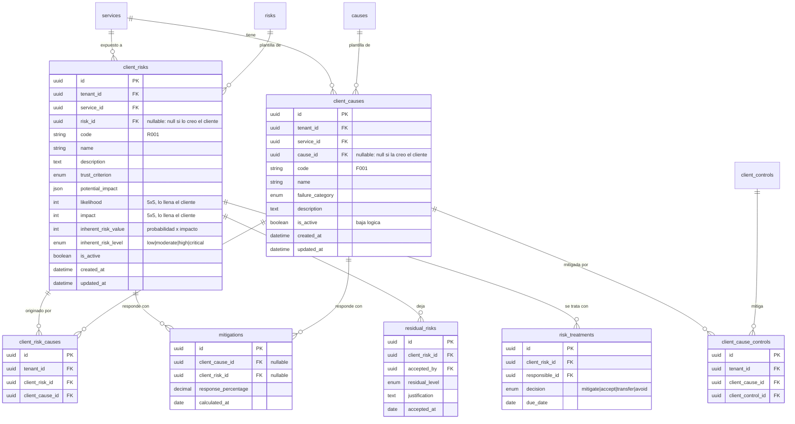

**Cada cliente trabaja sobre su propia copia** (decisión D28). Al crearse `service_frameworks`
se copian los riesgos y causas base a `client_risks` y `client_causes` **de ese servicio**, con
sus relaciones (`client_risk_causes` replica `risk_causes`; `client_cause_controls` replica
`cause_controls` pero apuntando al control **del cliente**, `client_controls`, que es el que él
particulariza). `risk_id` / `cause_id` guardan la plantilla de origen —para que una actualización
del catálogo sepa a quién afecta (§3.5)— y son `null` en lo que el cliente creó desde cero.

Por eso **editar o eliminar un riesgo o una causa no afecta al catálogo ni a ningún otro
cliente**: cada uno ve lo que tiene. Es lo que permite lo que dice el comité, que en este
módulo el cliente "crea, edita y elimina riesgos y causas según su propio entendimiento".

**Los tres indicadores no se mezclan** (reglas R-11 y R-12): cumplimiento (controles frente
al marco), mitigación (respuesta frente a una causa o riesgo) y riesgo residual son
**cálculos separados**. Un 93% de cumplimiento no dice que el riesgo residual sea del 7%.
`mitigations` apunta a **exactamente una** de las dos, causa o riesgo (hay un `CHECK`).

### 7.3 Evidencias

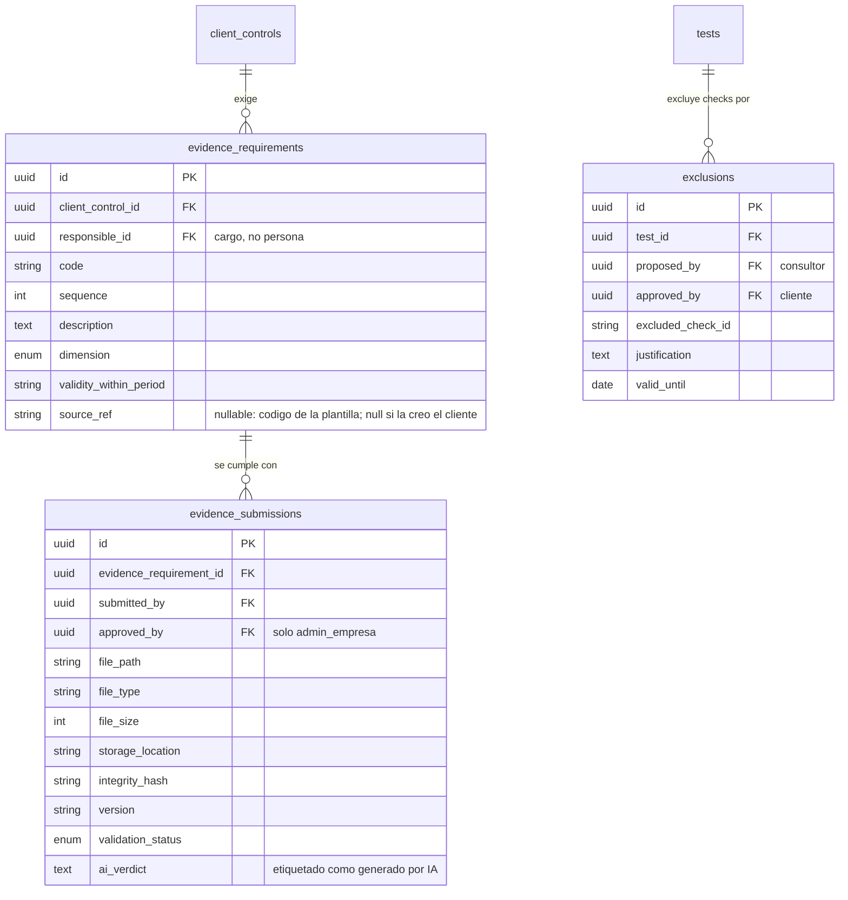

**El responsable de la evidencia es cargo *y* persona, en planos distintos** (decisión A1):
`evidence_requirements.responsible_id` apunta a `organization_responsibles`, es decir, al
**cargo** dentro de la organización del cliente (§5.4); quién lo ocupa hoy es su `person_name`.
Se cerró así en D30 (P4): no hay catálogo global de cargos, y `evidence_requirements` se
clona con el `responsible_id` vacío hasta que el cliente designa a sus responsables. Se clonan desde
`evidence_templates` (§3.2), una fila por plantilla ligada al control, con `code` = código de la
plantilla, `sequence` = su orden en el control y `validity_within_period` = el periodo de evaluación.

**La evidencia es válida si cae dentro del periodo de evaluación** del marco (decisión C1), no
por una fecha de caducidad fija.

**La exclusión la propone el consultor y la aprueba el cliente, y vence** (decisión A3). Una
exclusión sin justificación aprobada no cambia el denominador — y un check que sale por
omisión es un agujero, no una exclusión.

**Solo `admin_empresa` aprueba evidencia.** La IA puede sugerir un veredicto (`ai_verdict`),
siempre etiquetado como generado por IA, pero **nunca cierra un control**.

### 7.4 Evaluaciones y hallazgos (el histórico)

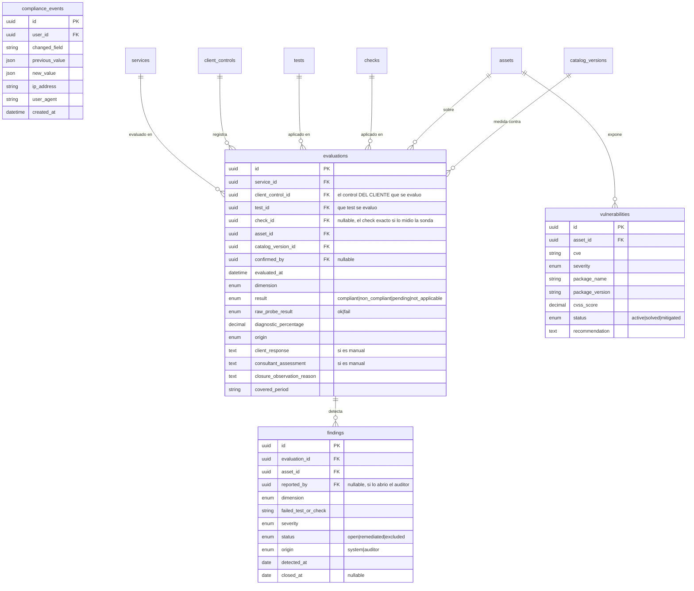

**Una evaluación dice qué se evaluó** (D27, D36): el control del cliente (`client_control_id`), `test_id` siempre —el test es lo que define la
dimensión y a qué exclusiones responde— y `check_id` cuando la midió la sonda. Sin esos dos campos
no se puede "señalar el activo y el check exactos" de una falla (§9). `evaluated_at` es un
**instante**, no un día: la sonda corre cada 6 horas y "la última evaluación" tiene que ser
inequívoca.

**Cuatro reglas que no se negocian:**

- **La evaluación es inmutable.** Una nueva se agrega, no pisa la anterior. Es lo que permite
  demostrar cumplimiento **durante un periodo**, requisito de SOC 2 Tipo II. La base lo impone:
  el rol de la app **no puede `DELETE`** y solo puede hacer `UPDATE` de `confirmed_by` y
  `closure_observation_reason` — el cierre humano de §7.5, que no cambia lo medido (D27).
- **El estado no puede vivir en la definición.** Hoy `ManualCheckItem` lleva `status` y
  `evaluated_at` en la misma fila que la definición: evaluar pisa la evaluación anterior. Eso
  se corrige separando definición de evaluación.
- **Se guarda el dato crudo junto a la interpretación.** La sonda dice `ok`/`fail`
  (`raw_probe_result`); Monkey dice `compliant`/`non_compliant` (`result`). Sobrescribir el
  crudo haría imposible auditar el veredicto.
- **El hallazgo tiene dos orígenes, y uno es humano.** El auditor puede abrirlo a mano
  (`origin = auditor`), y **no se cierra porque la sonda pase a verde**.

**`compliance_events` y `audit_logs` son dos tablas distintas.** `audit_logs` (§5.2) registra
acciones sobre la plataforma (quién cambió qué en el sistema); `compliance_events` registra
cambios en el estado de cumplimiento. Las dos son **append-only, 7 años, inmutables**.

**Las vulnerabilidades son solo insumo en el MVP** (decisión D7): alimentan los hallazgos de
los controles de gestión de vulnerabilidades y parches (`CC7.1` / `A.8.8`). El módulo con
vida propia no entra al MVP.

### 7.5 La IA y el auditor

La IA evalúa evidencia, sugiere conclusión y recomendaciones; **nunca cierra un control**. El
cierre es humano y del lado del cliente — *"solo personal de la empresa puede dar el control
como cumplido"* — y si se cierra con observaciones abiertas, **se documenta la razón**
(`evaluations.closure_observation_reason`).

---

## 8. Módulo Control Técnico — la operación continua

**Qué es:** la cara operativa de la sonda. El Componente 3 del onboarding conecta los
activos; este módulo es lo que pasa después, corrida tras corrida.

**Qué resuelve:** distinguir *"el control falla"* de *"la conexión falla"*. Sin esto, un
hallazgo técnico sin diagnóstico de conectividad es un falso negativo.

Principio del blueprint: **la unidad de seguimiento es el activo, no la sonda**. El recorrido
es **activo → estado → ejecución → resultado → log**.

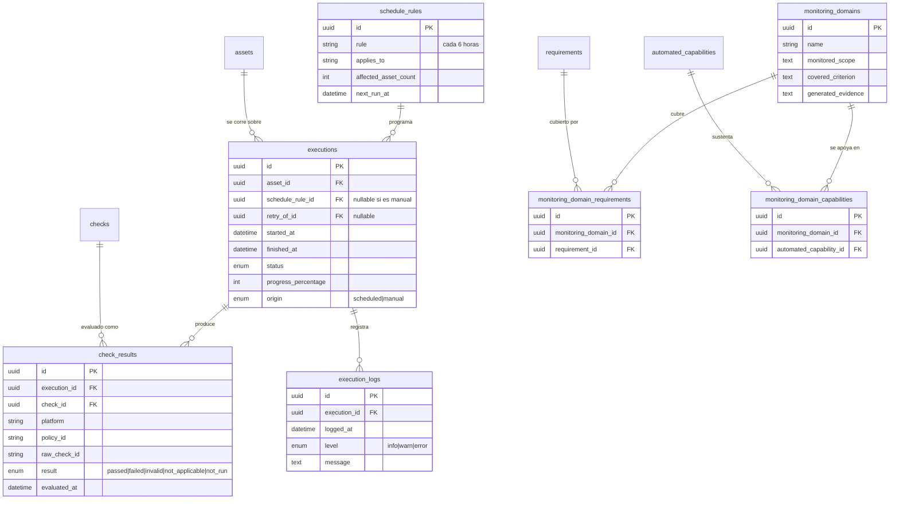

`monitoring_domain_requirements` y `monitoring_domain_capabilities` son las dos tablas puente de
las `N:M` (`id`, las dos FK y un único sobre el par), nombradas según la convención. Un dominio se
apoya en varias capacidades y una capacidad puede servir a varios dominios (D32).

**Tres reglas:**

- **`executions` ≠ `evaluations`.** Una es "corrió la sonda"; la otra, "se midió el
  cumplimiento". Colapsarlas impide distinguir *el control falla* de *la conexión falla*.
  `check_results` es el dato crudo de una corrida; `evaluations` (§7.4) es la interpretación.
- **La frecuencia vive en la conexión y en la regla, no en el control.** Al vencer **avisa sin
  mover el porcentaje**: vencido ≠ incumplido. La regla la editan `admin_monkey` y
  `admin_empresa`, con mínimos que Monkey define (decisión B6).
- **La cobertura técnica es un número aparte** del cumplimiento. Mezclarlos produce un número
  falso.

Cada capa tiene dos caras — lo que ve el cliente y el motor interno, que es confidencial:
conexión (self-service / aprovisionar agente) · recolección (estado "Conectado" / recolección
real) · análisis (hallazgos en lenguaje de negocio / reglas y SCA) · evidencia continua ·
cumplimiento por marco.

**Validador único:** se evaluó un segundo proveedor para nube (Prowler) y **se descartó**.
`automated_capabilities.provider` queda por extensibilidad, no porque hoy haya dos.

---

## 9. Cómo se calcula el cumplimiento

Especificado por el comité en su ejemplo de fórmula de cumplimiento, transcrito aquí (ver §0). **Ante una duda de
cálculo, ese archivo manda.**

### Las capas

```
1. EVALUACIÓN  (un test o check, sobre UN activo)
   → compliant · non_compliant · pending · not_applicable
2. CONTROL     % = cumplidas / (cumplidas + fallan)
               ESTADO = NO CUMPLE si hay ≥1 falla aplicable
3. DIMENSIÓN   % = promedio de los % de sus controles      ← TEMÁTICA
4. SERVICIO    % = promedio de los % de sus dimensiones
```

Las evaluaciones de un control son su **producto cartesiano**: checks o tests × activos
aplicables. Un test manual también se evalúa **una vez por activo**.

### El ejemplo resuelto

Servicio con 10 activos (3 servidores, 2 nubes, 5 BD), 5 controles, 45 evaluaciones:

| Control | Evaluaciones | Cumplen | % | Estado |
|---|---|---|---|---|
| `C-01` | 15 | 14 | 93,3% | **NO CUMPLE** |
| `C-02` | 10 | 9 | 90% | **NO CUMPLE** |
| `C-03` | 10 | 9 | 90% | **NO CUMPLE** |
| `C-04` | 5 | 5 | 100% | CUMPLE |
| `C-05` | 5 | 5 | 100% | CUMPLE |

Disponibilidad = promedio(93,3 · 100 · 100) = **97,8%** · Seguridad = **90%** · Protección de
la información = **90%** → **servicio = 92,6%**, con **3 controles incumplidos**.

### Las 12 reglas

| # | Regla |
|---|---|
| R-01 | Cumplimiento únicamente sobre el **scope del servicio** |
| R-02 | Cada control define sus **elementos aplicables** |
| R-03 | Manual: la evidencia sustenta, **el consultor evalúa** |
| R-04 | Automático: la sonda entrega el resultado, **Monkey interpreta el criterio** |
| R-05 | **Una falla aplicable ⇒ NO CUMPLE**, aunque el % sea alto |
| R-06 | **`pending` ≠ `non_compliant`** |
| R-07 | **`not_applicable`** se excluye del conjunto evaluable |
| R-08 | % control = **cumplidas / evaluables** |
| R-09 | % dimensión = promedio de sus controles, **peso igual en MVP** |
| R-10 | % servicio = promedio de sus dimensiones, **peso igual en MVP** |
| R-11 | **Mitigación: indicador separado** |
| R-12 | **Riesgo residual: cálculo separado.** *"No sustituir por % cumplimiento"* |

### Lo que estas reglas zanjan

**Estado y porcentaje conviven.** El % es **diagnóstico** (cuánto falta y dónde); el estado es
binario. Un control al 93,3% no está "casi cumplido": está incumplido, y se señala el activo
y el check exactos.

**`pending` no entra al denominador**, ni cuenta como cero. Igual que `not_applicable`. Se
reporta como **cobertura pendiente**: un cliente que empieza ve *"cobertura 12%, y de lo
medido cumple 80%"* — dos números, los dos verdad.

**El agregado no es "controles cumplidos sobre aplicables".** Es promedio de porcentajes en
dos saltos: contando binario, el ejemplo daría 40% en vez de 92,6%.

**Las exclusiones cambian el denominador solo si están justificadas y aprobadas.** Un check
que sale por omisión es un agujero — y es lo que hace hoy el calculador, que descarta todo
resultado que no encuentra sin dejar rastro.

**El requisito es binario, igual que el control** (decisión B2): se cumple cuando todos sus
controles cumplen. **No se pondera por nivel de riesgo** (decisión B1): todos los controles
valen igual, porque el peso ya está implícito en cuántas evaluaciones genera cada uno.

### La trazabilidad de una falla

Modelo de navegación del producto, con **responsable y tratamiento en cada nivel**:

| Nivel | Lleva a | Responsable | Tratamiento |
|---|---|---|---|
| Check → Activo | el control | Responsable del activo | Tratamiento |
| **Control** | la dimensión | Responsable parametrizado | **Plan de acción** |
| Dimensión → Servicio | — | Responsable de cumplimiento | Seguimiento |
| **Causa → Riesgo** | el servicio | Responsable de riesgo | **Mitigación / riesgo residual** |

### Cuánto se puede automatizar hoy

De los 61 TEST: **13 tienen checks automáticos**. Los **26 documentales** no los tendrán nunca
(son revisión con IA) y los **11 de nube no tienen ninguno** todavía (decisión D13).
`T-SRV-001` concentra 10.909 de los 11.352 checks. **El porcentaje se lee siempre junto a la
cobertura.**

**No existe un porcentaje consolidado de la organización.** La unidad de medida es el par
**(servicio × marco)**: si un cliente tiene 3 servicios con SOC 2, hay 3 porcentajes y
ninguno se promedia entre sí. El mismo control puede estar cumplido en un servicio e
incumplido en otro, porque se evalúa sobre insumos distintos. **La interfaz nunca muestra un
número único de "cumplimiento de la empresa": no existe.** Es coherente con una certificación
real, que se emite sobre un sistema definido.

> El cumplimiento del marco se **deriva** recorriendo requisitos → controles; nunca se
> almacena como columna del marco.

---

## 10. Diagrama global

```mermaid
erDiagram
    companies ||--o{ access_keys : "se accede con"
    companies ||--o{ users : "emplea"
    companies ||--|| organizations : "declara su negocio como"

    organizations ||--o{ services : "presta"
    organizations ||--o{ assets : "inventaria"
    organizations }o--o{ regulations : "sujeta a"
    organizations ||--o{ organization_responsibles : "designa"

    services ||--|| scopes : "declara"
    services }o--o{ assets : "usa"
    services ||--o{ service_trust_criteria : "contrata"
    trust_criteria ||--o{ service_trust_criteria : "contratado por"
    services ||--o{ subservice_organizations : "depende de"
    services ||--|| system_descriptions : "documentado en"
    subservice_organizations ||--o{ csocs : "debe aportar"
    services ||--o{ cuecs : "espera del usuario"

    services ||--o{ service_frameworks : "contrata"
    frameworks ||--o{ service_frameworks : "contratado en"
    frameworks ||--o{ requirements : "exige"
    requirements ||--o{ points_of_focus : "precisa"
    trust_criteria ||--o{ requirements : "clasifica"
    points_of_focus }o--o{ controls : "satisfecho por"

    risks }o--o{ causes : "originado por"
    causes }o--o{ controls : "mitigada por"
    risks ||--o{ client_risks : "plantilla de"
    causes ||--o{ client_causes : "plantilla de"
    services ||--o{ client_risks : "expuesto a"
    services ||--o{ client_causes : "tiene"
    client_risks }o--o{ client_causes : "originado por"
    client_causes }o--o{ client_controls : "mitigada por"
    client_risks ||--o{ residual_risks : "deja"
    client_risks ||--o{ risk_treatments : "se trata con"
    client_causes ||--o{ mitigations : "responde con"

    controls ||--o{ client_controls : "particularizado en"
    client_controls ||--o{ user_control_assignments : "asignado a"
    client_controls ||--o{ action_plans : "remediado con"
    controls ||--o{ control_dimensions : "se evalua en"
    controls ||--o{ control_measurements : "se califica con"
    controls ||--o{ test_plans : "se prueba segun"
    client_controls ||--o{ evidence_requirements : "exige"
    controls ||--o{ control_evidence_templates : "pide"
    evidence_templates ||--o{ control_evidence_templates : "pedida por"
    client_controls ||--o{ client_control_dimensions : "se evalua en"
    client_controls ||--o{ client_control_tests : "se verifica con"
    tests ||--o{ client_control_tests : "verifica a"
    controls }o--o{ tests : "se verifica con"
    controls }o--o{ policies : "depende de"

    tests }o--o{ checks : "ejecuta"
    tests ||--o{ exclusions : "excluye"
    tests ||--o{ evaluations : "aplicado en"
    checks ||--o{ evaluations : "aplicado en"
    monitoring_domains }o--o{ requirements : "cubre"
    monitoring_domains }o--o{ automated_capabilities : "se apoya en"
    checks ||--o{ check_mappings : "mapea a"
    sca_policies ||--o{ checks : "contiene"
    evidence_requirements ||--o{ evidence_submissions : "se cumple con"

    assets ||--o{ asset_provisionings : "se prepara con"
    automated_capabilities ||--o{ asset_provisionings : "habilita"
    schedule_rules ||--o{ executions : "programa"
    assets ||--o{ executions : "se corre sobre"
    executions ||--o{ check_results : "produce"
    executions ||--o{ execution_logs : "registra"
    checks ||--o{ check_results : "evaluado como"

    services ||--o{ evaluations : "evaluado en"
    client_controls ||--o{ evaluations : "registra"
    assets ||--o{ evaluations : "sobre"
    catalog_versions ||--o{ evaluations : "medida contra"
    evaluations ||--o{ findings : "detecta"
    assets ||--o{ vulnerabilities : "expone"
```
